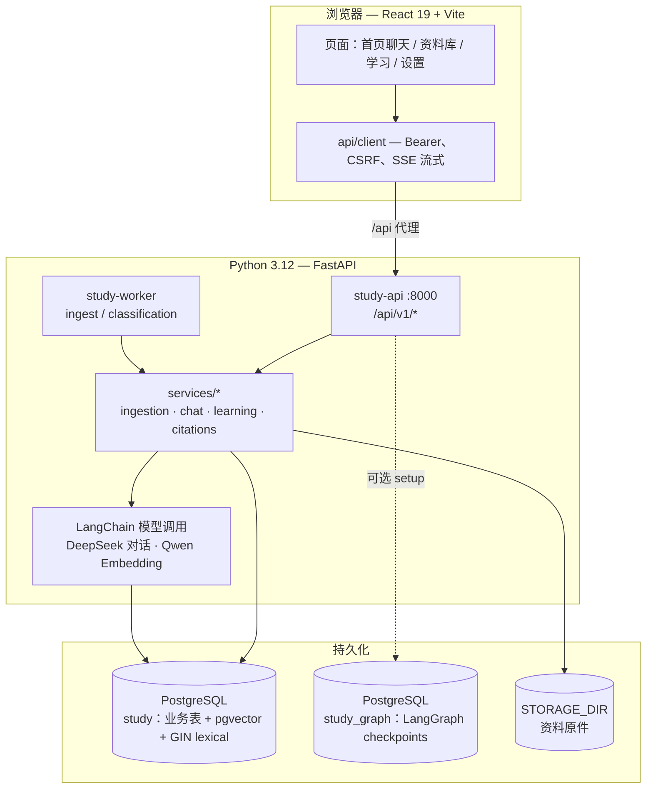
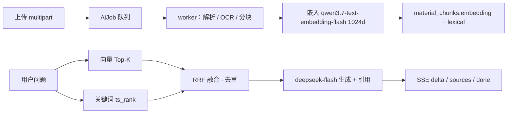

# Study Platform

*Personal multi–knowledge-base RAG Q&A and learning tools — upload your materials, chat with cited answers, and practice with quizzes grounded in your own library.*

**目录：** [简介](#简介) · [功能亮点](#功能亮点) · [架构](#架构) · [技术栈](#技术栈) · [快速开始](#快速开始) · [配置说明](#配置说明) · [测试与 CI](#测试与-ci) · [质量与检索评测](#质量与检索评测) · [目录结构](#目录结构) · [文档索引](#文档索引) · [路线图](#路线图)

---

## 简介

Study Platform（仓库名 **Study_Platform**）面向个人用户：将资料组织到多个**独立、私有**的知识库中，围绕当前选定的库进行问答、查看引用依据，并在同一底座上提供学习练习。

核心闭环是「上传 → 解析与向量索引 → 带出处问答 / 摘要」。服务端按 `owner_user_id` 隔离数据与检索范围；切换知识库时，历史消息仍可读，但不会自动把其他库的资料当作本轮事实依据。产品与边界详见 [产品定位与路线图](docs/product/product-positioning-and-roadmap.md)。

> **三层运行形态**
>
> - **前端**：React 19 + Vite 单页应用（开发时 `5173`，通过 Vite 将 `/api` 代理到后端）。
> - **应用层**：Python 3.12 / FastAPI（`study-api`）+ 独立 **`study-worker`** 处理资料队列；业务逻辑与模型调用均在服务端。
> - **数据层**：PostgreSQL（`study` schema，pgvector 1024 维 + 中文关键词索引）；业务原件存于可配置的 `STORAGE_DIR`；LangGraph checkpointer 使用独立 `study_graph` schema（由 `study-setup-checkpointer` 初始化，**不用于**当前问答流恢复）。

---

## 功能亮点

### 知识库与资料

- **多知识库**：创建、列表、删除；每库资料与索引相互隔离。
- **多格式导入**：PDF、DOCX、UTF-8 TXT、PNG、JPEG（单文件 ≤ 20 MiB、PDF ≤ 50 页、图片 ≤ 2000 万像素）。
- **扫描件 OCR**：无文字层的 PDF 页与图片由 RapidOCR（ONNX Runtime / CPU）提取文字；原件与页图经鉴权接口访问。
- **异步处理**：上传返回作业 ID；状态含 `queued` / `parsing` / `ocr` / `indexing` / `ready` / `failed`；支持取消与失败重试。

### 对话与检索

- **流式问答（SSE）**：`POST /chat/stream`，阶段事件 `searching` / `composing` 等；回答附带可回看引用。
- **混合检索**：默认开启向量相似度 + jieba 分词写入的 `material_chunks.lexical`（PostgreSQL `simple` tsvector），按 **RRF**（`Σ weight/(60+rank)`）融合排序；详见 [质量回归说明](docs/rag-quality.md)。
- **可选查询改写**：环境变量 `RAG_QUERY_REWRITE_ENABLED`（默认 `false`）控制是否在检索前生成等义问句。
- **摘要模式**：对选定已就绪资料生成要点（有分块与字符上限）。
- **通用知识补充**：`answer_mode: with_general` 时区分库内依据与模型通用知识，不自动联网搜索。

### 认证与安全

- **Cookie + CSRF + Bearer**：注册/登录设置 HttpOnly `study_refresh` 与 CSRF Cookie；业务请求使用短期 **Bearer** `access_token`（前端内存保存）。
- **Google OAuth / 邮件找回**：可选，依赖 `.env` 中对应 SMTP 与 Google 配置。
- **速率限制**：登录/注册默认每 IP 30 次/分钟。

### 学习（共用 RAG 底座）

- **独立入口**：前端侧栏「学习」路由 `/learning`。
- **出题**：`POST /learning/knowledge-bases/{kb_id}/quizzes/generate`（基于库内资料，默认每次最多 20 题）。
- **拍照作答**：上传 PNG/JPEG，OCR + 语义判题；用户可手动覆盖 `correct` / `incorrect` / `pending`。
- **错题本**：收录错题，支持标记已掌握。

### 工程与质量

- **离线 RAG 评测 CLI**：`study-eval-rag`（Recall@k、nDCG@k、Hit@k、MRR 等），见 [检索评测指标](docs/retrieval-evaluation.md)。
- **GitHub Actions**：后端 ruff + pytest（pgvector 服务容器）、前端 Vitest + build，见 [CI 说明](docs/ci.md)。

---

## 架构



### 资料处理与问答检索（逻辑）



API 契约与调用细节见 [API 接入说明](docs/api-integration.md)；OpenAPI 见 [`contracts/frontend.openapi.json`](contracts/frontend.openapi.json)。目标架构与遗留设计差异见 [架构设计](docs/architecture/01_Architecture_Design.md)（部分章节为演进草案，以代码与 `api-integration` 为准）。

---

## 技术栈

| 层级 | 选型 |
| --- | --- |
| 语言 | Python **3.12**（后端）、TypeScript（前端） |
| 包管理 | **uv**（`backend/pyproject.toml`）、**npm**（`frontend/package.json`） |
| Web | **FastAPI** + Uvicorn、`react` **19** + **Vite** 8 |
| 数据库 | PostgreSQL + **pgvector**、`citext`；Alembic 迁移 |
| AI | **LangChain** OpenAI 兼容客户端；对话默认 **DeepSeek** `deepseek-flash`；向量 **Qwen** `qwen3.7-text-embedding-flash`（**1024** 维） |
| OCR | RapidOCR + ONNX Runtime |
| 中文检索 | **jieba** + PostgreSQL FTS（`simple`） |
| 测试 | pytest、Vitest；CI 见 `.github/workflows/ci.yml` |

---

## 快速开始

### 前提

- **PostgreSQL**（本地开发推荐 16+，含 **pgvector** 扩展；实现说明见 [数据库规则](docs/database-rules.md)）。
- **Python 3.12** 与 [uv](https://docs.astral.sh/uv/)。
- **Node.js**（CI 使用 **22**；前端见 [CI 说明](docs/ci.md)）。
- 根目录可写的 **`.env`**（勿提交）；模板见 [`.env.example`](.env.example)。

### 1. 克隆与依赖

```bash
git clone https://github.com/ggwenling/Study_Platform.git
cd Study_Platform

cd backend
uv sync --locked

cd ../frontend
npm ci
```

### 2. 数据库与环境变量

**方式 A — 管理员引导（空仓库、尚无 `.env`）**

```bash
cd backend
uv run python -m study_platform.cli.bootstrap_database --admin-user postgres
```

脚本会创建 `study_platform` / `study_platform_test` 库、`study_app` / `study_graph` 角色，并在仓库根目录生成 `.env`（含随机 `AUTH_JWT_SECRET`）。随后在 `.env` 中填写：

- `DEEPSEEK_API_KEY`
- `EMBEDDING_API_KEY`

**方式 B — 手动**

```bash
cp .env.example .env
# 编辑 DATABASE_URL、GRAPH_DATABASE_URL、MIGRATION_DATABASE_URL、AUTH_JWT_SECRET（≥32 字节随机）及模型密钥
```

Windows 上首次安装 pgvector 可参考 [infra/windows/README.md](infra/windows/README.md)。

### 3. 迁移与服务

在 `backend` 目录：

```bash
uv run alembic upgrade head
uv run study-setup-checkpointer   # 初始化 study_graph（与业务迁移分离）
uv run study-api                  # 默认 127.0.0.1:8000，Swagger /docs
```

**另开终端**启动资料 worker（否则上传不会建索引）：

```bash
cd backend
uv run study-worker
```

前端开发服务器：

```bash
cd frontend
npm run dev                       # http://127.0.0.1:5173 ，/api 代理到 8000
```

健康检查：`GET /health/live`（进程）、`GET /health/ready`（迁移、存储、密钥配置等，**不调用付费模型**）。

### Windows 一键启停（可选）

在已完成依赖、`.env`、迁移后，可使用根目录 `Start-Synapse.cmd` / `Status-Synapse.cmd` / `Stop-Synapse.cmd`，或 `infra/windows/local-runtime.ps1`。说明见 [本地运行说明](docs/local-runtime.md)。启动器不代替迁移或安装步骤。

---

## 配置说明

配置自仓库根目录 **`.env`** 加载（见 `backend/src/study_platform/core/config.py`）。下列名称与 [`.env.example`](.env.example) 一致：

| 变量 | 用途 |
| --- | --- |
| `DATABASE_URL` | 应用运行时连接（角色 `study_app`） |
| `GRAPH_DATABASE_URL` | LangGraph checkpointer（角色 `study_graph`） |
| `MIGRATION_DATABASE_URL` | Alembic 迁移用管理员连接 |
| `TEST_DATABASE_URL` / `TEST_GRAPH_DATABASE_URL` | 集成测试库（名称须以 `_test` 结尾） |
| `DEEPSEEK_API_KEY` | 对话模型 |
| `CHAT_FALLBACK_MODEL` / `CHAT_FALLBACK_BASE_URL` / `CHAT_FALLBACK_API_KEY` | 可选聊天备用端点 |
| `EMBEDDING_API_KEY` | 向量模型 |
| `RAG_QUERY_REWRITE_ENABLED` | 检索前等义改写（默认 `false`） |
| `LEARNING_STUB_GRADER` | `true` 时学习判题走启发式（CI 使用） |
| `AUTH_JWT_SECRET` | JWT 签名（≥32 字节） |
| `AUTH_PUBLIC_URL` | 前端公网地址（OAuth 回调等） |
| `COOKIE_SECURE` | HTTPS 部署时设为 `true` |
| `STORAGE_DIR` | 资料原件目录（默认仓库下 `.local/storage`） |

未写入 `.env.example`、但在代码中有默认值的检索相关项（可通过环境变量覆盖）：`RETRIEVAL_HYBRID_ENABLED`（默认 `true`）、`RETRIEVAL_LEXICAL_WEIGHT`（默认 `1.0`）。行为说明见 [docs/rag-quality.md](docs/rag-quality.md)。

**勿在仓库中提交真实密钥。** 聊天与向量密钥仅配置在服务端。

---

## 测试与 CI

### 本地（与 CI 对齐的简述）

需要本机 PostgreSQL + pgvector，见 [docs/ci.md](docs/ci.md) 中的 `ci_bootstrap_postgres.py` 与 `RUN_DB_TESTS=1`。

```bash
cd backend
uv sync --locked
uv run ruff check .
uv run python tests/ci_bootstrap_postgres.py   # 或先 export 测试库变量
export RUN_DB_TESTS=1
uv run pytest -q

cd ../frontend
npm ci
npm test
npm run build
```

仅单元检查（无数据库）：

```bash
cd backend && uv run ruff check . && uv run pytest -q -m "not integration"
```

集成测试准备独立测试库：

```bash
uv run python tests/prepare_database.py
```

规则见 [数据库规则](docs/database-rules.md) 与 [测试说明](docs/verification.md)。

### 持续集成

Push / Pull Request 触发 [`.github/workflows/ci.yml`](.github/workflows/ci.yml)：后端 **ruff + pytest**（PostgreSQL 16 服务容器 + pgvector）、前端 **Vitest + build**。

---

## 质量与检索评测

CLI 入口（定义于 [`backend/pyproject.toml`](backend/pyproject.toml)）：

```bash
cd backend

# 仅校验评测数据集标注（无 DB、无模型）
uv run --no-sync study-eval-rag

# 离线复核已有 report（--review）
uv run --no-sync study-eval-rag --output ../.local/rag-eval/run-01 --review ../.local/rag-eval/run-01/review.json

# 真实对照（需 TEST_DATABASE_URL、模型密钥；会产生费用）
uv run --no-sync study-eval-rag --strategy compare --live --output ../.local/rag-eval/run-01

# 仅检索指标：baseline vs 混合检索
uv run --no-sync study-eval-rag --dataset evaluation/retrieval_mini.jsonl \
  --strategy hybrid_compare --retrieval-only --metric-k 1 3 6 \
  --metrics-format table --live --output ../.local/rag-retrieval/mini-hybrid-01
```

固定样例位于 `backend/evaluation/`。流程、门槛与复核见 [事实问答质量回归](docs/rag-quality.md)、[检索评测指标](docs/retrieval-evaluation.md)、[质量验收记录](docs/verification-rag-quality.md)。查询改写候选未达启用门槛时保持默认关闭。

---

## 目录结构

```text
Study_Platform/
├── .env.example              # 环境变量模板（复制为 .env）
├── backend/
│   ├── pyproject.toml        # uv 项目；study-api / worker / eval 入口
│   ├── alembic/              # study schema 迁移
│   ├── evaluation/           # RAG 离线评测数据集
│   ├── src/study_platform/
│   │   ├── api/v1/           # REST 路由（auth、materials、chat、learning…）
│   │   ├── cli/              # study-api、worker、evaluate_rag、bootstrap…
│   │   ├── core/             # 配置、数据库、错误
│   │   ├── persistence/      # SQLAlchemy 模型
│   │   └── services/         # 业务：ingestion、chat、learning、lexical…
│   └── tests/
├── frontend/
│   ├── package.json
│   └── src/                  # React 应用、api/client、组件
├── contracts/
│   └── frontend.openapi.json
├── docs/                     # 架构、API、产品、CI、评测说明
├── infra/windows/            # Windows 本地运行时脚本
├── Start-Synapse.cmd         # Windows 本地启动（可选）
└── .github/workflows/ci.yml
```

---

## 文档索引

| 文档 | 说明 |
| --- | --- |
| [API 接入说明](docs/api-integration.md) | 认证、资料流、SSE 聊天、学习相关 HTTP |
| [本地运行说明](docs/local-runtime.md) | Windows 启停、worker 恢复、DOCX 定位修复 |
| [产品定位与路线图](docs/product/product-positioning-and-roadmap.md) | 产品边界与阶段验收 |
| [首页需求](docs/product/homepage-requirements.md) | 聊天与资料 UI 行为 |
| [学习需求纪要](docs/product/learning-grilling.md) | 学习功能设计共识 |
| [架构 / 库表 / API 设计](docs/architecture/) | 演进草案（与现网接口核对后使用） |
| [本地 RAG 验收](docs/verification-local-rag.md) | 已验证范围记录 |

---

## 路线图

当前实现重点为 **个人多库 RAG 闭环**（上传、OCR、混合检索、引用问答）与 **学习入口**（出题、拍照作答、判题、错题本）。后续可能包括：片段检索开关、分块可视化、检索测试工具、图表语义理解等——均以 [产品路线图](docs/product/product-positioning-and-roadmap.md) 与真实评测为准，**未验收能力不作已交付承诺**。

架构文档中的课程中心 Tutor、LangGraph 考试流、SM-2 闪卡等为历史或远期设计；若代码与文档不一致，以本 README 所列 CLI/API 及 `docs/api-integration.md` 为准。

---

## 贡献与规范

开发约定见仓库根目录 [AGENTS.md](AGENTS.md)（如在 `codex` 分支开发、测试与 schema 边界等）。`.env`、`.venv`、`.local` 及凭据不提交 Git。