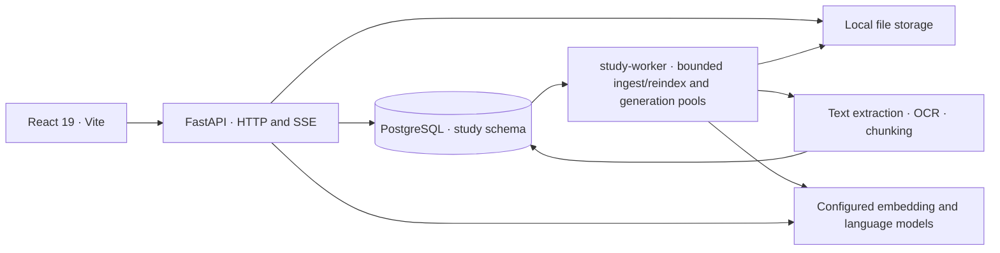

# KnowLoop · 知循

**A personal knowledge workspace for asking questions about your documents, checking the cited passages, and turning what you learn into notes and practice.**

[](https://react.dev/)
[](https://www.typescriptlang.org/)
[](https://vite.dev/)
[](https://www.python.org/)
[](https://fastapi.tiangolo.com/)
[](https://github.com/pgvector/pgvector)
[](https://docs.langchain.com/oss/python/langgraph/overview)

English · [简体中文](README.zh-CN.md)

[Quick start](#quick-start) · [Desktop gallery](#desktop-gallery) · [Features](#features) · [Architecture](#architecture) · [Verification](#verification)

[](docs/screenshots/01-cited-chat.png)

*KnowLoop running locally with a fictional reading-room project. The chat, notes, and flashcards use saved demo data.*

## Desktop gallery

| Knowledge base | Source reader |
| --- | --- |
| [](docs/screenshots/02-knowledge-base.png) | [](docs/screenshots/06-source-reader.png) |
| Import documents, check indexing status, and open the knowledge workshop. | Open a citation in context and save an excerpt with its source. |

| Research notes | Study |
| --- | --- |
| [](docs/screenshots/04-research-note.png) | [](docs/screenshots/05-study.png) |
| Save a passage with its document and location. | Flip a card, check its source, and rate how well you remembered it. |

[View workspace search](docs/screenshots/03-search.png) to see how `Ctrl+K` finds a source passage or saved note.

## Features

| Workflow | What you can do |
| --- | --- |
| **Collect and index** | Upload PDF, DOCX, PPTX, Markdown, UTF-8 TXT, PNG, or JPEG, paste text, or import a publicly accessible webpage by URL. PPTX import extracts slide text, tables, and speaker notes. The worker parses documents, uses OCR on eligible scans and images, and builds an index. Follow progress and retry failed jobs. |
| **Ask and verify** | Stream answers with citations, narrow a question to selected materials, and summarize indexed documents. Open a citation in the source reader to inspect adjacent passages or view available PDF pages. Use retrieval diagnostics to see which fragments a query matches. |
| **Find and organize** | Use `Ctrl+K` to find source passages and research notes. Open matched passages or notes directly. Group conversations by project, export them to Markdown, and restore archived conversations from History. |
| **Build a research notebook** | Save an answer or an excerpt from the source reader to a new or existing note. Generate study guides, mind maps, or formula sheets in the knowledge workshop and write selected notes back into the library as source material. |
| **Practice and review** | Generate quizzes and flashcards from a knowledge base, review due cards with spaced repetition, and revisit mistakes. Submit text or photo answers. Vision model assistance is opt-in. |
| **Export and back up** | Export notes as ZIP, flashcards as Anki TSV or Markdown, and filtered wrong questions as Markdown. Windows backup and restore cover the `study` schema and configured storage directory. |
| **Configure models** | Use platform defaults or configure compatible language and embedding connections. Each library can optionally use a compatible reranking connection. Each library has a defined embedding binding, with 1024-dimensional embeddings. |

## Quick start

The following commands use **Windows PowerShell**. Install Git, [Python 3.12](https://www.python.org/downloads/), [uv](https://docs.astral.sh/uv/), Node.js 22 with npm, and PostgreSQL 16 or later with pgvector available. CI uses PostgreSQL 16. [Windows pgvector setup](infra/windows/README.md)

### 1. Clone and install dependencies

```powershell
git clone https://github.com/ggwenling/Study_Platform.git
Set-Location Study_Platform
Set-Location backend
uv sync --locked
Set-Location ../frontend
npm ci
Set-Location ..
```

### 2. Set up the database and models

For a fresh local install with PostgreSQL listening on port 5432, run the database bootstrap from `backend`. It prompts for the local PostgreSQL administrator password, creates the application and test databases, and writes a root `.env` with a random authentication secret. Use [the database guide](docs/database-rules.md) and [the environment template](.env.example) if you need to configure an existing setup manually.

```powershell
Set-Location backend
uv run python -m study_platform.cli.bootstrap_database --admin-user postgres
```

Set `DEEPSEEK_API_KEY` and `EMBEDDING_API_KEY` in the root `.env` to use the platform model connections. For per-user connections and custom providers, see the [model connection guide](docs/model-connections.md).

| Configuration | Purpose |
| --- | --- |
| `DATABASE_URL` | Application connection to PostgreSQL. |
| `MIGRATION_DATABASE_URL` | Privileged connection used by Alembic for schema changes. |
| `GRAPH_DATABASE_URL` | Connection for the separate LangGraph checkpointer schema. |
| `AUTH_JWT_SECRET` | Random authentication signing secret of at least 32 bytes. |
| `DEEPSEEK_API_KEY`, `EMBEDDING_API_KEY` | Platform defaults for language and embedding calls. |
| `MODEL_CONNECTIONS_KEY` | Encryption key for credentials saved through Model Connections. |
| `STORAGE_DIR` | Optional override for originals and derived files. The default is `.local/storage`. |

### 3. Migrate and launch

From `backend`, run:

```powershell
uv run alembic upgrade head
uv run study-setup-checkpointer
```

Start the three processes from separate terminals, using the repository root as the starting directory.

| Process | Commands | What it does |
| --- | --- | --- |
| API | `cd backend`, then `uv run study-api` | API on `127.0.0.1:8000`, with OpenAPI docs at `/docs`. |
| Worker | `cd backend`, then `uv run study-worker` | Processes ingestion and reindex jobs in a bounded heavy pool, separately from queued note, flashcard, and quiz generation. |
| Web | `cd frontend`, then `npm run dev` | Web UI on `127.0.0.1:5173`, with API requests proxied to port 8000. |

Open [the local web app](http://127.0.0.1:5173/), register an account, create a knowledge base, and upload a small TXT or PDF. Wait for the upload to be ready, ask a question answered by the file, and open a citation. Use [the readiness endpoint](http://127.0.0.1:8000/health/ready) to check the schema and storage configuration. Provider access is exercised when indexing or asking.

After initial setup, `Start-Synapse.cmd`, `Status-Synapse.cmd`, and `Stop-Synapse.cmd` in the repository root can manage the Windows processes. [Local operations and recovery](docs/local-runtime.md)

## Architecture



React, TypeScript, and Vite provide the web interface. FastAPI handles authentication, retrieval, notes, learning, and streamed chat. `study-worker` uses separate bounded pools for ingestion/reindexing and generation jobs. Long-running note, flashcard, and quiz requests are queued and expose job status and coarse progress. PostgreSQL stores project data and indexes using pgvector and PostgreSQL text-search support. Alembic manages the `study` schema. The LangGraph checkpointer uses `study_graph` separately. [Architecture details](docs/architecture/README.md) · [API integration](docs/api-integration.md)

## Verification

- Run `uv run ruff check .` and `uv run pytest -q` in `backend`. Database integration tests require an explicit isolated `*_test` database with pgvector and `RUN_DB_TESTS=1`.
- Run `npm test` and `npm run build` in `frontend`. The production build includes TypeScript checking.
- [GitHub Actions](.github/workflows/ci.yml) runs backend and frontend checks. See [CI and local test setup](docs/ci.md), [local RAG verification](docs/verification-local-rag.md), and [retrieval evaluation](docs/retrieval-evaluation.md) for the tested scenarios and evidence.

## Operational boundaries

- PDFs are limited to 50 MiB and 150 pages by default. Other uploads are limited to 20 MiB per file, and images can contain up to 20 million pixels. Web import works with publicly reachable pages. Login walls and JavaScript-heavy pages can prevent extraction. Scan and slide-image quality affects OCR results.
- Documents and app records are stored on the configured host. Hosted model connections receive inputs needed for embedding or answering. A hosted reranker also receives the query and candidate passages. Choose providers and documents accordingly.
- Workspace search matches stored text. Model-based answers and learning outputs depend on the configured services and the quality of the source material.
- Windows backup and restore include the PostgreSQL `study` schema and configured `STORAGE_DIR` (default `.local/storage`). They exclude `.env` and the separate `study_graph` checkpointer schema. Review the script's checks and recovery steps before restoring. [Local operations and recovery](docs/local-runtime.md)

## More documentation

[Product direction](docs/product/product-positioning-and-roadmap.md) · [Model connections](docs/model-connections.md) · [Database rules](docs/database-rules.md) · [Contribution and workspace rules](AGENTS.md)
