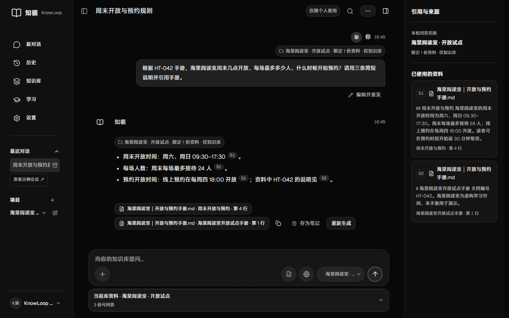
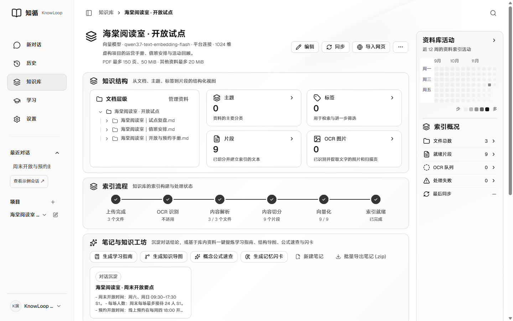
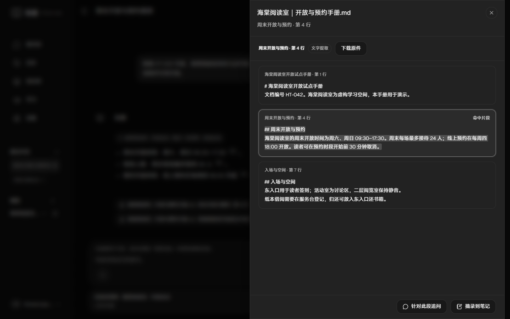
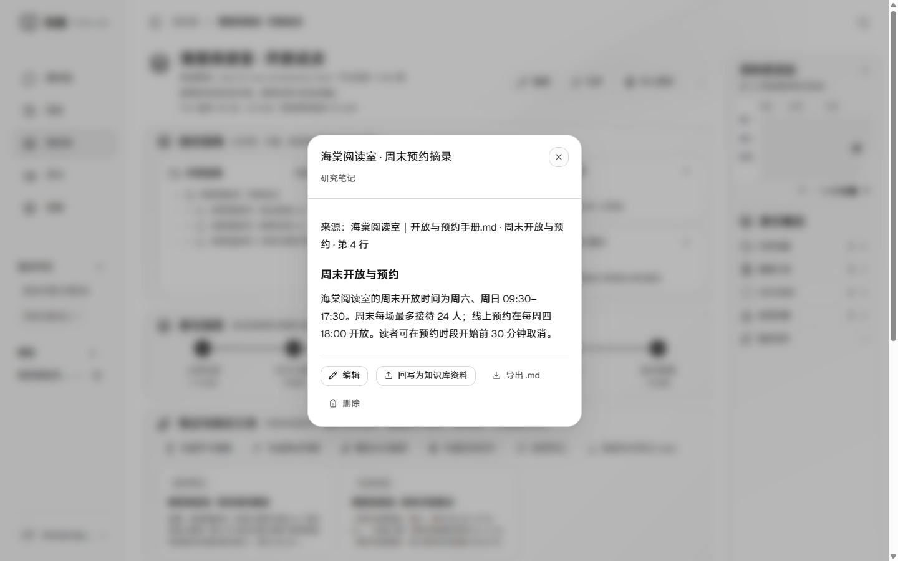
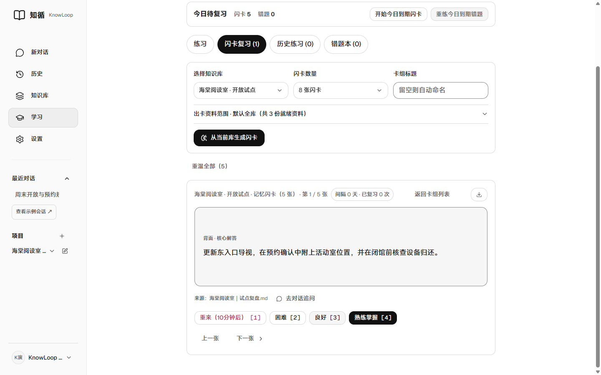
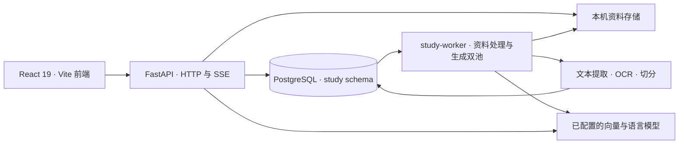

# 知循 · KnowLoop

**面向个人的知识工作台。把资料整理进知识库，提问后回查引用原文，再把所得做成笔记、测验或闪卡。**

[](https://react.dev/)
[](https://www.typescriptlang.org/)
[](https://vite.dev/)
[](https://www.python.org/)
[](https://fastapi.tiangolo.com/)
[](https://github.com/pgvector/pgvector)
[](https://docs.langchain.com/oss/python/langgraph/overview)

[English](README.md) · 简体中文

[快速开始](#快速开始) · [桌面截图](#桌面截图) · [核心功能](#核心功能) · [技术架构](#技术架构) · [测试与验收](#测试与验收)

[](docs/screenshots/01-cited-chat.png)

*知循本地运行截图。演示使用虚构的海棠阅读室项目，问答、笔记和闪卡来自已保存的演示数据。*

## 桌面截图

| 知识库详情 | 原文阅读器 |
| --- | --- |
| [](docs/screenshots/02-knowledge-base.png) | [](docs/screenshots/06-source-reader.png) |
| 导入资料、查看索引状态，或打开知识工坊。 | 在上下文中核对引用，也可以带着出处摘录到笔记。 |

| 研究笔记 | 学习 |
| --- | --- |
| [](docs/screenshots/04-research-note.png) | [](docs/screenshots/05-study.png) |
| 保存原文片段，保留资料名和定位信息。 | 翻看答案和来源，再标记掌握程度。 |

[查看工作区搜索截图](docs/screenshots/03-search.png)，了解如何用 `Ctrl+K` 找到原文片段或已有笔记。

## 核心功能

| 使用流程 | 你可以做什么 |
| --- | --- |
| **收集与建立索引** | 上传 PDF、DOCX、PPTX、Markdown、UTF-8 TXT、PNG 或 JPEG，粘贴文本，或按 URL 导入可公开访问的网页。PPTX 会提取幻灯片文字、表格和演讲者备注。后台 worker 解析资料，对符合条件的扫描件和图片做 OCR，再建立索引。可以查看进度并重试失败任务。 |
| **提问与核对** | 接收带引用的流式回答，把单轮问题限定到指定资料，对已就绪资料生成摘要。点击引用可打开原文阅读器，查看相邻片段和已有的 PDF 页面预览。检索命中测试可查看问题匹配了哪些片段。 |
| **查找与整理** | 按 `Ctrl+K` 找回资料片段或研究笔记，直接打开命中位置。用项目组织会话，导出 Markdown，在历史中恢复已归档会话。 |
| **沉淀研究资料** | 把问答或原文摘录保存到新笔记或已有笔记。用知识工坊生成学习指南、知识导图或公式速查，也可以把选定笔记回写为资料。 |
| **练习与复习** | 从知识库生成测验和闪卡，按间隔重复复习到期闪卡，用文本或照片作答并回顾错题。视觉模型辅助需显式开启。 |
| **导出与备份** | 笔记可导出为 ZIP，闪卡可导出为 Anki TSV 或 Markdown，筛选后的错题可导出为 Markdown。Windows 备份与恢复覆盖 `study` schema 和配置的存储目录。 |
| **配置模型** | 使用平台默认模型，或配置兼容的语言和向量连接。可按知识库启用兼容的 Rerank 连接。各知识库拥有独立的向量连接绑定，向量维度为 1024。 |

## 快速开始

以下命令适用于 **Windows PowerShell**。请准备 Git、[Python 3.12](https://www.python.org/downloads/)、[uv](https://docs.astral.sh/uv/)、带 npm 的 Node.js 22，以及已安装 pgvector 的 PostgreSQL 16 或更高版本。CI 使用 PostgreSQL 16。[Windows pgvector 安装说明](infra/windows/README.md)

### 1. 克隆仓库并安装依赖

```powershell
git clone https://github.com/ggwenling/Study_Platform.git
Set-Location Study_Platform
Set-Location backend
uv sync --locked
Set-Location ../frontend
npm ci
Set-Location ..
```

### 2. 配置数据库和模型

首次在本地安装且 PostgreSQL 监听 5432 时，可在 `backend` 执行初始化命令。脚本会提示输入本地 PostgreSQL 管理员密码，创建应用库、测试库和所需角色，并在仓库根目录生成带随机认证密钥的 `.env`。已有数据库配置时，可参照[数据库说明](docs/database-rules.md)和[环境变量模板](.env.example)手动填写。

```powershell
Set-Location backend
uv run python -m study_platform.cli.bootstrap_database --admin-user postgres
```

在根目录 `.env` 设置 `DEEPSEEK_API_KEY` 和 `EMBEDDING_API_KEY` 即可使用平台默认模型连接。配置个人连接和其他兼容供应商的方法见[模型连接说明](docs/model-connections.md)。

| 配置 | 用途 |
| --- | --- |
| `DATABASE_URL` | 应用访问 PostgreSQL 的连接。 |
| `MIGRATION_DATABASE_URL` | Alembic 执行结构迁移时使用的管理连接。 |
| `GRAPH_DATABASE_URL` | 独立 LangGraph checkpointer schema 的连接。 |
| `AUTH_JWT_SECRET` | 至少 32 字节的随机认证签名密钥。 |
| `DEEPSEEK_API_KEY`、`EMBEDDING_API_KEY` | 平台默认语言模型和向量模型的凭据。 |
| `MODEL_CONNECTIONS_KEY` | 加密「模型连接」中保存的凭据。 |
| `STORAGE_DIR` | 可选的原件及派生文件目录，默认为 `.local/storage`。 |

### 3. 迁移并启动服务

在 `backend` 目录运行：

```powershell
uv run alembic upgrade head
uv run study-setup-checkpointer
```

从仓库根目录打开三个终端，分别启动以下进程。

| 进程 | 命令 | 用途 |
| --- | --- | --- |
| API | `cd backend`，再执行 `uv run study-api` | 监听 `127.0.0.1:8000`，OpenAPI 文档位于 `/docs`。 |
| Worker | `cd backend`，再执行 `uv run study-worker` | 用独立的有界线程池处理资料入库与索引重建，以及笔记、闪卡和测验生成任务。 |
| Web | `cd frontend`，再执行 `npm run dev` | 监听 `127.0.0.1:5173`，将 API 请求代理到 8000。 |

打开[本机应用](http://127.0.0.1:5173/)，注册账号，创建知识库并上传一份小型 TXT 或 PDF。待资料就绪后，提出一个文件中能找到答案的问题，再打开引用核对。[后端就绪检查](http://127.0.0.1:8000/health/ready)可确认结构迁移与存储配置，供应商连接会在实际建立索引或提问时使用。

完成首次配置后，可通过仓库根目录的 `Start-Synapse.cmd`、`Status-Synapse.cmd` 和 `Stop-Synapse.cmd` 管理 Windows 上的服务。[本地运行与恢复](docs/local-runtime.md)

## 技术架构



前端使用 React、TypeScript 和 Vite。FastAPI 提供认证、检索、笔记、学习和流式问答。`study-worker` 将资料入库与索引重建、生成任务分到独立的有界线程池。笔记、闪卡和测验等长任务会入队，并提供任务状态和粗粒度进度。PostgreSQL 通过 pgvector 和内建的文本搜索能力存储应用数据及索引。Alembic 管理 `study` schema，LangGraph checkpointer 使用单独的 `study_graph`。[架构说明](docs/architecture/README.md) · [API 接入](docs/api-integration.md)

## 测试与验收

- 在 `backend` 执行 `uv run ruff check .` 和 `uv run pytest -q`。数据库集成测试需要显式配置含 pgvector 的独立 `*_test` 数据库，并设置 `RUN_DB_TESTS=1`。
- 在 `frontend` 执行 `npm test` 和 `npm run build`。生产构建包含 TypeScript 类型检查。
- [GitHub Actions](.github/workflows/ci.yml) 会执行前后端检查。验证范围和样本结果见 [CI 与本地测试配置](docs/ci.md)、[本地 RAG 验收](docs/verification-local-rag.md)以及[检索评测](docs/retrieval-evaluation.md)。

## 使用边界

- PDF 默认最多 50 MiB、150 页。其他文件默认最多 20 MiB，图片最多 2000 万像素。网页导入适用于可公开访问的页面，登录墙和重度 JavaScript 页面可能影响正文提取。扫描件和幻灯片图片质量会影响 OCR 结果。
- 原件与应用记录保存在配置的主机上。使用托管模型服务时，用于向量化或回答的输入会发送给供应商。启用托管 Rerank 时，问题和候选资料片段也会发送给对应供应商。请按资料性质选择供应商。
- 全文搜索基于已保存的正文。模型问答和学习产物依赖已配置的模型服务和原始资料质量。
- Windows 备份与恢复只包含 PostgreSQL `study` schema 和配置的 `STORAGE_DIR`（默认为 `.local/storage`），不包含 `.env` 或单独管理的 `study_graph` checkpointer schema。恢复前请阅读脚本检查和恢复步骤。[本地运行与恢复](docs/local-runtime.md)

## 更多文档

[产品方向](docs/product/product-positioning-and-roadmap.md) · [模型连接](docs/model-connections.md) · [数据库规则](docs/database-rules.md) · [贡献与工作区规范](AGENTS.md)
