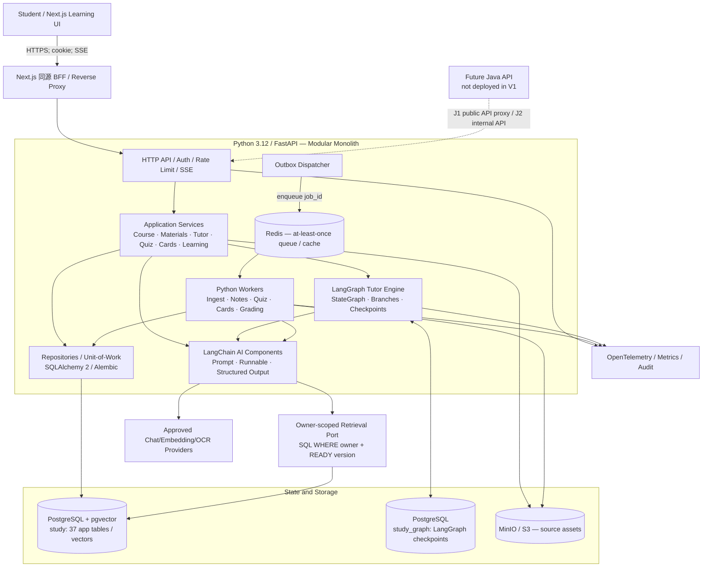
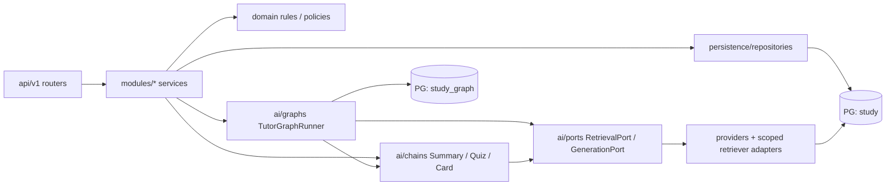
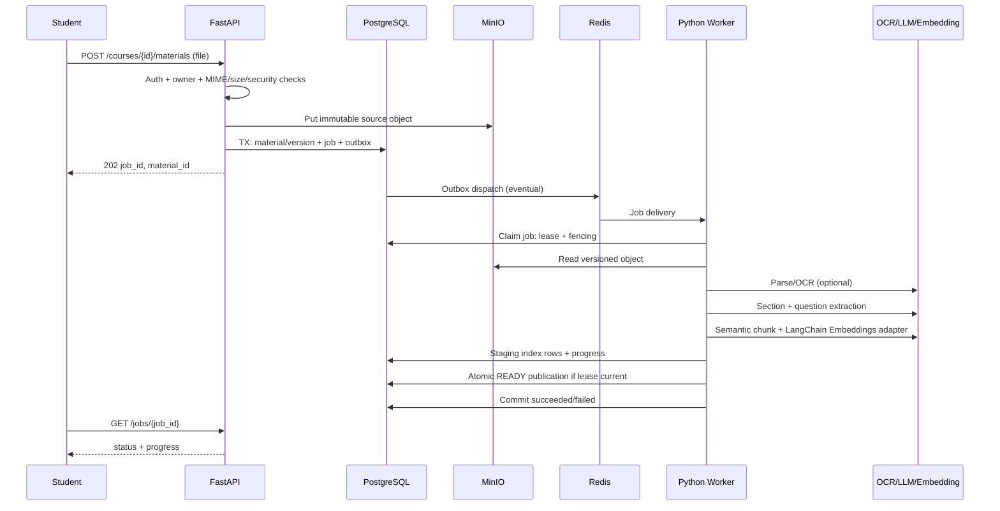
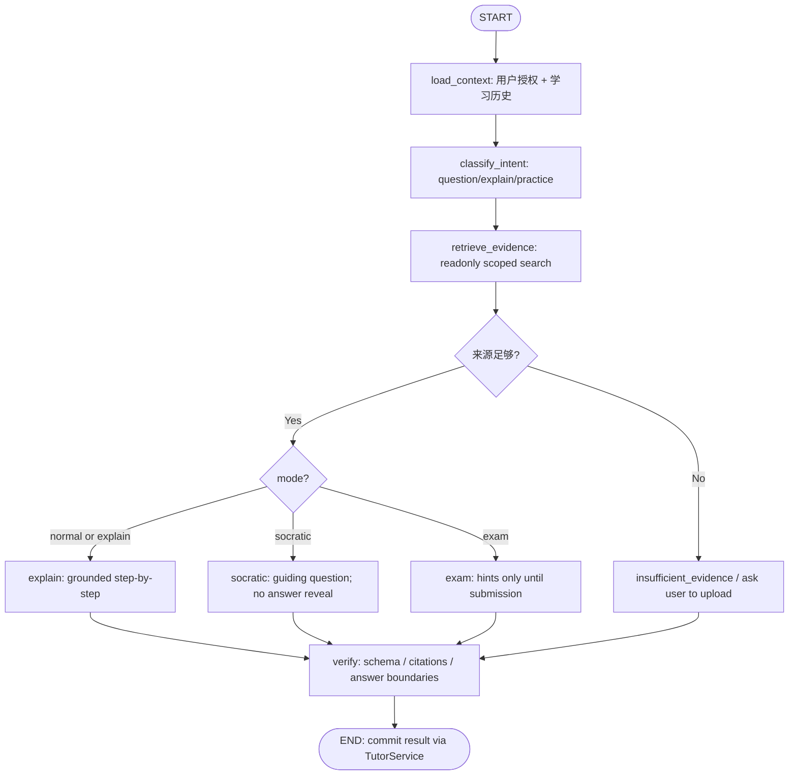
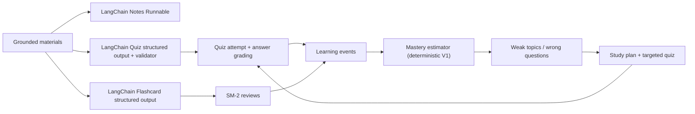
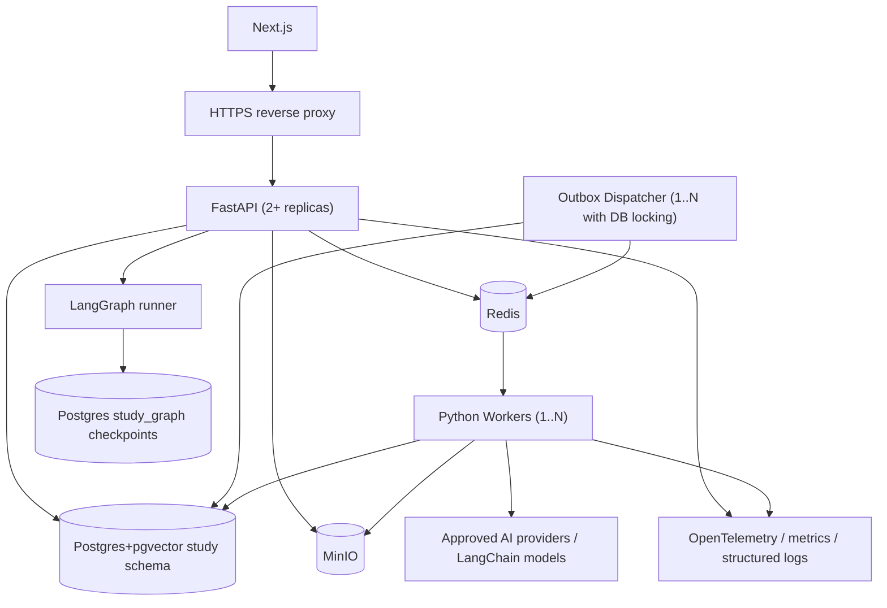

# Architecture Design — AI Learning Platform（KnowFlow 演进版）

> 文档版本：2.0 / LangChain + LangGraph 版设计草案　|　2026-11-14  
> 适用范围：V1 纯 Python + FastAPI + LangChain + LangGraph；未来 Java 仅定义兼容性边界。  
> **状态说明**：本文件为目标架构，不代表现有 KnowFlow 已经集成 LangChain/LangGraph 或完成 Python 全后端迁移。  
> 对应文档：[02 Database Design](02_Database_Design.md) · [03 API Design](03_API_Design.md)

## 0. 设计结论与边界

**ADR-001：V1 使用「模块化单体 + 独立 Worker 进程」**。同一套 Python 代码部署成 API 进程、后台任务 Worker 与 Outbox Dispatcher；**没有 Java 运行依赖、没有 Python→Java HTTP 调用**。业务事实、索引状态和 AI 结果均由 Python 通过 SQLAlchemy 的统一 Repository/Unit of Work 持久化。长耗时任务通过 Redis 派发，PostgreSQL 是任务状态真相源，Redis 只是队列/缓存。

**ADR-002：LangChain 是 AI 能力组件层，LangGraph 是教学工作流执行器。** LangChain（`langchain-core`、模型/Embedding 适配、`ChatPromptTemplate`、Runnable、结构化输出）用于 RAG 组装、讲解、笔记、出题、卡片生成。LangGraph（`StateGraph`、条件分支、持久化 checkpoint）用于 **Tutor 的多步骤教学与跨轮延续**。Quiz、Notes、Flashcards 初期以简单链完成，**不强制 Agent 化**；SM-2、权限检查、打分事务、mastery 算法完全保留为确定性 Python 业务代码。

**ADR-003：业务记录与 Graph Checkpoint 两套持久化语义。** `study` schema 由 SQLAlchemy/Alembic 管理（37 张应用表，含 `ai_workflow_runs`）；`study_graph` schema 由锁定版本的 LangGraph PostgreSQL checkpointer 负责初始化和管理内部表。`ai_workflow_runs` 是持久业务执行索引、诊断、幂等和状态记录；checkpoint 只是可恢复的**运行时状态**，**不是**学生成绩、消息与学习进度的权威来源。Graph State 只存 ID、简短摘要和受控证据元数据，不存整份课件、密码、原始 bearer token；两者均受删除/保留策略约束。

- **用户场景**：学生创建课程，上传资料/试卷，系统解析与知识点抽取，建立可信 RAG；生成总结、测验、闪卡；学生答题/复习后更新知识掌握度并形成学习计划。
- **产品范围（V1）**：账号与个人隔离、课程/资料、PDF/TXT/MD/DOCX（文本）、基础扫描件 OCR（功能开关）、引用式 AI Tutor、笔记、MCQ/简答 Quiz、SM-2 闪卡、错题本、规则化掌握度、异步任务、基本学习报表。
- **暂不做（V1）**：Java 微服务、实时协作/班级组织、多租户企业管理、AI 自主联网搜题、无约束多 Agent、实时语音、复杂知识图谱/自动评分可信考试、完整手写数学推理、多地域部署。
- **工程不变量**：资料是事实来源；生成结果不是事实来源；任何引用必须回指真实资料版本和 chunk；跨用户不能访问；取消/重试不能造成旧任务覆盖新索引；模型不能自行写数据库。
- **非功能目标（初始验收门槛，需真实压测校准）**：普通读 API P95 < 500 ms（不含模型调用）；检索 P95 < 1.5 s（热数据、指定测试集）；索引/生成全链路异步；每个 AI 请求有费用/超时上限；所有资源按认证 user_id 隔离。

## 1. 基于现有仓库的事实与处理策略

现有 `ggwenling/knowflow` 的 `main` 分支：`apps/web-v2` 是 Next.js；`services/api` 是 Java Spring Boot；`services/ai` 是 Python 3.12 / FastAPI；`contracts` 中协议 **0.2.0 冻结**。Java 当前拥有用户/文档/任务状态、pgvector 写入与原子索引发布；Python 当前拥有解析、切分、Embedding、基于 Java 可信快照的检索和证据校验生成。当前 `parsing.py` 只支持 TXT/MD/文本 PDF，`chunking.py` 默认 800 code points / 100 overlap，Embedding 配置锁定 `BAAI/bge-m3` / 1024维；Python Worker 使用 `java_client.py` 回调 Java。仓库记录了**合成模型**的 E2E，但真实模型质量与费用未正式验收。

| 原仓库模块/文件 | V1 处理 | 改造要点 |
|---|---|---|
| `services/ai/src/knowflow_ai/parsing.py` | **迁移改造** | 保留安全限制和 source locator；新增可插拔 PDF/DOCX/OCR parser；识别章节/题目 |
| `.../chunking.py` | **迁移改造** | 原确定性 chunker 保留为 fallback；新增 section/question-aware chunking 和版本 profile |
| `.../embedding.py` | **优先复用** | 抽象 EmbeddingProvider、模型维度/成本/重试；V1 使用兼容 1024维 profile |
| `.../answering.py`, `citation_verify.py` | **拆分复用** | 迁移为 retrieval、grounded_answer、citation 校验，新增会话和教学模式 |
| `.../worker.py`, `java_client.py`, `protocol.py` | **重写集成层** | 删除 JavaGateway 运行依赖；改为 DB JobLease/Outbox/Repository；旧协议保留为迁移参考 |
| `services/api` Java `auth/document/indexing/answer` | **只作为迁移规范** | 逐步以 Python domain/services/repositories 重建，不删除旧仓库作回退依据 |
| `services/api/.../db/migration/V1–V8` | **仅作数据映射参考** | 新服务建独立 `study` schema + Alembic revision 链，不让 Flyway/Alembic 管同一表 |
| `apps/web-v2` | **延续并重构 UI** | 保留 Next.js、同源会话代理/SSE 基础，新增课程/学习/Quiz 等页面 |
| `contracts/` 0.2.0 | **冻结存档** | 新增 `contracts/study-v1`，OpenAPI + JSON Schema + contract tests，不覆写旧 SHA |
| `evaluation/` | **复用评测框架** | 扩充 OCR、知识点、题目正确性、批改一致性及个性化学习指标 |

来源：[KnowFlow README](https://github.com/ggwenling/knowflow/blob/main/README.md)、[Python AI README](https://github.com/ggwenling/knowflow/blob/main/services/ai/README.md)、[Java API README](https://github.com/ggwenling/knowflow/blob/main/services/api/README.md)。Synapse 对标功能参考：[manav-2812/Synapse](https://github.com/manav-2812/Synapse)。**以上是设计规划，不代表代码已迁移。**  LangChain/LangGraph 是**本次新增的选型**，不能将旧 `answering.py` 或 `worker.py` 直接改几个 import 就视为完成集成。

## 2. 目标系统架构图

### 2.1 运行拓扑（V1，只有一个 Python 后端代码库）



**重要区分**：LangChain/LangGraph 是 `backend/` **内部依赖**，不是独立可访问的服务；没有运行 LangGraph Server 的要求。Java 虚线仅是未来路线，V1 的 Python 不发起任何 Java HTTP 请求。检索查询只能通过授权的 Repository/`RetrievalPort`，不能让模型调用不受控的 SQL 工具。`study_graph` 内部表由 checkpointer 的锁定版本决定，不归 Alembic 管理，也不计入 37 张业务表。

### 2.2 代码调用方向与边界



`modules` 负责业务事务与资源授权，`ai/chains` 只负责 AI 计算和结构化结果，`ai/graphs` 负责流程状态、路由和循环；它们**不得**直接提交学生成绩、Flashcard Review 或业务资料索引版本。业务持久化必须经 Application Service 的事务进行。任何依赖方向上的调用也不能绕过 owner/scope 验证。

## 3. 模块职责与依赖方向

| 模块（Python） | 负责 | 不应负责 |
|---|---|---|
| `auth` | 注册、登录、session 轮换、注销、CSRF 与账户状态 | 模型调用 |
| `courses` | 课程 CRUD，课程 owner/资源可见性 | 解析 PDF |
| `materials` | 上传校验、对象存储、版本/状态、删除、文档元数据 | 直接发起无限时 LLM |
| `ingestion` | PDF/DOCX/OCR、章节/题目结构化、locator、chunk、Embedding、索引发布 | 判定谁拥有课程 |
| `knowledge` | 知识点去重、来源关联、章节层次和置信度 | 伪造学习掌握度 |
| `retrieval` | 可信 scope 限定、pgvector+全文混合检索、RRF/重排、证据集合；向 LangChain 提供只读 `RetrieverPort` | 允许框架自行组合跨用户集合 |
| `tutor` | 授权、消息事务、LangGraph thread/run 启动和恢复、SSE/引用；一个会话同一时刻只允许一个 turn | 将 Graph checkpoint 当作会话/答题业务真相 |
| `notes` | 分层总结、生成的笔记版本与引用 | 直接修改原文 |
| `quizzes` | 题目生成/审校、题库、尝试、提交、确定性客观题评分、Rubric 主观题评分 | 无事务地更新学生掌握度 |
| `flashcards` | 闪卡生成、复习记录、SM-2 日程与幂等 | 始终调用 LLM 计算复习日期 |
| `learning` | 错题本、mastery、学习计划、学习事件与分析 | 在无学习证据时宣布“已掌握” |
| `jobs` | PostgreSQL job 状态、租约/fencing、outbox、去重、重试和取消 | 在 Redis 存唯一任务真相 |
| `ai/chains` | LangChain ChatPromptTemplate、Runnable、结构化结果生成/验证边界 | 修改课程/考试答案或绕过引用验证 |
| `ai/graphs` | LangGraph Tutor 状态节点、条件边、可恢复检查点、图版本 | 自由执行任意 SQL/网络工具或改写业务表 |
| `ai/workflow_runtime` | `ai_workflow_runs` 映射、Graph thread ID、checkpoint 生命周期、SSE projector | 保存未经验证的原文作为长期事实 |
| `providers` | LLM/Embedding/OCR 接口适配、重试/费用/配额、LangChain Model/Embeddings 绑定 | 决定业务权限 |
| `core` | 配置、DB、对象存储、审计/观测、安全、异常 | 业务耦合逻辑 |

依赖规则：`api → application services → repositories/domain`；AI 算法通过 ports（`EmbeddingProvider`, `LLMProvider`, `RetrievalPort`, `FileStore`）注入；LangChain `Runnable` 与 LangGraph `CompiledGraph` 只能出现在 `ai/` 实现层；`repositories` 只处理 SQL，不调用 LLM；`domain` 不导入 FastAPI/Redis/ORM。

## 4. 建议仓库结构（目标，不是当前已存在目录）

```text
learning-platform/
├── apps/web/                                 # 从 apps/web-v2 迁移 Next.js
├── backend/
│   ├── pyproject.toml                       # 锁定 Python/LangChain/LangGraph 相容版本
│   ├── src/study_platform/
│   │   ├── main.py                          # FastAPI app factory
│   │   ├── api/v1/                          # routers + DTO; 只处理 HTTP
│   │   ├── core/                            # auth, config, DB, errors, telemetry
│   │   ├── domain/                          # 不依赖 LangChain/ORM 的业务规则
│   │   ├── modules/
│   │   │   ├── auth/  courses/  materials/  ingestion/
│   │   │   ├── knowledge/  retrieval/  tutor/  notes/
│   │   │   ├── quizzes/  flashcards/  learning/  jobs/
│   │   ├── ai/
│   │   │   ├── ports/                       # 可替换 LLM / Retrieval / Embedding
│   │   │   ├── chains/
│   │   │   │   ├── grounded_answer.py       # LangChain RAG prompt + runnable
│   │   │   │   ├── summary.py               # Map-reduce/hierarchical note
│   │   │   │   ├── quiz.py                  # Pydantic structured generation
│   │   │   │   ├── flashcard.py
│   │   │   │   └── grading.py
│   │   │   ├── graphs/
│   │   │   │   ├── tutor_state.py            # State schema (IDs, no raw source blob)
│   │   │   │   ├── tutor_graph.py            # StateGraph nodes and conditional edges
│   │   │   │   ├── tutor_runner.py           # compile/astream/aexit
│   │   │   │   └── adaptive_learning.py      # 后续版本启用
│   │   │   ├── retrieval/
│   │   │   │   ├── scoped_retriever.py       # PG 查询范围安全边界
│   │   │   │   ├── hybrid.py
│   │   │   │   ├── rerank.py
│   │   │   │   └── evidence_guard.py
│   │   │   ├── prompts/                     # 版本化、教育模式、变量白名单
│   │   │   ├── schemas/                     # Pydantic AI 输出契约
│   │   │   └── workflow_runtime/
│   │   │       ├── checkpoints.py           # PG checkpointer 生命周期
│   │   │       ├── run_store.py             # ai_workflow_runs app records
│   │   │       └── sse_projector.py         # LangGraph runtime → Public SSE
│   │   ├── providers/                      # 原 KnowFlow adapter / LangChain binding
│   │   ├── persistence/models/             # SQLAlchemy
│   │   ├── persistence/repositories/
│   │   └── workers/                        # ingest/generate/outbox/cleanup
│   ├── alembic/                            # 只管理 study.* 应用表
│   └── tests/unit, tests/integration, tests/e2e
├── contracts/study-v1/
│   ├── openapi.yaml
│   └── schemas/                            # tutor decision/quiz/notes/checkpoint policy
├── infra/                                   # Postgres + Redis + MinIO + API + Workers
├── evaluation/                              # retrieval/quiz/tutor evals
└── docs/architecture/
```

### 4.1 LangChain / LangGraph 组件选型

| 技术组件 | V1 决策 | 说明 |
|---|---|---|
| `langchain-core`、`langchain` | **引入** | `ChatPromptTemplate`, `Runnable`, 消息/文档封装；避免引入大量 `langchain-community` 默认依赖 |
| 模型具体集成包 | **按 provider 可用性引入** | 支持原 DeepSeek / SiliconFlow 适配器；验证原 provider 是否支持 tool calling/结构化输出与 streaming |
| `langgraph` | **Tutor V1 引入** | `StateGraph` 管理 `explain/socratic/exam` 的多节点和条件路径；复杂学习计划图属于 P2 |
| PostgreSQL checkpointer | **Tutor V1 引入** | 采用与锁定 LangGraph 版本兼容的 `langgraph-checkpoint-postgres`，首次由单独 init job 执行 `setup()`（如该版本要求）；不由 API 每个实例执行 DDL |
| `langsmith` | **非必需、默认不上传用户资料** | 先用 OpenTelemetry + 自建评测；启用第三方追踪前完成隐私与数据外传审查 |
| `pgvector` + SQL | **保留 KnowFlow 数据底座** | 允许 LangChain 使用 `Document` / Runnable 接口，但**不要求**改用独立 ChromaDB；scope、index_version、owner 必须由 SQL 校验 |
| Agent 的写入 Tools | **V1 禁用** | 禁止 LangChain SQL Agent、任意 HTTP 请求、课程数据修改和联网搜索 |

依赖锁定/兼容性：在实现开始时通过 `uv.lock` 固定 **已验证的一组** `langchain`、`langchain-core`、`langgraph`、provider adapter、checkpointer 版本；`astream`、结构化输出策略和 checkpoint schema 以该版本的契约测试为准，不凭本设计假设自动兼容。官方参考：[LangChain Structured Output](https://docs.langchain.com/oss/python/langchain/structured-output) · [LangGraph Persistence](https://docs.langchain.com/oss/python/langgraph/persistence) · [LangGraph Streaming](https://docs.langchain.com/oss/python/langgraph/streaming)。

### 4.2 现有 KnowFlow 代码的迁移边界

先保留原仓库/分支作对照。把 `parsing.py` / `chunking.py` 的确定性算法和测试迁出，保留 `citation_verify.py` 的证据校验思想；拆开 `answering.py` 中 retriever、LLM adapter、prompt 与 SSE；对 `worker.py`、`java_client.py`、旧 `protocol.py` **重写跨服务集成**。不能再依赖 Java 读取源文件、续租、写向量或发布索引。`contracts/0.2.0` 只是历史参考；新 `study-v1` 独立版本化。

## 5. 关键处理链路

### 5.1 文档与试卷摄取



- **格式**：阶段 1 TXT/MD/文本 PDF；阶段 2 DOCX/PPTX；OCR 能力可作为独立阶段开关。若页面仅图片，返回 `NEEDS_OCR` 或启动 OCR，而非将空页错误地标记索引成功。
- **原文定位**：`page_number`、`char_start/end`、`bbox`（扫描内容）、`source_version_id`、`chunk_id`。推导知识点、题目和笔记引用均保持来源。
- **结构化分段**：先解析 section/question，再以问题/段落为最小逻辑单元；超长题拆分时保留 `group_id`，不能把选项/标准答案截断混淆；检索可以扩充上下文。
- **版本/发布**：重传先创建新 `material_version`，旧索引仍可按快照读取；新索引完成校验后原子替换 `is_active`；失败绝不覆盖原活动索引。
- **安全**：上传文件大小、页数、解压炸弹、PDF 攻击面、病毒扫描与 OCR 资源占用上限；提取的文字被视为**不可信数据**，不得执行其指令。

### 5.2 LangChain RAG + LangGraph Tutor

**RAG 走 LangChain，但检索范围由业务层掌控**：

```mermaid
flowchart LR
  S["Student Message + Course Scope"] --> AUTH["FastAPI TutorService: auth + freeze READY snapshot"]
  AUTH --> GRAPH["LangGraph Tutor StateGraph"]
  GRAPH --> INTENT["Intent / Teaching Mode"]
  INTENT --> RET["LangChain Scoped Retrieval Runnable"]
  RET --> SQL["pgvector + lexical; owner + index_version predicates"]
  SQL --> EV["Evidence Guard / Reranker"]
  EV --> DEC{"Evidence adequate?"}
  DEC -->|No| REFUSE["Explicit insufficient evidence"]
  DEC -->|Yes| GENERATE["LangChain Prompt + LLM + bounded memory"]
  GENERATE --> CHECK["Schema / citation / scope verification"]
  CHECK --> SSE["SSE provisional delta; committed citations; completed"]
  REFUSE --> SSE
```



**LangGraph 的节点与条件边（V1 Tutor）**：



教学循环**跨多次学生输入**进行：一个 HTTP/SSE 请求对应一个 turn 和一个 `ai_workflow_runs`；模型提出引导题后，该 turn 可以以 `awaiting_student` 结束，下一条学生消息使用相同 `thread_id` 从 checkpoint 恢复。**不能在一个 Worker 里无限等待学生输入**。`mastery` 仍由确定性的学习事件驱动，而非 Graph 自行修改。

**V1 TutorGraphState 建议字段**（使用 `TypedDict`/Pydantic 确定 Schema，示意）：

```python
from typing import TypedDict

class TutorGraphState(TypedDict, total=False):
    graph_version: str          # tutor-graph-v1
    conversation_id: str       # 唯一 server-derived thread_id
    run_id: str                # ai_workflow_runs.id
    course_id: str
    user_message_id: str
    teaching_mode: str         # normal | explain | socratic | exam
    intent: str
    scoped_index_ids: list[str] # 服务端验证来源，不来自模型
    evidence_chunk_ids: list[str]
    safe_history_summary: str # 有长度/保留期限限制
    needs_more_evidence: bool
    response_draft: str
    validated_citation_ids: list[str]
    next_step: str             # complete | awaiting_student
```

认证主体 `owner_user_id`、可信 `scope_snapshot`、provider 密钥属于运行时**不可变上下文**，不接受 LLM State Update 覆盖；读取数据时重复授权检查。Graph 状态仍可能包含学生学习信息，必须遵守加密、TTL、保留和删除要求。因 Graph 重试/断线会重新执行节点，任何 AI 节点只返回草稿或 ID，不能提交成绩/创建试卷；最终 `TutorService` 验证结果并在 PostgreSQL 事务里写入 `messages` + `message_citations` + `ai_workflow_runs` 结果状态。

**SSE 桥接**：Graph 的内部 token/node events 通过 `sse_projector` 输出标准外部事件 `started`、`phase`（可选）、`delta`、`citations`、`completed|error`；只把经过验证的 citation 发送为最终来源。`delta` 是**临时输出**；`completed` 前不可当作正式答案。LangGraph 内部 `astream`/event streaming 的具体事件形状由锁定版本吸收，不能泄漏给浏览器。失败后持久化错误状态；重复同一 `Idempotency-Key` 返回已有 turn/message，而不是再次运行 Graph。

**LangChain 结构化内容**：Notes 使用 `section summaries → chapter summary` 的有界 Runnable 链；Quiz/Flashcard/Grading 使用 `ChatPromptTemplate` + provider 可用的 `with_structured_output(Pydantic)` 或严格 parser/fallback，并强制二次校验和最多有限次重试。Prompt 来源片段以 untrusted context 隔离；模型返回的 `source_chunk_ids` 必须属于已验证 evidence set。

### 5.3 学习闭环



- **Quiz Generator**：通过 LangChain 的结构化输出/Parser 只生成 JSON Schema 通过、来源可追溯、答案可验证的题目；不合格的丢弃或请求受限重生成。
- **Grader**：MCQ/判断题 Python 确定性评分；简答题 LangChain 调用的 LLM 根据冻结 rubric 打分，保存评语、模型/版本、置信度，低置信度提示人工复核，不作为高风险考试分数。
- **Mastery**：V1 规则驱动（例如滚动正确率 × 题目难度 + 最近性 + 复习表现），存 `estimator_version`。不直接把 LLM 自述当做掌握程度。
- **Flashcards**：SM-2 或简化等价算法在 Python 纯函数运行；复习动作按 `Idempotency-Key` 去重。

## 6. 一致性、队列与失败恢复

1. HTTP 上传完成对象写入后，在数据库同一事务创建资料版本、`ai_jobs`、`outbox_events`；对象上传成功但 DB 失败时由孤儿对象清理任务回收。
2. Dispatcher `SELECT ... FOR UPDATE SKIP LOCKED` 抽取未投递 outbox，推送 Redis；崩溃后可重发。队列语义 **at least once**，不是 exactly once。
3. Worker 从 PostgreSQL 原子领取 job，设置 `lease_token_hash`、`lease_expires_at`、递增 `fencing`。进度/完成写入须匹配 fencing、当前版本、owner。
4. 失败采用指数退避及上限次数；取消先设置 DB 取消标记，Worker 协作取消；发布索引是单事务 compare-and-swap，拒绝过期 Worker。
5. `Idempotency-Key` 以 `(user_id, route_scope, key)` 唯一，并持久化 request hash/响应资源；同键不同参数返回 409。
6. Redis 丢失不丢任务真相；定期扫描超时/卡住 Job 和未投递 outbox；定期清理未引用临时对象与过期向量版本。
7. **Graph checkpoint 幂等/恢复**：相同 `run_id`+graph_version 只能存在一个活跃执行，线程由服务端从会话 ID 派生；`ai_workflow_runs` 记录运行、版本、最终 message 的关联（通过 `messages.workflow_run_id`），避免 checkpoint 重放产生第二份答案；checkpoint 的写入与业务写入不是跨 schema 单个原子提交时，应以 `ai_workflow_runs` 的完成记录重建/拒绝重复外部效果。过期版本先完成/终止旧 run，不能用新 graph_definition 强行恢复旧状态。
8. 多用户所有操作按可信 `auth.user_id` 过滤，禁止客户端直接填写 `owner_user_id`；SQL 层可在后续启用 RLS 作为第二道防线。

## 7. 数据流、隐私与权限

- **认证**：Next.js 同源 BFF 代理，Secure + HttpOnly + SameSite=Lax cookie；服务端维护 session/refresh token hash；有状态写请求验证 CSRF；账户密码 Argon2id。API 直接客户端使用可明确授权的 Bearer token 方案，但不能混用来源身份。
- **资源边界**：每个 Course/Material/Quiz/Conversation/Plan 都通过 `owner_user_id` 或其父实体关系授权；无权限与不存在统一 404。学生上传的资料可能涉及未成年人，默认私有，不进入公共模型训练资料池。
- **模型隐私和跟踪**：LangChain callbacks/Graph state/第三方 tracing 必须同样经过敏感数据脱敏；外部模型调用仅传任务所需最少片段；可配置关闭外部供应商/改本地模型；不记录原文和令牌到日志；资料删除必须关联删除对象、引用可见性和索引。
- **引用安全**：已删除或失权的源文件只返回 `unavailable`，不回显 quote、页码或下载 URL。上传文件与 OCR 文本存在 prompt injection 风险，模型输出不能触发未经授权的工具动作。
- **成本保护**：按用户/任务限制 token、文件页数、并发、模型调用次数；记录模型配置身份、token、延时、预估费用，异步生成可取消。

## 8. 部署拓扑、观察性与验证



- Docker Compose 为开发环境；生产中 API/Worker 水平扩缩容，DB/Redis/对象存储使用持久存储、备份及 TLS。迁移由独立一次性 Alembic Job 执行，不能让每个 API 实例并发执行迁移。
- 记录 `request_id`, `job_id`, `workflow_run_id`, `graph_version`, `trace_id`, `user_id`（合规脱敏）, `material_version_id`, `model_profile`, `latency_ms`, `tokens`, `cost`；不可记录文档正文和密码。
- 健康检查：`/health/live`（进程）、`/health/ready`（DB 与必要依赖），Provider 失败不导致整个 API 不可读取已存数据。
- 测试：pytest 单元、Postgres/MinIO/Redis Testcontainers 集成、Playwright E2E、API 契约快照、越权/重复 Job/旧租约/删除竞态、合成模型与真实模型独立评测。

## 9. 未来 Java 的两条演进路径

**Java 边界与 LangGraph**：J1 Java 只反代原 `/api/v1`，不接触 graph/checkpoint。J2 Java 拥有已迁出的业务数据，但 Python 仍可为 `study_graph` checkpoint 的唯一写入者（仅运行状态，不是业务真相）；Java 冻结会话/来源/权限范围并签名传入内部 Tutor 计算请求，Python 返回 AI 草稿与证据，Java 原子落地最终消息与引用。详见 API 设计的内部 `tutor/turns` 契约。

**Phase J1（最小风险）**：Java 作为公开 BFF/API Gateway，完整保持 `/api/v1` 请求与响应合同，将请求路由到 Python 内部 API；Python 仍拥有 DB 事务和业务写入。不出现双写。

**Phase J2（可选，拆分业务写入）**：按模块将账户/课程等业务迁到 Java；新 `Java API` 成为指定模块**唯一写入者**，Python 改为计算引擎并返回结构化结果。索引发布/任务归属、租约/fencing、安全范围与内部认证重新落到 Java 的所有权边界；必须先完成 outbox/回放及契约兼容测试。详见 [03 API Design §7](03_API_Design.md)。

任何阶段都不能同时由 Java/Python 独立写同一张业务表；共享 Schema 与幂等约束必须可验证。

## 10. 实施路线与验收门禁

| 阶段 | 开发内容 | 完成判定 |
|---|---|---|
| P0 | 复制项目、冻结 KnowFlow 基线、梳理数据映射、建 Alembic 初始 schema | 旧项目不受影响；新库迁移/up-down 可验证 |
| P1 | Python auth/course/material/storage/jobs，移除 JavaGateway | 无 Java 时上传/删除/查询通；租约重试/删除测试通过 |
| P2 | parser、chunk、Embedding、LangChain RAG + **LangGraph Tutor V1**、checkpoint、SSE、引用 | 合成 E2E、断线恢复、graph node 重试与来源越权、版本隔离全部通过 |
| P3 | knowledge、LangChain 结构化 Notes/Quiz/Grading/Flashcards | Schema 校验、模型失败降级、题目可追溯、客观题评分确定、SM-2 可重放 |
| P4 | wrongbook、mastery、planner、analytics、OCR 基础；按需要新增自适应 LangGraph 流程 | 学习闭环 E2E；确定性学习分数；真实教育资料人工评审 |
| P5 | 性能/隐私/成本与安全检查、灰度发布 | P95/成本/安全门禁达标且可回滚 |

### 待决策事项

1. MVP 范围是“课程课件”还是“中学试卷”优先？两者 OCR 与题目结构化要求不同；本设计数据模型兼容二者。
2. 首发是否必须支持扫描件？建议作为可选功能开关并以真实样本设质量门槛。
3. 用户是成年人还是包含未成年人？若包含未成年人，需单独制定年龄适配与数据保护/家长同意政策。
4. Provider 地域/保留政策、是否可本地化、模型预算需要产品层确认。
5. 从 KnowFlow 旧实例迁移真实数据还是只复用代码？本设计默认**新库新用户**，可选离线导入。
6. LangGraph checkpoint 保留期限、加密密钥、图版本升级/旧线程终止策略和事件流 API 必须随最终锁定依赖版本确定。
7. DeepSeek/SiliconFlow 当前所选模型是否可靠支持 `with_structured_output`/tool calling/流式事件，必须通过真实提供商验证，不成功则使用验证器与受限 JSON fallback（不能默认为保证正确）。
