# Database Design — AI Learning Platform

> **归档快照｜2026-11-14。** 本文保留当时的数据库设计。现行 schema 与迁移约定见 [数据库规则](../database-rules.md)。

> 版本：2.0 / LangChain + LangGraph 版设计草案　|　2026-11-14  
> 数据库：PostgreSQL 16 + pgvector（V1 `vector(1024)`）；独立 `study` schema；迁移：Alembic。  
> 对应文档：[01 Architecture Design](01_Architecture_Design.md) · [03 API Design](03_API_Design.md)

## 0. 设计原则

1. **V1 是新 Python + LangChain/LangGraph 后端的新库**；**不直接继续在 KnowFlow `knowflow` schema 跑 Flyway V9**。历史 Flyway V1–V8 作为迁移参照，新的 Alembic 独立管理 `study`；若需导入旧数据，使用离线 ETL 与映射校验。
2. 原始资料事实（`materials/material_versions/material_chunks`）与 AI 派生物（`knowledge_points/notes/quizzes/flashcards`）以及学生行为（`quiz_responses/flashcard_reviews/learning_events`）分别保存，不把模型生成内容作为原始教材。
3. 所有主键 UUID（应用生成 UUIDv7 或数据库 `gen_random_uuid()`，V1 统一选一种）；时间 `TIMESTAMPTZ` UTC 写入、RFC 3339 序列化；列名 `snake_case`；所有学生可见根实体必须有 `owner_user_id`，子实体经 FK+Repository ownership join 强制隔离。
4. **来源引用和索引快照是不可变记录**：一条引用至少锁定 `material_version_id` + `index_version_id` + `chunk_id` + locator；原文删除后仍可保留不可逆的引用 ID/状态，但不能泄露原文。
5. 文件在 MinIO/S3，数据库存对象 key/sha256，不存大 BLOB；索引和生成任务持久化在 PG，Redis 仅用于消息派发。生成物保存 `generator_profile`, `prompt_version`, `source_scope`。
6. **LangGraph 执行状态分层**：新增 `ai_workflow_runs` 表保存 Tutor Graph 的业务可查询运行记录、版本、会话和检查点引用；另建受限 `study_graph` schema，由 LangGraph PostgreSQL checkpointer 的锁定版本管理底层 checkpoint 表（其内部表名/字段可能随依赖版本变化，**不可被当作稳定业务表 schema**）。通过唯一 `run_id`、服务端派生 `thread_id` 和 `graph_version` 控制续跑；不保存完整 source text、凭证或学生标准答案。
7. 任何 API 客户端不得提交或修改 `owner_user_id`。V1 个人隔离，不建冗余 `organizations/tenant`；未来团队/学校再引入组织边界。未成年人隐私需专项评审。

## 1. 全局 ER 图（37 张业务表）

关系线表示主要物理 FK；多对多来源中间表显示为独立实体。**LangGraph checkpoint 的内部存储表由 checkpointer 库自行管理，不计入 37 张 `study` 业务表**。列字段清单见第 3 节。

```mermaid
erDiagram
    users ||--o{ user_sessions : owns
    users ||--o{ courses : owns
    users ||--o{ conversations : creates
    users ||--o{ ai_jobs : requests
    users ||--o{ learning_events : performs
    users ||--o{ idempotency_keys : submits
    users ||--o{ audit_logs : acts
    courses ||--o{ materials : contains
    courses ||--o{ knowledge_points : includes
    courses ||--o{ conversations : scopes
    courses ||--o{ notes : has
    courses ||--o{ quizzes : has
    courses ||--o{ flashcard_decks : has
    courses ||--o{ study_plans : has
    materials ||--o{ material_versions : versions
    material_versions ||--o{ material_sections : structures
    material_sections |o--o{ material_sections : parent
    material_versions ||--o{ index_versions : indexed_as
    index_versions ||--o{ material_chunks : contains
    material_chunks ||--o{ chunk_embeddings : embeds
    material_versions ||--o{ source_questions : extracts
    material_sections |o--o{ source_questions : contains
    knowledge_points ||--o{ knowledge_point_sources : cited_in
    material_chunks ||--o{ knowledge_point_sources : supports
    conversations ||--o{ messages : contains
    messages ||--o{ message_citations : cites
    material_chunks ||--o{ message_citations : grounds
    notes ||--o{ note_citations : cites
    material_chunks ||--o{ note_citations : grounds
    quizzes ||--o{ quiz_items : contains
    quiz_items ||--o{ quiz_item_sources : cites
    material_chunks ||--o{ quiz_item_sources : grounds
    quizzes ||--o{ quiz_attempts : attempted
    quiz_attempts ||--o{ quiz_responses : answers
    quiz_items ||--o{ quiz_responses : answered_for
    quiz_items ||--o{ wrong_questions : logged_as
    quiz_responses |o--o{ wrong_questions : evidenced_by
    flashcard_decks ||--o{ flashcards : contains
    flashcards ||--o{ flashcard_sources : cites
    material_chunks ||--o{ flashcard_sources : grounds
    flashcards ||--o{ flashcard_reviews : reviewed
    knowledge_points ||--o{ mastery_states : measured
    users ||--o{ mastery_states : owns
    study_plans ||--o{ study_plan_items : contains
    knowledge_points |o--o{ study_plan_items : trains
    ai_jobs ||--o{ ai_job_attempts : retries
    conversations ||--o{ ai_workflow_runs : runs
    users ||--o{ ai_workflow_runs : owns
    ai_jobs |o--o{ ai_workflow_runs : graph_jobs
    ai_workflow_runs |o--o{ messages : produces
    ai_jobs |o--o{ outbox_events : triggered
    users {
      UUID id PK
      CITEXT email UK
    }
    user_sessions {
        uuid id PK
        uuid user_id FK
    }
    courses {
        uuid id PK
        uuid owner_user_id FK
    }
    materials {
        uuid id PK
        uuid course_id FK
        uuid owner_user_id FK
    }
    material_versions {
        uuid id PK
        uuid material_id FK
    }
    material_sections {
        uuid id PK
        uuid material_version_id FK
        uuid parent_section_id FK
    }
    index_versions {
        uuid id PK
        uuid material_version_id FK
    }
    material_chunks {
        uuid id PK
        uuid index_version_id FK
    }
    chunk_embeddings {
        uuid chunk_id PK,FK
        varchar model_profile_id PK
    }
    knowledge_points {
        uuid id PK
        uuid course_id FK
    }
    knowledge_point_sources {
        uuid id PK
        uuid knowledge_point_id FK
        uuid chunk_id FK
    }
    source_questions {
        uuid id PK
        uuid material_version_id FK
        uuid section_id FK
    }
    conversations {
        uuid id PK
        uuid owner_user_id FK
        uuid course_id FK
    }
    messages {
        uuid id PK
        uuid conversation_id FK
        uuid workflow_run_id FK
    }
    message_citations {
        uuid id PK
        uuid message_id FK
        uuid chunk_id FK
    }
    notes {
        uuid id PK
        uuid course_id FK
    }
    note_citations {
        uuid id PK
        uuid note_id FK
        uuid chunk_id FK
    }
    quizzes {
        uuid id PK
        uuid course_id FK
    }
    quiz_items {
        uuid id PK
        uuid quiz_id FK
    }
    quiz_item_sources {
        uuid id PK
        uuid quiz_item_id FK
        uuid chunk_id FK
    }
    quiz_attempts {
        uuid id PK
        uuid quiz_id FK
    }
    quiz_responses {
        uuid id PK
        uuid attempt_id FK
        uuid quiz_item_id FK
    }
    flashcard_decks {
        uuid id PK
        uuid course_id FK
    }
    flashcards {
        uuid id PK
        uuid deck_id FK
    }
    flashcard_sources {
        uuid id PK
        uuid flashcard_id FK
        uuid chunk_id FK
    }
    flashcard_reviews {
        uuid id PK
        uuid flashcard_id FK
    }
    mastery_states {
        uuid id PK
        uuid owner_user_id FK
        uuid knowledge_point_id FK
    }
    wrong_questions {
        uuid id PK
        uuid owner_user_id FK
        uuid quiz_item_id FK
    }
    study_plans {
        uuid id PK
        uuid course_id FK
    }
    study_plan_items {
        uuid id PK
        uuid study_plan_id FK
        uuid knowledge_point_id FK
    }
    learning_events {
        uuid id PK
        uuid owner_user_id FK
    }
    ai_jobs {
        uuid id PK
        uuid owner_user_id FK
    }
    ai_job_attempts {
        uuid id PK
        uuid job_id FK
    }
    ai_workflow_runs {
        uuid id PK
        uuid owner_user_id FK
        uuid conversation_id FK
        uuid job_id FK
    }
    outbox_events {
        uuid id PK
        uuid job_id FK
    }
    idempotency_keys {
        uuid id PK
        uuid user_id FK
    }
    audit_logs {
        uuid id PK
        uuid actor_user_id FK
    }
```



**关系解释**：`material_versions`、`index_versions`、`material_chunks`、`quiz_item_sources` 等构成文档事实血缘；`quizzes → quiz_attempts → quiz_responses` 是不可混用的“题目模板/一次考试/每题作答”；`flashcards → flashcard_reviews` 是不可重写的复习历史。`learning_events` 以稀疏事件关联被操作资源，不以不受约束的多态 FK 替代核心物理关联。

## 2. 统一字段约定与约束

下表未重复的公共列在每张核心**可变**业务表中必须存在：`created_at TIMESTAMPTZ NOT NULL DEFAULT now()`, `updated_at TIMESTAMPTZ NOT NULL DEFAULT now()`；软删除根实体追加 `deleted_at TIMESTAMPTZ NULL`，不可变事件表不需要 `updated_at`。所有 `UUID` 主键非空且由应用/数据库默认生成，所有外键 `ON DELETE RESTRICT`，除非专门指定受控 purge。以下列清单中的 `!` 表示 `NOT NULL`，`?` 表示可空，`PK`/`FK`/`UQ` 指主键/外键/唯一键；未标类型默认没有额外隐含字段。

约束统一：状态字段通过 PostgreSQL `CHECK`（或固定 PG enum，但迁移时 CHECK 更易演进）；文本配置长度限制；非负计数 `CHECK >= 0`；分数 `0..1`，题目打分 `0..max_score`。JSONB 需要 Pydantic 输入验证与数据库 `jsonb_typeof` 基础形状检查。频繁按 `owner_user_id` + `created_at` 查询的根实体必须建复合索引。

## 3. 完整数据字典（37 张业务表）

### A. 身份与课程（4 表）

**`users`** — 用户账户（从 KnowFlow `users` 的语义映射，不直接复用 Flyway）。

| 字段 | 类型 / 约束 | 说明 |
|---|---|---|
| `id` | UUID PK | 用户 ID |
| `email` | CITEXT ! UQ | 规范化邮箱；需 `citext` 扩展 |
| `password_hash` | VARCHAR(255) ! | Argon2id 哈希，不记录明文 |
| `display_name` | VARCHAR(100) ! | 展示名 |
| `role` | VARCHAR(16) ! DEFAULT `student` | V1 `student/admin`；管理操作独立授权 |
| `status` | VARCHAR(16) ! DEFAULT `active` | `active/disabled/pending_verification` |
| `email_verified_at` | TIMESTAMPTZ ? | 邮箱认证 |
| `last_login_at` | TIMESTAMPTZ ? | 最近登录 |
| `created_at`, `updated_at`, `deleted_at` | TIMESTAMPTZ | 账户生命周期 |

索引：`UNIQUE(email)`；`status` 查询按需建立。删除需先匿名化/清理个人学习数据，禁止无序 `CASCADE`。

**`user_sessions`** — 服务端会话/刷新凭证。

| 字段 | 类型 / 约束 | 说明 |
|---|---|---|
| `id` | UUID PK | Session ID |
| `user_id` | UUID ! FK→users | 用户 |
| `refresh_token_hash` | CHAR(64) ! UQ | SHA-256；一次性刷新轮换 |
| `csrf_secret_hash` | CHAR(64) ! | 与 cookie/BFF 同源 CSRF 方案配套 |
| `user_agent_hash` | CHAR(64) ? | 诊断用途，避免高敏原始信息 |
| `expires_at` | TIMESTAMPTZ ! | 到期 |
| `revoked_at` | TIMESTAMPTZ ? | 撤销 |
| `created_at`, `updated_at` | TIMESTAMPTZ | 时间 |

索引：`(user_id, expires_at DESC) WHERE revoked_at IS NULL`；刷新时锁定旧行并原子撤销/签发新行。业务 session cookie 可使用不可预测的 opaque token，仅数据库存哈希。

**`courses`** — 学生的课程容器。

| 字段 | 类型 / 约束 | 说明 |
|---|---|---|
| `id` | UUID PK | Course ID |
| `owner_user_id` | UUID ! FK→users | 所有人 |
| `name` | VARCHAR(200) ! | 名称 |
| `subject` | VARCHAR(80) ? | 学科 |
| `description` | TEXT ? | 课程描述 |
| `language` | VARCHAR(16) ! DEFAULT `zh-CN` | 语言 |
| `settings` | JSONB ! DEFAULT `{}` | 教学偏好/目标年级（白名单键） |
| `created_at`, `updated_at`, `deleted_at` | TIMESTAMPTZ | 生命周期 |

约束与索引：`UNIQUE(id,owner_user_id)` 用于复合 FK；`(owner_user_id,created_at DESC) WHERE deleted_at IS NULL`。

**`materials`** — 上传的逻辑学习资料，不存正文。

| 字段 | 类型 / 约束 | 说明 |
|---|---|---|
| `id` | UUID PK | Material ID |
| `owner_user_id` | UUID ! FK→users | 所有人 |
| `course_id` | UUID ! FK→courses | 所属课程，应用/复合 FK 验证同 owner |
| `title` | VARCHAR(512) ! | 展示名 |
| `kind` | VARCHAR(24) ! | `notes/textbook/exam/worksheet/other` |
| `status` | VARCHAR(20) ! DEFAULT `active` | `active/deleted` |
| `created_at`, `updated_at`, `deleted_at` | TIMESTAMPTZ | 生命周期 |

约束：`FOREIGN KEY (course_id,owner_user_id) REFERENCES courses(id,owner_user_id)`；`UNIQUE(id,owner_user_id)`；索引 `(course_id,created_at DESC)`。

### B. 资料解析、索引、知识结构（8 表）

**`material_versions`** — 不可变上传内容版本，记录提取状态。

| 字段 | 类型 / 约束 | 说明 |
|---|---|---|
| `id` | UUID PK | 版本 ID |
| `material_id` | UUID ! FK→materials | 逻辑文档 |
| `version_no` | INTEGER ! | 从 1 递增 |
| `is_current` | BOOLEAN ! DEFAULT false | 当前内容版本，唯一部分索引 |
| `source_mime` | VARCHAR(100) ! | 检测后的 MIME |
| `source_sha256` | CHAR(64) ! | 文件哈希 |
| `byte_size` | BIGINT ! CHECK >0 | 字节数 |
| `object_key` | TEXT ! UQ | MinIO 原文件地址，不暴露给客户 |
| `page_count` | INTEGER ? CHECK >0 | 页数 |
| `parser_profile` | VARCHAR(120) ? | 已用 parser/OCR profile |
| `parse_status` | VARCHAR(20) ! DEFAULT `pending` | `pending/processing/ready/failed/needs_ocr` |
| `failure_code` | VARCHAR(64) ? | 固定错误码 |
| `created_at`, `updated_at` | TIMESTAMPTZ | 时间 |

约束/索引：`UNIQUE(material_id,version_no)`；`UNIQUE(material_id) WHERE is_current`; `(material_id,created_at DESC)`。`is_current` 切换必须事务化，不能指向未通过上传校验的新版本。

**`material_sections`** — 章节/页段树，可关联知识点与题目。

| 字段 | 类型 / 约束 | 说明 |
|---|---|---|
| `id` | UUID PK | Section ID |
| `material_version_id` | UUID ! FK→material_versions | 资料版本 |
| `parent_section_id` | UUID ? FK→material_sections | 父章节（同一版本，由服务校验） |
| `ordinal` | INTEGER ! | 文档内顺序 |
| `heading` | TEXT ? | 标题 |
| `level` | SMALLINT ! | 1..8 |
| `text` | TEXT ! | 正文（受长度限制） |
| `locator` | JSONB ! | `page/char_range/bbox` 等来源定位 |
| `confidence` | NUMERIC(5,4) ? | 结构识别置信度 |
| `created_at` | TIMESTAMPTZ | 不可变提取记录 |

约束/索引：`UNIQUE(material_version_id,ordinal)`，`(material_version_id,parent_section_id)`；父子同版本和无环校验需触发器或服务校验。

**`index_versions`** — 向量索引候选与发布状态。

| 字段 | 类型 / 约束 | 说明 |
|---|---|---|
| `id` | UUID PK | Index ID |
| `material_version_id` | UUID ! FK→material_versions | 对应源版本 |
| `generation` | INTEGER ! | 单源版本递增索引代次 |
| `pipeline_profile` | VARCHAR(128) ! | 解析/分段/模型配置签名 |
| `embedding_profile` | VARCHAR(128) ! | Embedding 模型身份 |
| `embedding_dim` | SMALLINT ! DEFAULT 1024 CHECK=1024 | V1 固定维数 |
| `status` | VARCHAR(16) ! | `building/ready/failed/retired` |
| `is_active` | BOOLEAN ! DEFAULT false | 活动索引 |
| `chunk_count` | INTEGER ! DEFAULT 0 | 条数 |
| `manifest_sha256` | CHAR(64) ? | 内容清单校验 |
| `failure_code` | VARCHAR(64) ? | 失败原因 |
| `ready_at` | TIMESTAMPTZ ? | 发布时刻 |
| `created_at`, `updated_at` | TIMESTAMPTZ | 时间 |

约束：`UNIQUE(material_version_id,generation)`；`UNIQUE(material_version_id) WHERE is_active`；`is_active => status='ready' AND ready_at IS NOT NULL`；原子 `UPDATE` 切换索引。历史被引用索引可以退役保留到安全删除窗口结束。

**`material_chunks`** — 真实检索证据、不可变文本块。

| 字段 | 类型 / 约束 | 说明 |
|---|---|---|
| `id` | UUID PK | Chunk ID |
| `index_version_id` | UUID ! FK→index_versions | 归属索引 |
| `material_version_id` | UUID ! FK→material_versions | 冗余血缘，必须与 index 同源 |
| `section_id` | UUID ? FK→material_sections | 所属章节 |
| `group_id` | UUID ? | 多块组成同一题时用于邻接扩充 |
| `ordinal` | INTEGER ! | 原文顺序 |
| `text` | TEXT ! | 检索片段 |
| `text_sha256` | CHAR(64) ! | 片段摘要 |
| `locator` | JSONB ! | 页码/字符范围/bbox |
| `lexical` | TSVECTOR ? | 词法检索缓存，按语言使用合适分词器 |
| `created_at` | TIMESTAMPTZ | 时间 |

约束/索引：`UNIQUE(index_version_id,ordinal)`；`(material_version_id,index_version_id)`；`GIN(lexical)`；`section_id` 同源一致性在写入事务中验证。中文关键词索引在应用层用 jieba `cut_for_search` 生成 token，再以 `to_tsvector('simple', …)` 写入 `lexical`（CI 的 `pgvector/pgvector:pg16` 不依赖 `pg_jieba` 等扩展）。

**`chunk_embeddings`** — 向量，独立于 Chunk 原文。

| 字段 | 类型 / 约束 | 说明 |
|---|---|---|
| `chunk_id` | UUID PK(1) FK→material_chunks | 原文块 |
| `model_profile_id` | VARCHAR(128) PK(2) | Embedding 版本 |
| `embedding` | VECTOR(1024) ! | pgvector |
| `embedding_sha256` | CHAR(64) ? | 结果校验摘要 |
| `created_at` | TIMESTAMPTZ | 时间 |

索引：`HNSW (embedding vector_cosine_ops)`（数据量/内存允许后创建）；`(model_profile_id)`。改用非 1024 维模型必须新建维度匹配的物理存储/索引，不可只改文本配置。

**`knowledge_points`** — 课程内知识点，LLM 提取后去重/人工可订正。

| 字段 | 类型 / 约束 | 说明 |
|---|---|---|
| `id` | UUID PK | KnowledgePoint ID |
| `course_id` | UUID ! FK→courses | 课程 |
| `parent_id` | UUID ? FK→knowledge_points | 父节点（同一课程） |
| `canonical_name` | VARCHAR(255) ! | 规范名 |
| `description` | TEXT ? | 定义/解释 |
| `subject_tag` | VARCHAR(80) ? | 领域标签 |
| `difficulty` | SMALLINT ? CHECK 1..5 | 难度 |
| `source` | VARCHAR(16) ! | `ai/manual` |
| `confidence` | NUMERIC(5,4) ? | 模型置信度 |
| `status` | VARCHAR(16) ! | `draft/verified/archived` |
| `created_at`, `updated_at` | TIMESTAMPTZ | 时间 |

约束/索引：`UNIQUE(course_id,parent_id,canonical_name)` 另需处理 `parent_id IS NULL` 根节点唯一性（`NULLS NOT DISTINCT` 或专门部分索引）；`(course_id,status)`；父节点同课程/无环检查。

**`knowledge_point_sources`** — 知识点与真实证据多对多。

| 字段 | 类型 / 约束 | 说明 |
|---|---|---|
| `id` | UUID PK | ID |
| `knowledge_point_id` | UUID ! FK→knowledge_points | 知识点 |
| `chunk_id` | UUID ! FK→material_chunks | 来源 chunk |
| `material_version_id` | UUID ! FK→material_versions | 来源内容版本 |
| `index_version_id` | UUID ! FK→index_versions | 来源索引版本 |
| `evidence_span` | JSONB ? | 可选段内 offset |
| `confidence` | NUMERIC(5,4) ? | 归因可信度 |
| `created_at` | TIMESTAMPTZ | 时间 |

约束：`UNIQUE(knowledge_point_id,chunk_id)`；写入时校验 `chunk_id → index_version_id → material_version_id` 与 course owner 一致。

**`source_questions`** — 从学生试卷/资料**提取**的题目（不是生成的 Quiz 题）。

| 字段 | 类型 / 约束 | 说明 |
|---|---|---|
| `id` | UUID PK | 来源题 ID |
| `material_version_id` | UUID ! FK→material_versions | 资料来源 |
| `section_id` | UUID ? FK→material_sections | 原文结构 |
| `ordinal` | INTEGER ! | 文档内序号 |
| `question_type` | VARCHAR(24) ! | `mcq/true_false/fill_blank/short_answer/other` |
| `stem` | TEXT ! | 题干 |
| `options` | JSONB ? | 选项（若有） |
| `reference_answer` | JSONB ? | 识别出的原始答案；可为空 |
| `solution` | TEXT ? | 解析；不可无依据编造 |
| `locator` | JSONB ! | 页码/区域 |
| `confidence` | NUMERIC(5,4) ? | 解析质量 |
| `created_at` | TIMESTAMPTZ | 时间 |

约束：`UNIQUE(material_version_id,ordinal)`；`section_id` 与版本同源；对无法识别的答案显式 `NULL`。

### C. 对话和学习笔记（5 表）

**`conversations`**

| 字段 | 类型 / 约束 | 说明 |
|---|---|---|
| `id` | UUID PK | 会话 ID |
| `owner_user_id` | UUID ! FK→users | 所有人 |
| `course_id` | UUID ! FK→courses | 课程范围 |
| `title` | VARCHAR(200) ? | 标题 |
| `mode` | VARCHAR(16) ! DEFAULT `normal` | `normal/explain/socratic/exam` |
| `scope_snapshot` | JSONB ! DEFAULT `[]` | 允许读取的 material/index version 列表 |
| `created_at`, `updated_at`, `deleted_at` | TIMESTAMPTZ | 时间 |

索引：`(owner_user_id,course_id,updated_at DESC)`；新增 `UNIQUE(id,owner_user_id)` 供 workflow-run 复合 FK；写入时校验 scope 均属于同 owner、可见、READY。`conversations.id` 生成安全的 graph thread_id，但实际查询 Graph 必须先鉴权课程/会话。

**`messages`**

| 字段 | 类型 / 约束 | 说明 |
|---|---|---|
| `id` | UUID PK | 消息 ID |
| `conversation_id` | UUID ! FK→conversations | 会话 |
| `role` | VARCHAR(16) ! | `user/assistant/system_summary` |
| `content` | TEXT ! | 消息；受容量限制 |
| `status` | VARCHAR(16) ! | `pending/streaming/completed/failed/cancelled` |
| `sequence_no` | BIGINT ! | 会话内顺序 |
| `model_profile` | VARCHAR(128) ? | 模型标识 |
| `prompt_version` | VARCHAR(50) ? | 提示词版本 |
| `workflow_run_id` | UUID ? FK→ai_workflow_runs | 生成此消息的 Graph turn；user 消息可为空 |
| `usage` | JSONB ? | token/费用信息 |
| `created_at`, `updated_at` | TIMESTAMPTZ | 时间 |

约束/索引：`UNIQUE(conversation_id,sequence_no)`、`(conversation_id,created_at)`、`(workflow_run_id)`；`messages.workflow_run_id` 须与实际 conversation 一致，且同一次 run 最多只有一个 assistant 最终回答（可用 `UNIQUE(workflow_run_id) WHERE role='assistant'`，`workflow_run_id IS NOT NULL`）。SSE 失败时不把草稿消息当已完成答案。

**`message_citations`**

| 字段 | 类型 / 约束 | 说明 |
|---|---|---|
| `id` | UUID PK | 引用 ID |
| `message_id` | UUID ! FK→messages | 回答消息 |
| `chunk_id` | UUID ! FK→material_chunks | 实际被检索来源 |
| `material_version_id` | UUID ! FK→material_versions | 冻结的源版本 |
| `index_version_id` | UUID ! FK→index_versions | 冻结的索引版本 |
| `locator` | JSONB ! | 来源位置快照 |
| `quote_sha256` | CHAR(64) ! | 引用文本校验；源可用时可再取原文 |
| `ordinal` | SMALLINT ! | 引用排序 |
| `created_at` | TIMESTAMPTZ | 时间 |

约束：`UNIQUE(message_id,ordinal)`；所有来源列必须相互一致；失权/删除只返回引用 `id/status`。

**`notes`**

| 字段 | 类型 / 约束 | 说明 |
|---|---|---|
| `id` | UUID PK | Note ID |
| `owner_user_id` | UUID ! FK→users | 所有人 |
| `course_id` | UUID ! FK→courses | 课程 |
| `title` | VARCHAR(255) ! | 标题 |
| `note_type` | VARCHAR(24) ! | `summary/chapter_summary/formula_sheet/exam_guide` |
| `content_md` | TEXT ! | 当前可展示/可编辑 Markdown 文本 |
| `generated_content_md` | TEXT ! | AI 首次生成内容的不可变快照 |
| `edit_revision` | INTEGER ! DEFAULT 0 | 用户编辑次数（乐观锁辅助） |
| `edited_at` | TIMESTAMPTZ ? | 最近一次用户编辑 |
| `status` | VARCHAR(16) ! | `draft/ready/failed` |
| `source_scope` | JSONB ! | 资料版本/索引快照 |
| `generator_profile` | VARCHAR(128) ! | 模型身份 |
| `prompt_version` | VARCHAR(50) ! | 提示词 |
| `created_at`, `updated_at`, `deleted_at` | TIMESTAMPTZ | 时间 |

索引：`(owner_user_id,course_id,created_at DESC)`；生成笔记的来源不能从前端任意自报。

**`note_citations`**

| 字段 | 类型 / 约束 | 说明 |
|---|---|---|
| `id` | UUID PK | 引用 ID |
| `note_id` | UUID ! FK→notes | 笔记 |
| `chunk_id` | UUID ! FK→material_chunks | 原文 |
| `material_version_id` | UUID ! FK→material_versions | 版本 |
| `index_version_id` | UUID ! FK→index_versions | 索引版本 |
| `locator` | JSONB ! | 来源定位 |
| `ordinal` | INTEGER ! | 顺序 |
| `created_at` | TIMESTAMPTZ | 时间 |

约束：`UNIQUE(note_id,ordinal)`；校验 `chunk` 血缘。

### D. Quiz 和错题本（6 表）

**`quizzes`**

| 字段 | 类型 / 约束 | 说明 |
|---|---|---|
| `id` | UUID PK | 测验 ID |
| `owner_user_id` | UUID ! FK→users | 所有人 |
| `course_id` | UUID ! FK→courses | 课程 |
| `title` | VARCHAR(255) ! | 名称 |
| `status` | VARCHAR(16) ! | `draft/ready/archived` |
| `difficulty` | SMALLINT ? CHECK 1..5 | 生成难度 |
| `source_scope` | JSONB ! | 索引快照范围 |
| `generator_profile` | VARCHAR(128) ? | 模型身份 |
| `prompt_version` | VARCHAR(50) ? | 生成策略版本 |
| `created_at`, `updated_at`, `deleted_at` | TIMESTAMPTZ | 时间 |

索引：`(owner_user_id,course_id,created_at DESC)`；仅 `ready` 允许发起 attempt。

**`quiz_items`**

| 字段 | 类型 / 约束 | 说明 |
|---|---|---|
| `id` | UUID PK | 测验题 ID |
| `quiz_id` | UUID ! FK→quizzes | 所属 Quiz |
| `knowledge_point_id` | UUID ? FK→knowledge_points | 考察知识点 |
| `ordinal` | INTEGER ! | 顺序 |
| `item_type` | VARCHAR(24) ! | `mcq/true_false/fill_blank/short_answer` |
| `stem` | TEXT ! | 题干 |
| `options` | JSONB ? | 选项 `{id,text}` 数组 |
| `answer_key` | JSONB ! | 正确答案（提交前不向学生暴露） |
| `rubric` | JSONB ? | 主观题评分细则 |
| `explanation` | TEXT ? | 答案解释 |
| `difficulty` | SMALLINT ? CHECK 1..5 | 难度 |
| `max_score` | NUMERIC(8,2) ! DEFAULT 1 CHECK>0 | 满分 |
| `created_at` | TIMESTAMPTZ | 时间 |

约束：`UNIQUE(quiz_id,ordinal)`、`UNIQUE(id,quiz_id)`；ready 后题干、答案与 rubric 应冻结，改题须新测验版本。

**`quiz_item_sources`**

| 字段 | 类型 / 约束 | 说明 |
|---|---|---|
| `id` | UUID PK | 引用 ID |
| `quiz_item_id` | UUID ! FK→quiz_items | 生成题目 |
| `chunk_id` | UUID ! FK→material_chunks | 检索证据 |
| `material_version_id` | UUID ! FK→material_versions | 原文版本 |
| `index_version_id` | UUID ! FK→index_versions | 索引版本 |
| `locator` | JSONB ! | 来源位置 |
| `created_at` | TIMESTAMPTZ | 时间 |

约束：`UNIQUE(quiz_item_id,chunk_id)`；入库前答案/证据一致性校验。

**`quiz_attempts`**

| 字段 | 类型 / 约束 | 说明 |
|---|---|---|
| `id` | UUID PK | 作答尝试 ID |
| `quiz_id` | UUID ! FK→quizzes | 被作答 Quiz |
| `owner_user_id` | UUID ! FK→users | 答题用户（V1 与 quiz owner 一致） |
| `status` | VARCHAR(16) ! | `in_progress/submitted/graded` |
| `started_at` | TIMESTAMPTZ ! | 开始时间 |
| `submitted_at` | TIMESTAMPTZ ? | 提交时间 |
| `graded_at` | TIMESTAMPTZ ? | 批改完成 |
| `total_score` | NUMERIC(10,2) ? | 总分 |
| `max_score` | NUMERIC(10,2) ! | 满分快照 |
| `created_at`, `updated_at` | TIMESTAMPTZ | 时间 |

约束：`UNIQUE(id,quiz_id)`；`owner_user_id` 从可信身份填；提交状态需一致性事务。

**`quiz_responses`**

| 字段 | 类型 / 约束 | 说明 |
|---|---|---|
| `id` | UUID PK | 答题记录 ID |
| `attempt_id` | UUID ! FK→quiz_attempts | 所属 attempt |
| `quiz_id` | UUID ! | 冗余一致性列，用于复合 FK |
| `quiz_item_id` | UUID ! FK→quiz_items | 被答题目 |
| `answer` | JSONB ! | 学生答案 |
| `score` | NUMERIC(8,2) ? | 得分 |
| `is_correct` | BOOLEAN ? | 是否正确（主观题可以为空） |
| `feedback` | TEXT ? | 批改反馈 |
| `grader_profile` | VARCHAR(128) ? | 规则/模型与版本 |
| `graded_at` | TIMESTAMPTZ ? | 批改时刻 |
| `created_at`, `updated_at` | TIMESTAMPTZ | 时间 |

约束：`UNIQUE(attempt_id,quiz_item_id)`；复合 FK `(attempt_id,quiz_id) → quiz_attempts(id,quiz_id)` 与 `(quiz_item_id,quiz_id) → quiz_items(id,quiz_id)`；得分必须在 `[0,quiz_items.max_score]`（跨行限制由事务验证）。

**`wrong_questions`**

| 字段 | 类型 / 约束 | 说明 |
|---|---|---|
| `id` | UUID PK | 错题条目 ID |
| `owner_user_id` | UUID ! FK→users | 学生 |
| `quiz_item_id` | UUID ! FK→quiz_items | 题目 |
| `last_response_id` | UUID ? FK→quiz_responses | 最近错误依据 |
| `wrong_count` | INTEGER ! DEFAULT 1 | 累计错次 |
| `status` | VARCHAR(16) ! | `open/reviewing/mastered` |
| `last_wrong_at` | TIMESTAMPTZ ! | 最近错误 |
| `next_review_at` | TIMESTAMPTZ ? | 建议复习 |
| `created_at`, `updated_at` | TIMESTAMPTZ | 时间 |

约束：`UNIQUE(owner_user_id,quiz_item_id)`；服务保证 `last_response` 所属用户且题目一致；正确重做不能擦除既有错误历史。

### E. Flashcards、掌握度与学习计划（7 表）

**`flashcard_decks`**

| 字段 | 类型 / 约束 | 说明 |
|---|---|---|
| `id` | UUID PK | Deck ID |
| `owner_user_id` | UUID ! FK→users | 所有人 |
| `course_id` | UUID ! FK→courses | 课程 |
| `title` | VARCHAR(255) ! | 名称 |
| `source_scope` | JSONB ! | 版本/索引快照 |
| `generator_profile` | VARCHAR(128) ? | 模型 |
| `created_at`, `updated_at`, `deleted_at` | TIMESTAMPTZ | 时间 |

索引：`(owner_user_id,course_id,created_at DESC)`。

**`flashcards`**

| 字段 | 类型 / 约束 | 说明 |
|---|---|---|
| `id` | UUID PK | 卡片 ID |
| `deck_id` | UUID ! FK→flashcard_decks | 卡组 |
| `knowledge_point_id` | UUID ? FK→knowledge_points | 知识点 |
| `front` | TEXT ! | 正面 |
| `back` | TEXT ! | 背面 |
| `ease_factor` | NUMERIC(4,2) ! DEFAULT 2.50 | SM-2 参数，最小 1.30 |
| `interval_days` | INTEGER ! DEFAULT 0 | 间隔 |
| `repetition_count` | INTEGER ! DEFAULT 0 | 连续通过次数 |
| `due_at` | TIMESTAMPTZ ! | 下次复习 |
| `status` | VARCHAR(16) ! DEFAULT `active` | `active/suspended` |
| `created_at`, `updated_at` | TIMESTAMPTZ | 时间 |

索引：`(deck_id,due_at) WHERE status='active'`；SM-2 更新与 reviews 写入同一事务，锁卡片行避免重复更新。

**`flashcard_sources`**

| 字段 | 类型 / 约束 | 说明 |
|---|---|---|
| `id` | UUID PK | 引用 ID |
| `flashcard_id` | UUID ! FK→flashcards | 卡片 |
| `chunk_id` | UUID ! FK→material_chunks | 证据 |
| `material_version_id` | UUID ! FK→material_versions | 版本 |
| `index_version_id` | UUID ! FK→index_versions | 索引版本 |
| `locator` | JSONB ! | 页码/文本范围 |
| `created_at` | TIMESTAMPTZ | 时间 |

约束：`UNIQUE(flashcard_id,chunk_id)`。

**`flashcard_reviews`**

| 字段 | 类型 / 约束 | 说明 |
|---|---|---|
| `id` | UUID PK | Review ID |
| `flashcard_id` | UUID ! FK→flashcards | 卡片 |
| `owner_user_id` | UUID ! FK→users | 复习者 |
| `rating` | SMALLINT ! CHECK 0..3 | `again/hard/good/easy` |
| `previous_state` | JSONB ! | 原 SM-2 状态 |
| `new_state` | JSONB ! | 新状态 |
| `reviewed_at` | TIMESTAMPTZ ! | 时间 |
| `idempotency_key` | VARCHAR(128) ! | 同次复习去重 |

约束：`UNIQUE(owner_user_id,flashcard_id,idempotency_key)`；审计历史不可更新。

**`mastery_states`**

| 字段 | 类型 / 约束 | 说明 |
|---|---|---|
| `id` | UUID PK | 掌握度 ID |
| `owner_user_id` | UUID ! FK→users | 学生 |
| `knowledge_point_id` | UUID ! FK→knowledge_points | 知识点 |
| `mastery_score` | NUMERIC(5,4) ! CHECK 0..1 | 当前估计值 |
| `evidence_count` | INTEGER ! DEFAULT 0 | 参与估计事件数 |
| `estimator_version` | VARCHAR(60) ! | 算法版本 |
| `last_practiced_at` | TIMESTAMPTZ ? | 最近练习 |
| `next_review_at` | TIMESTAMPTZ ? | 推荐复习 |
| `created_at`, `updated_at` | TIMESTAMPTZ | 时间 |

约束：`UNIQUE(owner_user_id,knowledge_point_id)`；分数是算法估计，不是教育测量的权威百分比。

**`study_plans` / `study_plan_items`** — 计划与日程，不与实际作答混淆。

| 表 | 字段 | 类型 / 约束 | 说明 |
|---|---|---|---|
| `study_plans` | `id` | UUID PK | Plan ID |
|  | `owner_user_id`, `course_id` | UUID ! FK→users/courses | 用户、课程 |
|  | `title`, `status` | VARCHAR(255) !, VARCHAR(16) ! | `draft/active/completed/archived` |
|  | `start_date`, `end_date` | DATE !, DATE ? | 计划时间区间 |
|  | `generator_profile` | VARCHAR(128) ? | 生成器版本 |
|  | `created_at`, `updated_at` | TIMESTAMPTZ | 时间 |
| `study_plan_items` | `id`, `study_plan_id` | UUID PK, UUID ! FK→study_plans | Item/Plan |
|  | `knowledge_point_id` | UUID ? FK→knowledge_points | 目标知识点 |
|  | `task_type` | VARCHAR(24) ! | `read/quiz/review/note` |
|  | `title` | VARCHAR(255) ! | 任务名 |
|  | `scheduled_for` | DATE ! | 计划日期 |
|  | `estimated_minutes` | SMALLINT ? CHECK >0 | 估时 |
|  | `status`, `completed_at` | VARCHAR(16) !, TIMESTAMPTZ ? | `pending/done/skipped` |
|  | `created_at`, `updated_at` | TIMESTAMPTZ | 时间 |

索引：`study_plans(owner_user_id,course_id,status)`、`study_plan_items(study_plan_id,scheduled_for)`；目标知识点必须属于计划课程。

### F. 任务、Workflow、事件、审计与可靠性（7 表）

**`learning_events`** — 事实事件供掌握度重算与分析回放。

| 字段 | 类型 / 约束 | 说明 |
|---|---|---|
| `id` | UUID PK | Event ID |
| `owner_user_id` | UUID ! FK→users | 行为者 |
| `course_id` | UUID ! FK→courses | 课程 |
| `event_type` | VARCHAR(50) ! | `quiz_submitted/item_graded/card_reviewed/...` |
| `event_key` | VARCHAR(160) ! UQ | 防止重复计算的事件业务键 |
| `occurred_at` | TIMESTAMPTZ ! | 事件时间 |
| `subject_type` | VARCHAR(50) ! | 被操作对象类型 |
| `subject_id` | UUID ! | 被操作对象（服务验证真实存在/owner） |
| `payload` | JSONB ! DEFAULT `{}` | 不存原始文档、密码等敏感值 |
| `created_at` | TIMESTAMPTZ | 入库时间 |

索引：`(owner_user_id,course_id,occurred_at DESC)`、`(event_type,occurred_at)`；这类多态事件不替代 quiz/flashcard 实体的物理 FK。

**`ai_jobs`** — 长任务数据库真相源。

| 字段 | 类型 / 约束 | 说明 |
|---|---|---|
| `id` | UUID PK | Job ID |
| `owner_user_id` | UUID ! FK→users | 用户 |
| `job_type` | VARCHAR(40) ! | `ingest/notes/quiz/flashcards/grade/cleanup` |
| `resource_type` | VARCHAR(40) ! | 关联资源类型 |
| `resource_id` | UUID ! | 关联对象，业务验证 |
| `status` | VARCHAR(20) ! | `queued/running/succeeded/failed/cancelled` |
| `progress` | SMALLINT ! DEFAULT 0 CHECK 0..100 | 进度 |
| `payload` | JSONB ! DEFAULT `{}` | 仅 ID 与配置，避免含文件正文 |
| `result` | JSONB ? | 资源 ID、计数等 |
| `attempt_count`, `max_attempts` | SMALLINT ! | 执行/最大次数 |
| `fencing` | BIGINT ! DEFAULT 0 | 租约代次 |
| `lease_token_hash` | CHAR(64) ? | 只存 token hash |
| `lease_expires_at` | TIMESTAMPTZ ? | 租约截止 |
| `cancel_requested_at` | TIMESTAMPTZ ? | 协作取消 |
| `failure_code` | VARCHAR(64) ? | 固定错误码 |
| `next_run_at` | TIMESTAMPTZ ! | 可重试时间 |
| `created_at`, `updated_at`, `finished_at` | TIMESTAMPTZ | 生命周期 |

索引：`(status,next_run_at)`, `(owner_user_id,created_at DESC)`；worker 的完成 UPDATE 必须包含 `WHERE id=? AND fencing=? AND status='running' AND cancel_requested_at IS NULL`。

**`ai_job_attempts`**

| 字段 | 类型 / 约束 | 说明 |
|---|---|---|
| `id` | UUID PK | Attempt ID |
| `job_id` | UUID ! FK→ai_jobs | Job |
| `attempt_no` | SMALLINT ! | 代次 |
| `worker_id` | VARCHAR(128) ! | Worker 标识 |
| `fencing` | BIGINT ! | 租约代次 |
| `started_at` | TIMESTAMPTZ ! | 开始 |
| `finished_at` | TIMESTAMPTZ ? | 结束 |
| `outcome` | VARCHAR(16) ? | `success/retry/failed/cancelled` |
| `failure_code` | VARCHAR(64) ? | 失败码 |
| `usage` | JSONB ? | 模型耗时/Token 等非敏感指标 |

约束：`UNIQUE(job_id,attempt_no)`；如 Job 后续由 LangGraph 驱动，`ai_workflow_runs.job_id` 建立外部执行关联。

**`ai_workflow_runs`** — LangGraph Tutor 一次 turn/（未来）异步 AI 图运行的**业务审计和唯一执行索引**，不等同于框架 checkpoint。

| 字段 | 类型 / 约束 | 说明 |
|---|---|---|
| `id` | UUID PK | Graph Run ID，由应用生成 |
| `owner_user_id` | UUID ! FK→users | 当前学生，后端注入 |
| `conversation_id` | UUID ? FK→conversations | Tutor 运行所属会话 |
| `job_id` | UUID ? FK→ai_jobs | 未来生成图可能属于异步 Job |
| `graph_name` | VARCHAR(64) ! | `tutor`, 未来可扩展 `adaptive_plan` |
| `graph_version` | VARCHAR(50) ! | 已发布的图结构/状态 Schema 版本，例如 `tutor-graph-v1` |
| `thread_id` | VARCHAR(128) ! | 从已授权 conversation/job ID **由服务端派生**，绝不信任客户端 |
| `checkpoint_namespace` | VARCHAR(128) ! | LangGraph checkpoint namespace；与 graph_version 关联 |
| `last_checkpoint_id` | VARCHAR(256) ? | 运行时 checkpoint ID（opaque；可能为空） |
| `status` | VARCHAR(24) ! | `created/running/awaiting_student/completed/failed/cancelled` |
| `source_scope` | JSONB ! DEFAULT `{}` | 由服务端冻结的允许文档/索引版本；禁止 user-supplied scope |
| `last_node` | VARCHAR(80) ? | 最后执行节点名，用于审计恢复 |
| `model_profile` | VARCHAR(128) ? | 模型身份 |
| `prompt_version` | VARCHAR(50) ? | 提示词版本 |
| `usage` | JSONB ? | token/成本/耗时汇总，不存原始正文 |
| `failure_code` | VARCHAR(64) ? | 固定错误码，不含内部异常详情 |
| `started_at`, `finished_at` | TIMESTAMPTZ ? | 开始和终止时刻 |
| `created_at`, `updated_at` | TIMESTAMPTZ ! | 审计时间 |

约束：`CHECK ((conversation_id IS NULL) <> (job_id IS NULL))`（仅一类运行主体），`CHECK(status IN (...))`；`(owner_user_id, created_at DESC)`、`(conversation_id, created_at DESC)`、`(job_id)`、`(thread_id,created_at DESC)` 索引。会话所属 user 必须与 run.owner 相同（推荐复合 FK `(conversation_id,owner_user_id)` → `conversations(id,owner_user_id)`，需给会话加 `UNIQUE(id,owner_user_id)`）；涉及 Job 同理。完成请求按 `run_id` 去重，业务消息写 `messages.workflow_run_id`，避免恢复 Graph 后重复提交答案或 citations。

**`outbox_events`** — 与业务事务一同提交的待投递事件。

| 字段 | 类型 / 约束 | 说明 |
|---|---|---|
| `id` | UUID PK | Event ID |
| `job_id` | UUID ? FK→ai_jobs | 对应 Job |
| `event_key` | VARCHAR(160) ! UQ | 重复投递去重键 |
| `topic` | VARCHAR(60) ! | Queue topic |
| `payload` | JSONB ! | 仅标识符 |
| `available_at` | TIMESTAMPTZ ! | 可投递时间 |
| `delivered_at` | TIMESTAMPTZ ? | 成功发送（不等于业务处理成功） |
| `dispatch_attempts` | INTEGER ! DEFAULT 0 | 重试次数 |
| `last_error_code` | VARCHAR(64) ? | 错误码 |
| `created_at` | TIMESTAMPTZ | 时间 |

索引：`(available_at) WHERE delivered_at IS NULL`；Dispatcher `FOR UPDATE SKIP LOCKED` 扫描；重复推送由 `ai_jobs` 租约防重复执行。

**`idempotency_keys`** — 外部写 API 幂等凭证。

| 字段 | 类型 / 约束 | 说明 |
|---|---|---|
| `id` | UUID PK | 记录 ID |
| `user_id` | UUID ! FK→users | 用户 |
| `route_scope` | VARCHAR(140) ! | 规范化路由/动作名 |
| `key` | VARCHAR(128) ! | 客户端幂等 key |
| `request_hash` | CHAR(64) ! | 规范化输入 hash |
| `response_status` | SMALLINT ? | 首次接受的响应码 |
| `response_body` | JSONB ? | 可以重放的安全响应（不含凭据） |
| `resource_type`, `resource_id` | VARCHAR(40) ?, UUID ? | 引用创建资源 |
| `expires_at` | TIMESTAMPTZ ! | 保留期 |
| `created_at` | TIMESTAMPTZ | 时间 |

约束：`UNIQUE(user_id,route_scope,key)`；同 key 不同请求 hash 返回 `409 IDEMPOTENCY_CONFLICT`。

**`audit_logs`** — 安全敏感操作审计。

| 字段 | 类型 / 约束 | 说明 |
|---|---|---|
| `id` | UUID PK | Audit ID |
| `actor_user_id` | UUID ? FK→users | 系统操作可为空 |
| `action` | VARCHAR(80) ! | `auth.login/material.delete/...` |
| `target_type` | VARCHAR(60) ! | 对象类型 |
| `target_id` | UUID ? | 对象 ID |
| `request_id` | VARCHAR(128) ! | 请求链路 |
| `outcome` | VARCHAR(16) ! | `success/denied/error` |
| `metadata` | JSONB ! DEFAULT `{}` | 无敏感原文，仅固定白名单字段 |
| `created_at` | TIMESTAMPTZ | 时间 |

索引：`(actor_user_id,created_at DESC)`、`(action,created_at DESC)`；建议按月分区及明确保留期限。

> **计数核对**：身份 4 + 资料/知识 8 + 对话/笔记 5 + Quiz 6 + 闪卡/计划 7 + 任务/Workflow/审计 7 = **37 张 `study` 业务表**。另有 `study_graph` 里的 LangGraph 持久化内部表，数量随锁定框架版本决定，不属于本应用的 37 张模型表。

## 4. 关键 SQL DDL 示例（必须进入 Alembic）

此处演示易出错的不可变版本、向量索引和 fencing；完整逐表 DDL 应按第 3 节数据字典生成并测试。示例省略的字段按表定义补齐。

```sql
CREATE SCHEMA IF NOT EXISTS study;
-- study_graph 由单独初始化作业 + pin 版本 checkpointer 管理，不在应用 Alembic 中猜测其内部 DDL。
CREATE SCHEMA IF NOT EXISTS study_graph;
CREATE EXTENSION IF NOT EXISTS vector;
CREATE EXTENSION IF NOT EXISTS citext;

-- V1 模型维度必须与 provider 完全匹配。
CREATE TABLE study.chunk_embeddings (
  chunk_id uuid NOT NULL REFERENCES study.material_chunks(id),
  model_profile_id varchar(128) NOT NULL,
  embedding vector(1024) NOT NULL,
  embedding_sha256 char(64),
  created_at timestamptz NOT NULL DEFAULT now(),
  PRIMARY KEY (chunk_id, model_profile_id)
);
CREATE INDEX chunk_embedding_cosine_hnsw
  ON study.chunk_embeddings USING hnsw (embedding vector_cosine_ops);

CREATE UNIQUE INDEX ux_material_versions_current
  ON study.material_versions(material_id) WHERE is_current;
CREATE UNIQUE INDEX ux_index_versions_active
  ON study.index_versions(material_version_id) WHERE is_active;
CREATE UNIQUE INDEX ux_user_course_owner
  ON study.courses(id, owner_user_id);

-- Worker completion 必须匹配当前 fencing，旧 Worker 不能发布。
UPDATE study.ai_jobs
SET status='succeeded', progress=100, finished_at=now(), updated_at=now()
WHERE id=:job_id AND fencing=:fencing AND status='running'
  AND cancel_requested_at IS NULL AND lease_expires_at > now();
-- 受影响行数必须恰好 1，否则拒绝发布；索引发布同事务。
```

注意：PG 语法中 `UNIQUE(id,owner_user_id)` 一般应作为 `ALTER TABLE ... ADD CONSTRAINT` 或 `CREATE UNIQUE INDEX` 实现，并确认复合 FK 引用存在独立唯一约束。`material_chunks` 的来源一致性应以复合 FK 加强（例如给 `index_versions` 加 `UNIQUE(id, material_version_id)`），或者由索引写入事务验证；**仅检查 owner_id 字面相等不足以保证血缘正确**。

### 4.1 LangGraph 检查点数据库与迁移策略

| 存储 | 谁负责建表 / 迁移 | 写入者与内容 | 读取者 |
|---|---|---|---|
| `study.ai_workflow_runs` | 本项目 Alembic | Python Application Service；业务运行 ID、状态、Graph 版本、范围和 checkpoint 引用 | API/授权 Repository |
| `study.messages` / `message_citations` | 本项目 Alembic | Python Application Service；**最终用户可见消息与可信引用** | API/授权 Repository |
| `study_graph.*` checkpoint 内部表 | **锁定版本** LangGraph PostgreSQL checkpointer 单独 setup/migration | 仅 Graph Runtime 凭据；最小状态、thread、检查点、阶段执行信息 | 已鉴权 TutorRunner；不暴露通用查询接口 |
| `study.ai_jobs` | 本项目 Alembic | Worker 任务生命周期、业务结果状态 | Worker/API |

- 启动前的一次性部署步骤初始化并验证 `study_graph`（不允许每个 FastAPI replica 自行 setup）；与 Alembic 升级分开编排。`langgraph-checkpoint-postgres` 的实际表名/列名/升级 DDL 以最终锁定版本为准；**不在此设计里虚构特定内部表**。
- `thread_id` 格式建议 `tutor:{conversation_id}`（未来 `job:{job_id}`），`checkpoint_namespace` 使用 `tutor-graph-v1`；属于隔离的运行定位符，不是授权条件。跨用户共享 Graph Checkpointer 实例前必须通过 API/Repository 严格鉴权并构建完整上下文；禁止公开 `thread_id` 任意查询接口。
- Graph state 仅存资源 ID、有限上下文摘要、已验证 evidence ID；页面/文档全文、标准答案、token 与隐私敏感历史不应进入 checkpoint。可选静态/传输加密与 checkpoint serializer 策略必须验证安全；禁止 pickle 反序列化不可信输入。
- 账户/课程/会话删除时立即拒绝后续 run 和 retrieval；对 `study_graph` thread 执行明确删除/TTL 清理（具体接口依赖锁定 checkpointer 的能力），并审计是否完成；不可只软删除业务行而永久留存 Graph state。
- 图升级时新 turn 不能在不兼容的旧 checkpoint 上直接恢复；保持可读旧图定义直至 drain / 显式状态升级，必要时安全重建有限历史摘要，记录 `graph_version` 转换记录。
- `ai_workflow_runs` 与 checkpointer 属于不同事务边界。图节点恢复可能重复执行；业务完成提交以 `workflow_run_id`、`Idempotency-Key`、当前会话锁为准，禁止用 checkpoint 出现就默认业务已经完成。

## 5. 数据生命周期与删除语义

- 上传：`material`（逻辑）→ 新 `material_version`（对象 hash、key）→ `ai_job`（index）→ staging `index_version` → chunks/embeddings → 校验 manifest → 原子 `ready/is_active`。
- 更新：新的 `material_version` 不覆写旧版本；新索引发布时保留旧引用所需的快照内容到设置的保留窗口。`material_versions.is_current` 只能指向当前使用的版本；不可直接删除仍被消息/试卷引用的版本。
- 删除：标记课程/资料/笔记等 `deleted_at` 后，**立即在 API/检索端不可见**；写 outbox 清理请求，在保留策略允许时清理对象/旧 chunk/向量。历史 citation 仅保留不可见状态与 ID，不再返回 locator、quote、download URL。
- 数据导出与账户删除：支持用户下载结构化学习数据；隐私删除需撤销 session、屏蔽数据、删除对象与 provider 缓存并按合法保留政策清除业务/审计数据。
- 归档：答题、闪卡复习、learning_events 是 append-only；“重算掌握度”从这些事实重放，不直接篡改历史行为。

## 6. 从 KnowFlow 数据迁移（可选）

| KnowFlow 表/语义 | 新表 | 策略 |
|---|---|---|
| `knowflow.users` | `study.users` | 重新审视密码哈希，迁移验证/必要时重设密码 |
| `knowledge_bases` | `courses` | 个人知识库映射课程；课程名可重复 |
| `documents` | `materials` | 关联 owner、course，保留原始 UUID 映射表 |
| `content_versions` | `material_versions` | 保留 object key/sha256；重新验证 MIME/对象可读性 |
| `index_versions/chunks/chunk_embeddings` | 同语义新表 | 如重用旧索引先严格核验维度、版本与清单；首选重新索引 |
| `questions/question_sources` | `conversations/messages/message_citations` | 仅迁移被明确允许且来源仍有效的历史 |
| `indexing_tasks`, cleanup queues | `ai_jobs/outbox_events` | **不迁移运行中的任务**；先 drain，再重建新 job |

迁移流程：只读快照 → 映射 CSV/ETL → 在隔离新库导入 → owner/FK/hash/文件数核对 → 重新索引 → 来源抽样校验 → 灰度切换；旧系统保持只读回退窗口。Flyway/Alembic 的历史版本不能拼接或由两个迁移器共同管理同一 schema。

## 7. 索引、数据量与性能策略

- `courses`, `materials`, `quizzes`, `notes`, `conversations`, `ai_jobs` 按 owner 和时间建 B-tree 复合索引。
- `material_chunks.lexical` 建 GIN，用于英文/具备专用分词器的中文全文检索；不能依赖默认 simple FTS 实现准确中文 BM25。
- `chunk_embeddings.embedding` HNSW 可以全局加速，但必须**在检索 SQL 中先验证 owner/course/material_version/index_version**；大规模时评估过滤后 ANN 的召回损失，必要时分区/候选集检索。
- `learning_events`、`audit_logs` 量大时按月分区并设置保留策略；事件负载只保存必要 ID/数值。
- 周期性 VACUUM、向量索引维护、MinIO 生命周期策略；索引 profile 更新必须走新 `index_version`。

## 8. 数据库验收测试

1. 从空 PG 数据库 `alembic upgrade head` 成功，迁移可以在新环境重复安装；禁止线上随意 down。
2. 不同学生访问彼此课程、chunks、Quiz、聊天记录、job 均返回 404；跨用户组合 FK/服务校验拒绝。
3. 同一材料重传产生新版本，失败/取消 worker 不能替换活动索引；旧 fencing 发布影响行数为 0。
4. `quiz_responses` 不能提交另一个 Quiz 的题；重复提交与重复闪卡复习不会双计分。
5. 任意 AI note/quiz/flashcard/message citation 都能追溯到仍存在的 source version/index/chunk；源失权时不能读取原文。
6. Redis 重发、worker 崩溃、outbox 重放后不会产生双重任务结果；事件重放的 mastery 可复算。
7. 每张表的数据字典与 SQLAlchemy model/Alembic migration/Swagger/Pydantic DTO 保持一致，生成模型快照测试。

## 9. 尚待产品和工程确认

- 首发用户年龄与隐私/数据保留政策；是否要支持共享课程/教师功能（V1 **不做**）。
- OCR 质量/账单、是否引入知识点人工校验 UI。
- 真实模型是否固定 1024 维；若变更，设计新的向量列/索引方案并版本化。
- 应用层限流、账户删除/审计保留的法律条件。
- 对历史 KnowFlow 文档/索引是否执行真实迁移（默认仅复用代码和算法）。
- 明确 LangGraph PostgreSQL Checkpointer 的锁定依赖版本、schema `search_path`/权限、checkpoint 备份与生命周期；`study_graph` 表属于第三方内部结构，不作为业务数据导出 API。
