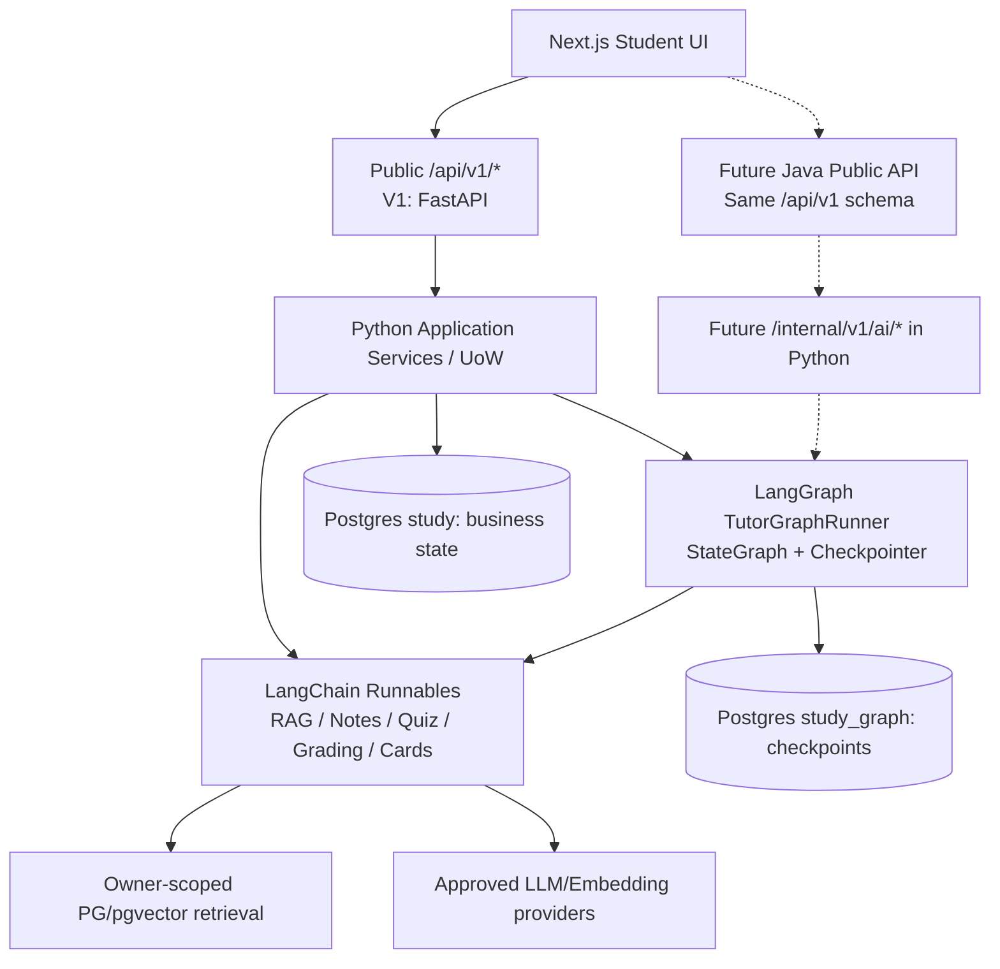
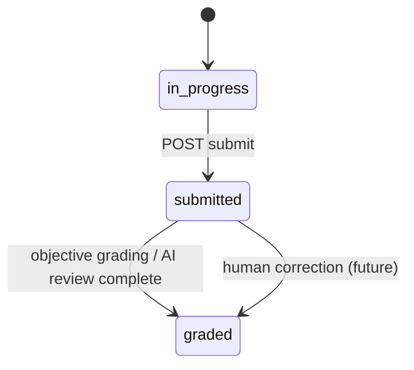
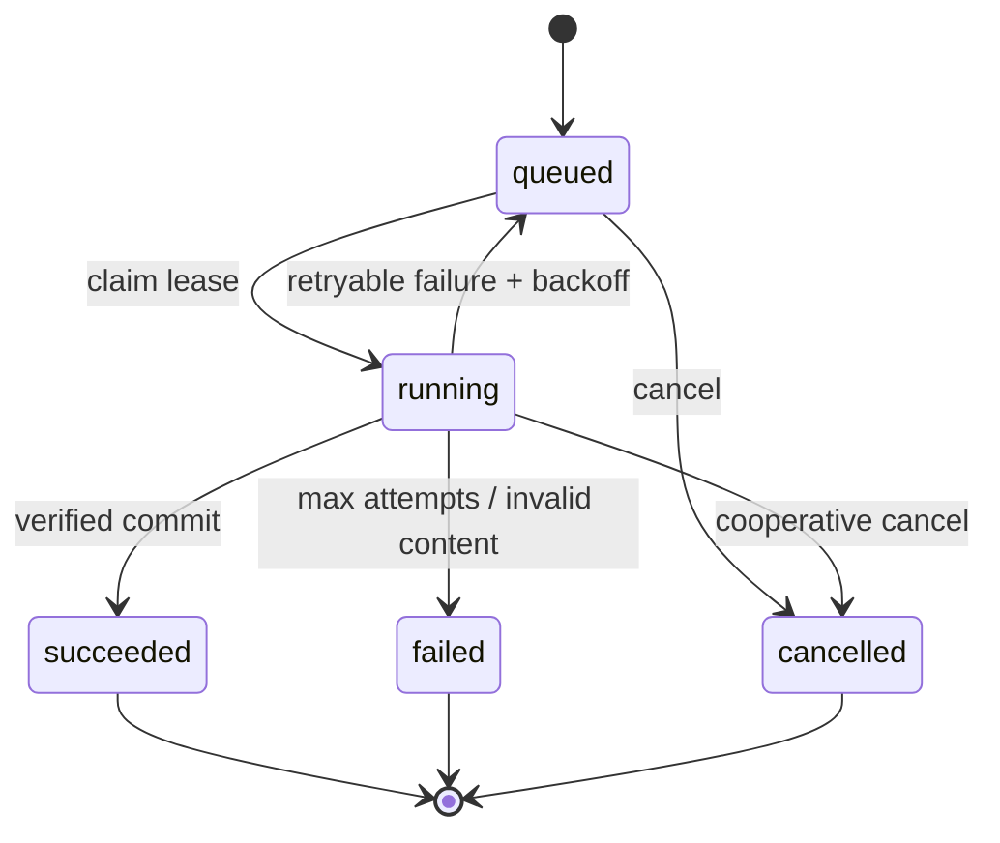
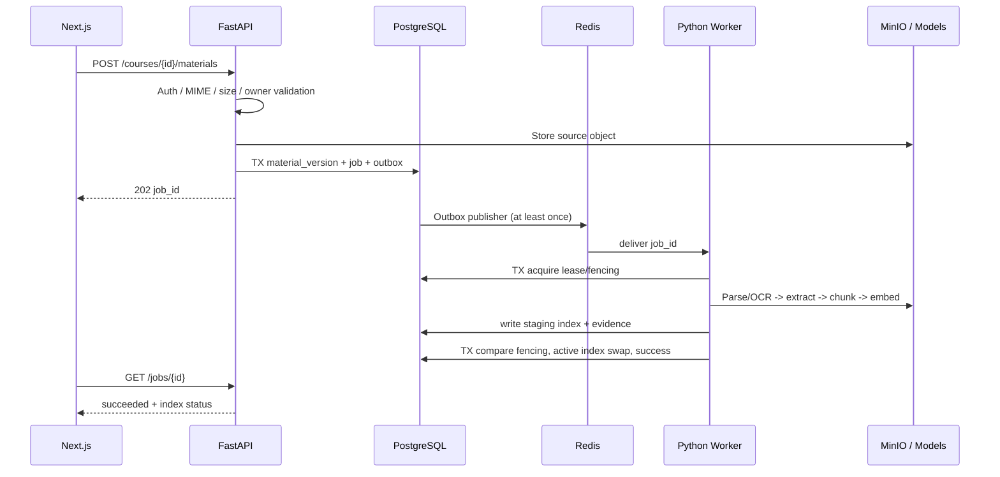
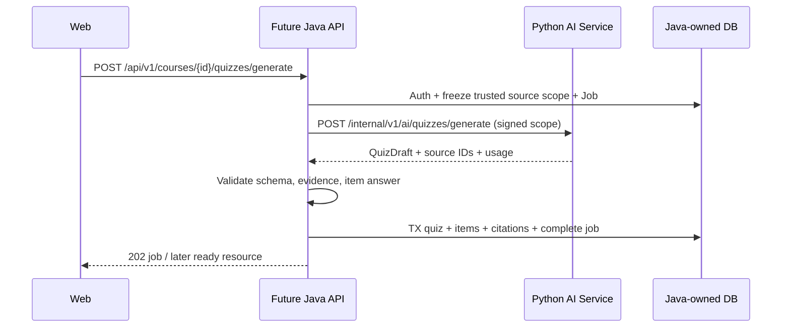

# API Design — AI Learning Platform

> **归档快照｜2026-11-14。** 本文保留当时的目标接口。现行接口见 [API 接入](../api-integration.md)。

> 版本：2.0 / LangChain + LangGraph 版设计草案　|　2026-11-14  
> **运行前提**：V1 仅部署 Python/FastAPI（内部集成 LangChain + LangGraph）。本文的“未来 Java 对外 API”与“Java↔Python 内部 API”是**预先冻结的目标兼容契约，不是 V1 需要上线的服务**。  
> 对应文档：[01 Architecture Design](01_Architecture_Design.md) · [02 Database Design](02_Database_Design.md)

## 0. API 分层、框架职责及版本策略



1. **V1 Python Public API**：只有 FastAPI 对外的 `/api/v1/*` 和必要的 health/SSE。Python 是用户/课程/资料/Quiz/学习记录、索引发布的**唯一业务写入方**。Java 不部署。
2. **AI Runtime**：LangChain 负责 RAG、Prompt、模型适配和 Pydantic 结构化草稿生成；LangGraph 负责 Tutor 的 `StateGraph` 节点/条件边、跨轮 checkpoint 与流式事件。它们**不是新服务**，也不会把内部 graph node 或 checkpoint_id 暴露为可调用的浏览器工具。
3. **未来 Java Public API**：Java J1 可以原样反代 `/api/v1/*`，仍由 Python 写业务数据；J2 逐模块接管事务写入，Java 实现**相同的外部字段和语义**。
4. **未来 Java↔Python Internal API**：J2 才启用 `/internal/v1/ai/*` 及 Java 的租约/受控回调接口。Python 此时可写自己的 `study_graph` 运行 checkpoint，但不能改写 Java 负责的学生成绩和业务主数据。
5. **版本三层分离**：Public API `/api/v1`、AI 输出 Schema（如 `quiz-generation-v1`）、Graph 定义 `graph_version=tutor-graph-v1`（影响 State/恢复），未来内部 `contract_version=study-ai-1.0`。任何不兼容修改必须有契约升级和回滚计划，不能直接加载旧 checkpoint。
6. **开源框架版本**：生产代码实际使用的 LangGraph stream API / checkpointer、LangChain `with_structured_output` 取决于锁定依赖；本 API 通过自己的 SSE 事件和 Pydantic DTO 屏蔽具体版本的差异。

官方实现依据：[LangChain 结构化输出](https://docs.langchain.com/oss/python/langchain/structured-output)、[LangGraph 状态检查点](https://docs.langchain.com/oss/python/langgraph/checkpointers)、[LangGraph 流式执行](https://docs.langchain.com/oss/python/langgraph/streaming)。

## 1. 通用协议与权限约定

### 1.1 传输与命名

- HTTPS + JSON UTF-8，JSON 属性 `snake_case`；ID 为 UUID 字符串；时间为 RFC 3339 时区时间；日期为 `YYYY-MM-DD`；不使用浮点数表示货币。
- 外部请求使用 `X-Request-ID`（可选，格式 `[A-Za-z0-9][A-Za-z0-9._:-]{0,127}`；不可信则服务器重建），服务器返回同名响应头用于追踪。
- 所有用户资源路径必须在当前认证用户下验证 owner，所有 `owner_user_id`、`scope_snapshot` 的可信部分由后端自己解析/冻结，客户端不能直接指定任意 owner 或内部向量范围。
- 资源不存在、被删或无权限统一返回 404；未认证返回 401；会话有效但操作不允许返回 403（仅对公开允许的能力操作，例如非管理员动作）。
- JSON 列表用 cursor：`?limit=20&cursor=...`，`limit=1..100`（默认 20）。排序固定 `created_at DESC,id DESC` 或资源明确排序；cursor 不透明且包含排序位置，不能当作授权条件。
- 创建/重试/提交以及 **Tutor turn** 等可能重复操作支持 `Idempotency-Key: <UUID>`；建议保留至少 72h。用户+动作+key+规范化请求哈希唯一；相同输入重放资源结果，不同输入返回 `409 IDEMPOTENCY_CONFLICT`。
- 用户提交的 Markdown/文件/OCR 文字不可信；接口使用明确的 schema、大小限制、格式检测、输出过滤。内容未获证据支持时必须明确标记，不允许 AI 自动补造教材事实。

### 1.2 认证与会话

**推荐 V1**：`/auth/login` 返回安全的 HttpOnly + Secure + SameSite=Lax 会话/刷新 cookie，由 Next.js 同源 BFF 转发；写请求由 CSRF 双重提交 token 或等价同源验证保护。对独立移动端可增加短期 Bearer Token，但必须明确其身份受众、scope 与过期，不把不同机制混用。密码使用 Argon2id，刷新 token 仅保存 SHA-256 hash，刷新旋转并撤销旧凭证。

外部路由不得直接信任 `X-User-ID`、`owner_user_id`、`scope_snapshot` 或任意 `object_key`。内部服务凭证绝不暴露到浏览器。

### 1.3 统一成功/失败响应

普通 GET / 业务提交返回业务对象；列表使用统一封装，异步命令统一 `202` + `job`。示例：

```json
{
  "data": [{"id":"00000000-0000-4000-8000-000000000101","name":"Calculus"}],
  "page": {"next_cursor":"opaque_cursor_or_null","has_more":false}
}
```

错误对象（适用于 HTTP 与 SSE 的 `error` event）：

```json
{
  "error": {
    "code":"MATERIAL_NOT_READY",
    "message":"The material is not ready for this operation.",
    "request_id":"req_01J_SAMPLE",
    "retryable":true,
    "details":{}
  }
}
```

| HTTP | 标准错误码（示例） | 处理 |
|---|---|---|
| 400 | `INVALID_REQUEST` | 结构/操作错误 |
| 401 | `UNAUTHENTICATED` | 重新登录/刷新 |
| 403 | `FORBIDDEN` | 合法身份但操作权限不足 |
| 404 | `RESOURCE_NOT_FOUND` | 不泄露他人资源存在性 |
| 409 | `IDEMPOTENCY_CONFLICT`, `INVALID_STATE`, `VERSION_CONFLICT` | 前端提示冲突、重新读取 |
| 413 | `UPLOAD_TOO_LARGE` | 文件超出服务端限制 |
| 415 | `UNSUPPORTED_MEDIA_TYPE` | 不支持格式 |
| 422 | `VALIDATION_ERROR`, `GENERATED_CONTENT_INVALID` | 字段或 AI 输出不满足 schema |
| 429 | `RATE_LIMITED`, `MODEL_QUOTA_EXCEEDED` | 返回 Retry-After（可选） |
| 502 | `PROVIDER_FAILURE` | 上游供应商错误 |
| 503 | `DEPENDENCY_UNAVAILABLE` | DB/存储/队列不可用 |
| 504 | `MODEL_TIMEOUT` | 调用超时 |

错误细节不能带出提示词、原文、对象 key、SQL、API Key、堆栈；`request_id` 用于日志关联，不是授权凭据。

## 2. V1 Python FastAPI 对外 REST API（完整首版端点清单）

标记：**P0** 基础，**P1** 核心学习，**P2** 个性化/增强。动态路由均在 `/api/v1` 下。

### 2.1 认证和个人资料

| 方法 | 路径 | 请求/用途 | 返回 | 优先级 |
|---|---|---|---|---|
| POST | `/auth/register` | `{email,password,display_name}` | `201 user`、建立 session | P0 |
| POST | `/auth/login` | `{email,password}` | `200 user`、Set-Cookie | P0 |
| POST | `/auth/refresh` | refresh cookie + CSRF | `200 session`, rotated cookie | P0 |
| POST | `/auth/logout` | 当前 session | `204` | P0 |
| GET | `/me` | 当前用户 | `200 user` | P0 |
| PATCH | `/me` | 昵称/语言/学习偏好 | `200 user` | P1 |
| DELETE | `/me` | 请求删除账户（异步） | `202 job` | P2 |

### 2.2 课程与知识点

| 方法 | 路径 | 请求/用途 | 返回 | 优先级 |
|---|---|---|---|---|
| POST | `/courses` | `{name,subject,description?,language?}` | `201 course` | P0 |
| GET | `/courses` | limit/cursor | `200 list` | P0 |
| GET | `/courses/{course_id}` | 课程详情 | `200 course` | P0 |
| PATCH | `/courses/{course_id}` | 名称/说明/设置 | `200 course` | P0 |
| DELETE | `/courses/{course_id}` | 软删除、异步清理 | `202 job` | P0 |
| GET | `/courses/{course_id}/knowledge-points` | 章节/知识点层级 | `200 list` | P1 |
| GET | `/knowledge-points/{id}` | 知识点详情及来源 | `200 point` | P1 |
| PATCH | `/knowledge-points/{id}` | 用户修正名称/描述/状态 | `200 point` | P2 |
| GET | `/courses/{course_id}/mastery` | 各知识点掌握度 | `200 list` | P2 |

### 2.3 资料、版本与文件引用

| 方法 | 路径 | 请求/用途 | 返回 | 优先级 |
|---|---|---|---|---|
| POST | `/courses/{course_id}/materials` | `multipart/form-data: file,title?,kind` | `202 {material_id,material_version_id,job}` | P0 |
| GET | `/courses/{course_id}/materials` | limit/cursor/status | `200 list` | P0 |
| GET | `/materials/{material_id}` | 含当前版本与索引状态 | `200 material` | P0 |
| POST | `/materials/{material_id}/versions` | multipart 新版本上传 | `202 job` | P0 |
| GET | `/materials/{material_id}/versions` | 历史版本 | `200 list` | P1 |
| GET | `/material-versions/{version_id}/sections` | 提取章节/定位 | `200 list` | P1 |
| GET | `/material-versions/{version_id}/questions` | 从试卷提取的题目 | `200 list` | P2 |
| GET | `/materials/{material_id}/file` | 授权后的流式原文件或短期签名 URL | `200/302` | P0 |
| POST | `/materials/{material_id}/reindex` | 重新索引当前版本 | `202 job` | P0 |
| DELETE | `/materials/{material_id}` | 逻辑删除+异步清理 | `202 job` | P0 |
| GET | `/sources/{citation_type}/{citation_id}` | 鉴权后读取页码/引用片段 | `200 source` / `404` | P1 |

**上传样例**：表单 `file=@chapter1.pdf`, `kind=notes`, `title=Chapter 1`，响应：

```json
{
  "material_id": "00000000-0000-4000-8000-000000000201",
  "material_version_id": "00000000-0000-4000-8000-000000000202",
  "job": {
    "id":"00000000-0000-4000-8000-000000000203",
    "type":"ingest","status":"queued","progress":0
  }
}
```

文件验证采用扩展名 + MIME sniffing + 限额 + 安全扫描；V1 初始上限建议 PDF 8MiB/200页，需针对扫描件需求独立压测后调整。**文件上传 accepted ≠ 文档已可检索**，只有 job succeeded 且 active index `ready` 时可发起来源范围的 RAG。

### 2.4 AI Tutor（SSE）

| 方法 | 路径 | 说明 | 返回 | 优先级 |
|---|---|---|---|---|
| POST | `/conversations` | `{course_id,title?,mode,material_ids?}` | `201 conversation` | P1 |
| GET | `/conversations` | course_id、分页 | `200 list` | P1 |
| GET | `/conversations/{id}` | 详情 | `200 conversation` | P1 |
| GET | `/conversations/{id}/messages` | 历史消息，分页 | `200 list` | P1 |
| POST | `/conversations/{id}/messages/stream` | `{content,mode?,material_ids?}` | `200 text/event-stream` | P1 |
| GET | `/conversations/{id}/turns/{run_id}` | 已鉴权 turn 状态与最终 message ID；**不返回 checkpoint 内容** | `200 run summary` | P1 |
| DELETE | `/conversations/{id}` | 软删除、安排 checkpoint 清理 | `204` | P1 |

**会话建立请求**：

```json
{
  "course_id":"00000000-0000-4000-8000-000000000101",
  "mode":"socratic",
  "material_ids":["00000000-0000-4000-8000-000000000201"]
}
```

**发消息请求**：

```json
{
  "content":"能一步步引导我理解链式法则吗？",
  "mode":"socratic",
  "material_ids":["00000000-0000-4000-8000-000000000201"]
}
```

- `material_ids` 是**选择提示**，服务端必须检查 owner、course、未删除、当前 READY index，再冻结 `scope_snapshot`；不可提交客户端构造的 `index_version_id`。
- 同一个会话可在发消息时更改引用材料，**每个 assistant 消息**必须记录实际采用的索引版本快照，防止上传新版本导致历史引用漂移。
- 同一会话中只能有一个正在生成的 assistant turn（V1），不允许顺序竞态或重放重复消息。

**SSE 事件规范**（LangGraph 运行内部事件→服务端 `sse_projector`→独立公共协议；`delta` 只是暂存文本，`completed` 才表示经过最终验证）：

```text
event: started
data: {"message_id":"00000000-0000-4000-8000-000000000311","workflow_run_id":"00000000-0000-4000-8000-000000000313","graph_version":"tutor-graph-v1","schema_version":"study-v1"}

event: phase
data: {"stage":"retrieving","workflow_run_id":"00000000-0000-4000-8000-000000000313"}

event: delta
data: {"text":"先想想复合函数的结构……"}

event: citations
data: {"sources":[{"citation_id":"00000000-0000-4000-8000-000000000312","material_id":"00000000-0000-4000-8000-000000000201","material_version_id":"00000000-0000-4000-8000-000000000202","index_version_id":"00000000-0000-4000-8000-000000000213","chunk_id":"00000000-0000-4000-8000-000000000214","page_number":3,"status":"available"}]}

event: completed
data: {"message_id":"00000000-0000-4000-8000-000000000311","status":"completed","workflow_status":"awaiting_student","graph_version":"tutor-graph-v1","answer":"先想想复合函数的结构……","usage":{"input_tokens":700,"output_tokens":120}}
```

失败时用 `event: error`（统一 `error` JSON），之后结束 SSE；不能继续发送 `completed`。客户端使用 `fetch()` 的 POST 流读取，不使用仅支持 GET 的原生 `EventSource` 直接提交 POST。断连可取消生成并记录 `failed/cancelled`，不能留无期限 `streaming`；服务重启时由恢复任务修复超时消息。`workflow_status=awaiting_student` 表示本轮消息已经成功发出、图的教学状态等待**下一条独立学生输入**；不能一直占着 Worker/HTTP 连接。Graph 的 checkpoint state 不允许从浏览器任意读取，也不代替 `messages` 的正式历史。

### 2.5 生成笔记

| 方法 | 路径 | 说明 | 返回 | 优先级 |
|---|---|---|---|---|
| POST | `/courses/{course_id}/notes/generate` | `{material_ids,note_type,title?}` | `202 job` | P1 |
| GET | `/courses/{course_id}/notes` | limit/cursor/type | `200 list` | P1 |
| GET | `/notes/{note_id}` | 笔记 Markdown + 引用 | `200 note` | P1 |
| PATCH | `/notes/{note_id}` | 用户编辑标题/内容（保留原 AI 生成版本） | `200 note` | P2 |
| DELETE | `/notes/{note_id}` | 删除 | `204` | P1 |

示例生成命令：

```json
{"material_ids":["00000000-0000-4000-8000-000000000201"],"note_type":"chapter_summary","title":"链式法则总结"}
```

生成服务对每个章节/Chunk 先做有来源的局部笔记，最后合成课程总结；`note_citations` 记录可验证来源，生成作业保存版本 profile。

### 2.6 Quiz、答题和批改

| 方法 | 路径 | 说明 | 返回 | 优先级 |
|---|---|---|---|---|
| POST | `/courses/{course_id}/quizzes/generate` | `{material_ids,knowledge_point_ids?,count,difficulty,item_types}` | `202 job` | P1 |
| GET | `/courses/{course_id}/quizzes` | 课程 Quiz 列表 | `200 list` | P1 |
| GET | `/quizzes/{quiz_id}` | 题干/选项；**未提交不暴露答案** | `200 quiz` | P1 |
| POST | `/quizzes/{quiz_id}/attempts` | 创建一次答题 | `201 attempt` | P1 |
| PUT | `/quiz-attempts/{attempt_id}/responses/{quiz_item_id}` | 保存/修改尚未提交的答案 | `200 response` | P1 |
| POST | `/quiz-attempts/{attempt_id}/submit` | 事务锁定并提交；简答题可能异步批改 | `200 graded` 或 `202 job` | P1 |
| GET | `/quiz-attempts/{attempt_id}` | 进度/得分/错误解析 | `200 attempt` | P1 |
| GET | `/wrong-questions` | course_id/status/cursor | `200 list` | P2 |
| PATCH | `/wrong-questions/{id}` | 更改复习状态 | `200 wrong_question` | P2 |

生成请求样例：

```json
{
  "material_ids":["00000000-0000-4000-8000-000000000201"],
  "knowledge_point_ids":[],
  "count":10,
  "difficulty":3,
  "item_types":["mcq","short_answer"]
}
```

`PUT` 保存答案示例：`{"answer":{"selected_option_ids":["B"]}}`；简答题：`{"answer":{"text":"..."}}`。前端只读的 `quiz_items` 不返回 `answer_key`、`rubric`（可返回评分说明摘要），提交并批改后允许读取标准答案和解释。

**评分状态**：



客观题使用后端确定性匹配；简答题使用固定 rubric 的结构化 LLM 输出，记录 `grader_profile` 和 `feedback`；低置信度返回 `requires_review=true`，不把该分数表述为权威考试结果。`learning_events` 和 `mastery_states` 在一个可重放事务/事件投影中同步处理，避免重复 submit 双计分。

### 2.7 闪卡、学习计划与报告

| 方法 | 路径 | 说明 | 返回 | 优先级 |
|---|---|---|---|---|
| POST | `/courses/{course_id}/flashcards/generate` | `{material_ids,count?,knowledge_point_ids?}` | `202 job` | P1 |
| GET | `/courses/{course_id}/flashcard-decks` | 卡组 | `200 list` | P1 |
| GET | `/flashcard-decks/{deck_id}/cards` | 卡片与复习计划 | `200 list` | P1 |
| GET | `/flashcards/due` | `course_id?,limit?` 需要复习的卡 | `200 list` | P1 |
| POST | `/flashcards/{card_id}/reviews` | `{rating}` + Idempotency-Key | `200 review + next_due_at` | P1 |
| POST | `/courses/{course_id}/study-plans/generate` | `{goal,end_date,minutes_per_day}` | `202 job` | P2 |
| GET | `/courses/{course_id}/study-plans` | 计划 | `200 list` | P2 |
| PATCH | `/study-plan-items/{item_id}` | `{status}` | `200 item` | P2 |
| GET | `/courses/{course_id}/analytics` | 活跃度、正确率、知识掌握度、到期闪卡 | `200 analytics` | P2 |

**闪卡复习返回**：

```json
{
  "review_id":"00000000-0000-4000-8000-000000000511",
  "card_id":"00000000-0000-4000-8000-000000000512",
  "rating":"good",
  "previous_interval_days":3,
  "new_interval_days":8,
  "next_due_at":"2026-11-22T10:00:00Z",
  "algorithm_version":"sm2-v1"
}
```

注意：具体 3→8 天仅是响应形状示例，真实数值由卡片当前 SM-2 状态和评分确定；`again/hard/good/easy` 映射 0..3 保存。一次 review 的计算/插入/状态更新必须单事务，重复请求返回同一结果，不再次推进到期日期。

### 2.8 异步任务与进度

| 方法 | 路径 | 说明 | 返回 | 优先级 |
|---|---|---|---|---|
| GET | `/jobs/{job_id}` | Job 最新状态/失败码/结果资源 ID | `200 job` | P0 |
| GET | `/jobs` | type/status/cursor | `200 list` | P0 |
| POST | `/jobs/{job_id}/cancel` | 协作取消（幂等） | `202 job` / `409 terminal` | P0 |
| POST | `/jobs/{job_id}/retry` | 可重试失败任务重新入队 | `202 job` | P1 |
| GET | `/health/live` | 进程存活，无业务私密信息 | `200` | P0 |
| GET | `/health/ready` | 数据库/必要依赖就绪 | `200/503` | P0 |

状态流转：



`POST /jobs/{id}/retry` 对 `failed` 创建**新 Job**并在结果里引用 `retry_of_job_id`（可加入 `ai_jobs.payload`，不篡改原任务审计历史）。所有异步业务请求需返回 `job.id` 与可查询资源 ID。

## 3. LangChain 结构化输出与 LangGraph 状态契约

对 Quiz/Notes/Flashcard/Grading，优先使用可用的 LangChain `model.with_structured_output(PydanticModel)` 或经过验证的同类结构化输出能力。如果具体 provider 不支持，使用固定 JSON/受限重试/严格 Parser fallback，并把生成结果当成**不可信草稿**。Pydantic 校验通过不代表题目事实正确；仍须来源、答案及业务规则校验。LangChain Runnable 不可直接持久化成绩、知识点掌握度和学习计划事实。

### 3.0 TutorGraphState（仅 Python 内部，不能作为 Public DTO）

```json
{
  "graph_version": "tutor-graph-v1",
  "run_id": "00000000-0000-4000-8000-000000000313",
  "conversation_id": "00000000-0000-4000-8000-000000000310",
  "course_id": "00000000-0000-4000-8000-000000000101",
  "user_message_id": "00000000-0000-4000-8000-000000000309",
  "teaching_mode": "socratic",
  "intent": "explain",
  "scoped_index_ids": ["00000000-0000-4000-8000-000000000213"],
  "evidence_chunk_ids": ["00000000-0000-4000-8000-000000000214"],
  "safe_history_summary": "学生正在练习链式法则，尚未掌握复合函数拆分。",
  "response_draft": "先告诉我 sin(x²) 的内层函数是什么？",
  "next_step": "awaiting_student"
}
```

`run_id` 关联 `ai_workflow_runs.id`；`conversation_id` 作为 server-side `thread_id` 派生依据；`scoped_index_ids` 必须由 Application Service 冻结、每次检索再验证；模型只建议 `intent` 和回复草稿，不得覆写可信范围。不可持久保存整篇文档正文、模型密钥、用户 token、标准答案。

**Graph 节点与终止条件**：`load_context → classify_intent → retrieve_evidence → evidence_guard → (normal/explain | socratic | exam | insufficient_evidence) → validate_response → commit_result`。其中最后的 `commit_result` **是 TutorService 在 Graph 返回后执行的业务事务**，不是 Graph 里可被自动重放的直接写入节点。每次请求有最大节点数、模型 token 数、超时和最多一次修复重试；不得形成无限循环。等待学生消息时结束当前 turn 并 checkpoint，下一请求再续跑。

以下是正式生成物的结构化输出实例；除 Pydantic/JSON Schema 外，还要做来源权限、答案正确性和业务不变量校验。

生产里必须强制结构化输出，不能直接相信模型返回的 Markdown。Schema 版本独立于 Public API 版本，所有枚举与数据表保持对应。下面以 JSON 示例而非未落地的代码体现结构。

### 3.1 文档提取与知识点

```json
{
  "schema_version":"extraction-v1",
  "material_version_id":"00000000-0000-4000-8000-000000000202",
  "sections":[{
    "ordinal":1,
    "heading":"导数",
    "level":1,
    "locator":{"kind":"pdf_page","page_number":3},
    "knowledge_points":[{
      "canonical_name":"链式法则",
      "description":"复合函数求导规则",
      "difficulty":3,
      "confidence":0.94,
      "evidence_chunk_ids":["00000000-0000-4000-8000-000000000214"]
    }]
  }],
  "extracted_questions":[{
    "ordinal":2,
    "question_type":"mcq",
    "stem":"...",
    "options":[{"id":"A","text":"..."}],
    "reference_answer":null,
    "locator":{"kind":"pdf_page","page_number":4},
    "confidence":0.88
  }]
}
```

要点：`evidence_chunk_ids` 必须属于本次允许索引快照；`locator` 由解析器验证或重建，不接受模型任意杜撰的页数；`reference_answer=null` 表示无法确认，不能猜测原题答案。

### 3.2 Quiz Generator

```json
{
  "schema_version":"quiz-generation-v1",
  "items":[{
    "item_type":"mcq",
    "stem":"函数 f(x)=sin(x²) 的导数是？",
    "options":[
      {"id":"A","text":"cos(x²)"},
      {"id":"B","text":"2x cos(x²)"},
      {"id":"C","text":"2x sin(x²)"}
    ],
    "answer_key":{"selected_option_ids":["B"]},
    "rubric":null,
    "explanation":"应用链式法则，外层求导乘内层导数。",
    "difficulty":2,
    "knowledge_point_id":"00000000-0000-4000-8000-000000000601",
    "source_chunk_ids":["00000000-0000-4000-8000-000000000214"],
    "confidence":0.95
  }]
}
```

验证规则：每题有非空 `source_chunk_ids`、选项 ID 唯一、`answer_key` 必在 options 范围内、`knowledge_point_id` 属于课程；模型 `confidence` 仅作参考，答案正确性需用规则/独立校验器（数学题可结合符号计算或二次验证）检查。未通过的题目不发布为 ready。

### 3.3 Grading / Flashcard / Note

**主观题评分输出**：

```json
{
  "schema_version":"grading-v1",
  "score":0.75,
  "max_score":1.0,
  "feedback":"思路正确，但少写了链式法则的内层导数。",
  "rubric_items":[{"criterion":"chain_rule","earned":0.75,"possible":1.0}],
  "confidence":0.81,
  "requires_review":false,
  "grader_profile":"deepseek-rubric-v1"
}
```

**Flashcard 输出**：

```json
{
  "schema_version":"flashcard-generation-v1",
  "cards":[{
    "front":"什么是链式法则？",
    "back":"对复合函数求导时，外层导数乘以内层导数。",
    "knowledge_point_id":"00000000-0000-4000-8000-000000000601",
    "source_chunk_ids":["00000000-0000-4000-8000-000000000214"]
  }]
}
```

**Note** 输出：`{schema_version,note_type,title,sections:[{heading,content_md,source_chunk_ids}],generator_profile,prompt_version}`；合成后写入 `notes` 与 `note_citations`，不允许未验证的 citations。模型仅建议笔记/评分；**掌握度算法与 SM-2 复习日期由 Python 确定性规则计算**。

## 4. V1 工作流和事务边界

### 4.1 学习资料上传与索引



原则：解析器/OCR 可以使用纯 Python/专用库，LangChain 对接 embedding、generation 与 Document metadata；对象文件上传成功但 DB 失败则定期清理孤儿对象；解析失败不发布 READY；重试同一个 Job 不重复创建相同语义的版本。`idx.is_active` 在 PG 事务内切换。

### 4.2 有引用的 AI Tutor

```mermaid
sequenceDiagram
  participant C as Client
  participant A as FastAPI Tutor
  participant DB as PostgreSQL
  participant L as Retrieval + LLM
  C->>A: POST /conversations/{id}/messages/stream
  A->>DB: verify owner + active source snapshots
  A->>DB: persist user message / streaming assistant placeholder
  A->>L: hybrid retrieve within trusted scope
  L-->>A: scoped evidence chunks
  A->>L: LangGraph TutorState -> LangChain grounded prompt
  L-->>C: provisional SSE delta via A
  A->>A: Pydantic/schema/citation guard; workflow_run version + status
  A->>DB: TX final message + citations + ai_workflow_runs status
  A-->>C: citations + completed
```

无证据时返回清晰的 `insufficient_evidence` 状态（也可生成不含资料事实的学习建议，但必须标识“未从上传资料验证”）；任何引用必须属于冻结 source scope。

### 4.3 Quiz、评分、掌握度


关键事务：提交 attempt 的 `in_progress→submitted`、响应锁定同一事务；评分结果落表和 `learning_events.event_key` 去重；mastery 投影可异步且可重放。AI 超时不能让 attempt 静默“已评分”。

### 4.3.1 LangGraph Tutor turn 状态、恢复与双写隔离

```mermaid
sequenceDiagram
  participant Web as Next.js
  participant API as FastAPI TutorService
  participant PG as study schema
  participant Graph as LangGraph TutorGraph
  participant CP as study_graph checkpoints
  participant Chain as LangChain RAG / LLM
  Web->>API: POST /conversations/id/messages/stream + Idempotency-Key
  API->>PG: Auth + lock conversation + freeze READY scope + create run
  API->>Graph: input + server thread_id + graph_version
  Graph->>CP: load prior checkpoint
  Graph->>Chain: classify / scoped retrieval / generate
  Chain-->>Graph: evidence IDs + provisional answer
  Graph->>CP: save stage checkpoint
  Graph-->>API: stream events + final draft
  API->>API: validate scope / citations / schema
  API->>PG: TX upsert final assistant message + citations; complete run
  API-->>Web: citations + completed
```

业务与 checkpoint 是**两个持久化域**，没有跨域原子提交假设。每个 `run_id` 仅允许一个 assistant 最终答案（DB 唯一约束 + 锁）；即使 graph 最后一个节点被重放，也不得重复收费或重复写学生学习记录。失败事件 `error` 之后不发送 `completed`；`GET /conversations/{id}/turns/{run_id}` 用于断线后查已经持久化的结果，而不是对浏览器开放 checkpoint 重放权限。源码版本不兼容或 checkpoint 丢失必须返回明确错误，不能静默从空状态生成看似连续的教学结论。

### 4.4 资源失效与来源权限

任何 `GET /sources/{citation_type}/{citation_id}`（`citation_type=message|note|quiz_item|flashcard`）必须重新检查当前用户、资料/课程状态、对应 material/index 版本留存和 visibility。已删除源仅返回 `404` 或可见但无原文的状态对象（建议统一 `404` 以减少信息泄露），不提供 quote/locator/文件代理。

## 5. 建议的 FastAPI Python Router 与 Service 映射

```text
study_platform/
├── api/v1/
│   ├── auth.py, me.py, courses.py, materials.py, knowledge.py
│   ├── conversations.py, notes.py, quizzes.py, attempts.py
│   ├── flashcards.py, learning.py, jobs.py, sources.py
│   └── health.py
├── ai/
│   ├── chains/grounded_answer.py, summary.py, quiz.py, flashcard.py, grading.py
│   ├── graphs/tutor_state.py, tutor_graph.py, tutor_runner.py
│   ├── retrieval/scoped_retriever.py, hybrid.py, evidence_guard.py
│   ├── workflow_runtime/checkpoints.py, run_store.py, sse_projector.py
│   └── schemas/quiz.py, grading.py, tutor.py
├── modules/
│   ├── auth/service.py
│   ├── courses/service.py
│   ├── materials/service.py
│   ├── ingestion/service.py
│   ├── retrieval/service.py
│   ├── tutor/service.py
│   ├── notes/service.py
│   ├── quizzes/service.py
│   ├── flashcards/service.py
│   ├── learning/service.py
│   └── jobs/service.py
└── persistence/repositories/
```

Controller/Router 只做 HTTP 参数解析与身份注入；`service` 负责业务状态、幂等和事务；`repository` 负责 owner-scoped SQL；Graph 的 checkpointer 不能允许由前端输入任意 thread_id；AI Provider 接口不能直接读取用户 session cookie、也不能决定谁能查哪个课程。

## 6. 未来 Java 对外 API 兼容契约

**目标**：将来如果新增 Java Spring Boot，**不需要前端改变 URL、字段、SSE 行为**。

| Python V1 对外 API 分组 | 未来 Java Controller 名称建议 | 保持不变的契约 |
|---|---|---|
| `/api/v1/auth/*`, `/api/v1/me` | `AuthController`, `ProfileController` | cookie/token 安全、user DTO、401/403 |
| `/api/v1/courses/*` | `CourseController` | Course DTO、owner 隔离、分页/软删除 |
| `/api/v1/materials/*` | `MaterialController` | 上传 202 + job、文件代理、版本状态 |
| `/api/v1/conversations/*` | `TutorController` | SSE 事件名/顺序/引用校验 |
| `/api/v1/notes/*` | `NoteController` | Note DTO、source citations |
| `/api/v1/quizzes/*`, `/quiz-attempts/*` | `QuizController`, `AttemptController` | 题目答案发布策略、评分状态 |
| `/api/v1/flashcards/*` | `FlashcardController` | 复习幂等/日期/算法版本 |
| `/api/v1/jobs/*` | `AiJobController` | job status、fencing/取消/重试语义 |
| `/api/v1/courses/{id}/analytics` | `LearningAnalyticsController` | mastery/统计口径版本 |

**LangGraph/J1 约束**：J1 Java 只负责代理和鉴权入口的请求处理，不管理 LangGraph checkpoint，不写 `study.ai_workflow_runs` 或最终消息；Python 仍是唯一业务/Graph 写入者。前端甚至不需要知道 AI 框架。

**J1 最小接入模式**：Java 作为 TLS/BFF/反向代理层，持有对客户端入口，但将 token/cookie 和用户上下文安全转发给 Python，由 Python 继续验证身份并唯一写库；Java 不复制业务写入。这个阶段 Java→Python 使用内网受保护的**原 `/api/v1`**，新 AI 内部协议还不是必须的。

**J2 业务拆分模式**：将某个业务（如 Auth/Courses/Materials）整体迁到 Java，Java 才成为对应实体唯一写入方；Python 只提供 AI 计算/只读授权快照。迁移要有明确 writer switch、契约测试与回滚窗口。**不允许 Java/Python 同时修改同一业务对象的状态**。

### 6.1 Java 兼容性测试门槛

- 由 OpenAPI 自动生成 Pydantic/Java DTO 兼容测试；同一请求样例在 Java/Python 返回相同的核心 JSON schema、HTTP status、错误码、分页参数。
- SSE `started → delta* → citations? → completed|error` 同序；Java 反代必须保证 flush/no buffering、客户端断连可取消下游。
- Java 登录/刷新/CSRF 的语义与原 Python 客户端兼容，不能仅“字段一致”就绕过 token session 轮换。
- 生产切流前必须完成每个表**唯一写入者**确认，并验证跨服务 outbox/幂等和来源权限。

## 7. 未来 Java↔Python 内部通信 API（J2 目标设计）

这一节**只供未来实施参考**；V1 没有 Java 服务，也不会创建这些内部端点。假设未来：Java 拥有选定业务表/索引发布写入，Python 仅做解析、Embedding、检索、教学生成、评分等 AI 计算，并独占 LangGraph checkpoint 的运行时写入；**Java** 负责正式消息、Quiz、成绩、来源引用和索引发布的业务事务。内部 API 不接受浏览器直接调用。

### 7.1 安全和通用 Header

- `Authorization: Bearer <short-lived-service-token>`，生产首选 mTLS + 工作负载身份；`X-Request-ID`、`X-Contract-Version: study-ai-1.0`、`X-Idempotency-Key`、短期 `X-Request-Timestamp` 与 nonce；支持超时/取消传播。
- Java 从已认证的业务主体生成 `trusted_scope`（owner、course、允许的 material/content/index IDs、token 有效期）并附加**签名的范围断言**。Python 验证签名、有效期、audience、源索引集合，不接受未经签名的 owner 字段。
- 如果内部传递 source file：只允许 Java 生成的短期、受约束 MinIO 下载令牌/受控文件代理；Python 不能根据任意传入 URL 发起下载，以免 SSRF。
- 任意内部输入 `user_id` 仅用于追踪，权限来自 Java scope token；Python 不持有 Java 写库密码。结果中必须携带 `source_ids`, `source_version`, `model_profile`, `prompt_version`, `usage`、错误码。
- 内部 Tutor 使用 `run_id` + `thread_id` + `graph_version` + 签名 scope；Java 在受控事务中为每个 turn 分配 `run_id` 并跟踪 `idempotency_key`，Python 只负责 Graph checkpoint 和 AI 草稿。`thread_id` 应由 Java 从已授权 conversation ID 派生，不由用户直接指定；同一个 conversation 的 Graph/checkpoint 不能同时被多个 run 并发写入。
- 内部任务执行使用 `job_id + lease_id + fencing` 三元组；fencing/数据库状态由唯一写入方 Java 判定，不能只靠 Bearer secret。

### 7.2 Java → Python AI Engine

| 方法 | Python 内部路径 | 输入 | 输出 | 语义 |
|---|---|---|---|---|
| GET | `/internal/v1/health` | service auth | `{status,contract_version,model_profiles}` | 内部健康 |
| POST | `/internal/v1/ai/ingestions` | lease、可信对象引用、parser/index profile | `202 execution_id` | 启动异步解析/索引计算 |
| POST | `/internal/v1/ai/retrieval` | trusted_scope、query、top_k | evidence list + versions | 有边界检索，不写数据 |
| POST | `/internal/v1/ai/tutor/turns` | signed scope、server-verified `thread_id`、`graph_version`、mode、history summary、query、run_id | `TutorDraft + candidate citations + next_step + usage + checkpoint_ref` | LangGraph 可恢复的同步单轮草稿；不写 Java 业务表 |
| POST | `/internal/v1/ai/tutor/answers` | mode、history window、scope、query | answer+citations+usage | 兼容型单轮非流式（可内部委托 `/turns`） |
| POST | `/internal/v1/ai/tutor/turns/stream` | 同 `/turns` + `X-Internal-Run-ID` | Internal SSE phases/tokens/draft/evidence/end | LangGraph streaming；Java 必须复核并转为 Public SSE |
| POST | `/internal/v1/ai/tutor/answers/stream` | 同旧调用语义 | Internal SSE | 兼容桥接，J2 可弃用 |
| POST | `/internal/v1/ai/notes/generate` | scope、note_type、profile | structured NoteDraft | 仅返回草稿 |
| POST | `/internal/v1/ai/quizzes/generate` | scope、item_types、count、difficulty | QuizDraft JSON | 仅返回草稿/引用 |
| POST | `/internal/v1/ai/grades/evaluate` | item+rubric+student_answer | ScoreDraft | 不写用户成绩 |
| POST | `/internal/v1/ai/flashcards/generate` | scope、count | FlashcardDraft list | 不推进复习日程 |
| POST | `/internal/v1/ai/index-executions/{id}/cancel` | lease_id、fencing | 202 ack | 协作取消计算 |

`QuizDraft`, `ScoreDraft`, `FlashcardDraft` 的字段同第 3 节 AI Schema；Java 必须再次对用户/来源、结构化输出、题目正确性验收后落表，不能仅相信 Python 结果。

### 7.3 Python → Java 内部回调（J2）

| 方法 | Java 内部路径 | 输入 | 语义 |
|---|---|---|---|
| POST | `/internal/v1/indexing/leases/{lease_id}/heartbeat` | job_id、lease_id、fencing、progress | 续租；过期/旧代次返回 409 |
| POST | `/internal/v1/indexing/leases/{lease_id}/batches` | batch_id、sequence、manifest_sha256、chunk/embedding batch | Java 按租约/向量维度/内容版本受控写入 |
| POST | `/internal/v1/indexing/leases/{lease_id}/complete` | job_id、fencing、counts、final manifest | Java 核验原子 READY 发布 |
| POST | `/internal/v1/indexing/leases/{lease_id}/fail` | fixed failure_code、retryable、usage | Java 决定失败/退避/重试 |
| GET | `/internal/v1/source-objects/{source_token}` | Java 签发的短期只读凭据 | 受控文件读取（或预签名对象） |

重复 batch 必须根据 `(job_id,lease_id,batch_id,hash)` 幂等；相同 id 不同内容 409。`complete` 校验 batch manifest、counts、模型 identity、活动 version、fencing/lease 有效性，再在一个数据库事务中切换 READY。Java 拥有 DB 写入，Python 不写 Java 管理的业务数据。

### 7.4 未来内部请求示例

**Java → Python quiz 草稿**：

```json
{
  "contract_version":"study-ai-1.0",
  "request_id":"req_01J_SAMPLE",
  "trusted_scope":{
    "scope_token":"SIGNED_SHORT_LIVED_SCOPE_ASSERTION",
    "course_id":"00000000-0000-4000-8000-000000000101",
    "allowed_sources":[{
      "material_version_id":"00000000-0000-4000-8000-000000000202",
      "index_version_id":"00000000-0000-4000-8000-000000000213"
    }]
  },
  "generation":{"count":10,"difficulty":3,"item_types":["mcq","short_answer"]},
  "model_profile":"quiz-default-v1"
}
```

响应：

```json
{
  "contract_version":"study-ai-1.0",
  "request_id":"req_01J_SAMPLE",
  "status":"succeeded",
  "result_schema_version":"quiz-generation-v1",
  "items":[{"item_type":"mcq","stem":"...","options":[{"id":"A","text":"..."}],"answer_key":{"selected_option_ids":["A"]},"source_chunk_ids":["00000000-0000-4000-8000-000000000214"],"confidence":0.87}],
  "usage":{"input_tokens":1250,"output_tokens":600},
  "model_profile":"quiz-default-v1"
}
```

上述请求里的 `scope_token` 仅为形状示例，不是真实凭证；未来必须由服务端签发验证，不允许前端直接传入。

### 7.4.1 Java→Python LangGraph Tutor turn 请求（J2）

```json
{
  "contract_version": "study-ai-1.0",
  "run_id": "00000000-0000-4000-8000-000000000313",
  "graph_version": "tutor-graph-v1",
  "thread_id": "tutor:00000000-0000-4000-8000-000000000310",
  "trusted_scope": {
    "scope_token": "SIGNED_SHORT_LIVED_SCOPE_ASSERTION",
    "course_id": "00000000-0000-4000-8000-000000000101",
    "allowed_sources": [{"material_version_id": "00000000-0000-4000-8000-000000000202", "index_version_id": "00000000-0000-4000-8000-000000000213"}]
  },
  "teaching_mode": "socratic",
  "user_message": "链式法则怎么理解？",
  "history_summary": "学生此前在练习复合函数。",
  "limits": {"max_graph_steps": 8, "max_tokens": 2000, "timeout_seconds": 30}
}
```

Python 验证服务身份、scope 签名、版本、来源归属和 run_id 幂等，再运行 LangGraph 并返回 `TutorDraft`、`source_chunk_ids`、`next_step=awaiting_student|complete`、`checkpoint_ref`（仅服务端可见）。Java 校验答复，落库后发送外部 `completed`。**Graph checkpoint 成功 ≠ Java 业务消息已提交**；因跨服务断线需通过 `run_id` 查询/重放已验证的草稿（受签名作用域约束），不能再次向学生写入第二条答案。不同版本 graph schema 必须拒绝不兼容恢复。

### 7.5 未来 Java 接管事务的顺序



长时生成应在内部 job/work queue 中执行；上面是逻辑顺序，不要求 HTTP 请求一直保持打开。

## 8. 错误恢复、可靠性与限额细节

- **模型超时**：同步 Tutor 超时发送 SSE `error`，保留失败状态；异步 `ai_jobs` 按政策重试。题目批改失败停留 `submitted`，不谎称 `graded`。
- **过期版本**：课程选材检查 READY snapshot；生成期间新上传不改变已冻结范围；旧版本来源被清理时最终返回来源 `unavailable`。
- **并发**：同一个 quiz attempt `submit` 用数据库行锁确保一次性；Flashcard reviews 用 idempotency key 锁；source index publish 比较 `fencing`。
- **安全与限额**：每分钟登录次数、用户并发聊天数、课程资料量、单任务模型 tokens、OCR 页数、生成 Quiz 数量设置配置化上限；错误返回固定 `RATE_LIMITED`/`MODEL_QUOTA_EXCEEDED`。
- **模型安全**：资料内容对提示词具有攻击性可能性，retriever 结果只作为 data，不作为 system/developer 指令；过滤来源引用与模型输出工具调用。
- **观测**：`request_id`, `job_id`, `trace_id`, `model_profile`, `latency`, `tokens`, `estimated_cost`；日志不得记录密码、Token、文档全文与学生主观答案。

## 9. 接口验收清单与开发顺序

| 里程碑 | 必须通过的契约/功能测试 |
|---|---|
| M0 Python 独立 | 关闭 Java 服务后 auth/course/upload/jobs 可运行；Python DB 事务写入；Alembic 从空库安装 |
| M1 RAG | 资料 READY 才可引用；LangChain RAG 和 LangGraph Tutor 各模式；SSE projector 帧序；checkpoint 续跑、重试不双发、跨用户/旧索引/源删除不泄露数据 |
| M2 Study | LangChain Notes/Quiz/Flashcard/Grading 结构化输出；无 provider 支持时受控回退；选择题确定性校验；提交重复不双计分 |
| M3 Learning | Review 幂等、SM-2 可重算、wrongbook/mastery/plan 有行为事件来源 |
| M4 安全/质量 | 文件/模型资源限额、OCR 评测、真实模型准确性与费用指标、E2E 浏览器测试 |
| J1（未来） | Java 实现同一 Public OpenAPI，前端无修改；用户登录和 SSE 契约一致 |
| J2（未来） | Java/Python 内部 Scope 签名、lease/fencing、单写责任、故障补偿与回滚经过测试 |

### 需要正式落实的契约文件（本设计未生成代码）

1. `contracts/study-v1/openapi.yaml`：上述 Public API 的完整 OpenAPI 3.1、枚举、鉴权与 error schema。
2. `contracts/study-v1/schemas/ai-extraction-v1.json`、`ai-quiz-v1.json`、`ai-grading-v1.json`、`ai-flashcard-v1.json`：强校验 AI 输出。
3. `contracts/study-v1/schemas/tutor-graph-state-v1.json`、`tutor-sse-events-v1.json`、`workflow-run-v1.json`：**V1** 明确状态、流式协议及版本不兼容策略（Graph State 是内部状态，非 Public DTO）。
4. `contracts/study-v1/schemas/internal-ai-v1.json`：J2 时再实现并单独审批，不作为 V1 runtime dependency。
5. `contracts/study-v1/examples/`：golden fixtures + Python/TypeScript/未来 Java 契约测试。

**LangChain / LangGraph 契约测试**：Mock `RetrieverPort` 与 deterministic model 能精确验证所有 Graph 路由（有/无依据、Socratic、Exam）、checkpoint 续跑/恢复、node 重试不产生双写、schema 验证与 SSE projector。真实 provider 的 tool calling、structured-output、stream events 和成本必须额外独立测试。

**核心交付原则**：第一版只能有一个写入权威（Python），第二版引入 Java 只是在同一外部契约之下转移或代理职责。外部接口、数据库实体与 AI 工作流在此设计中相互对应，而不是三个互不关联的独立方案。
