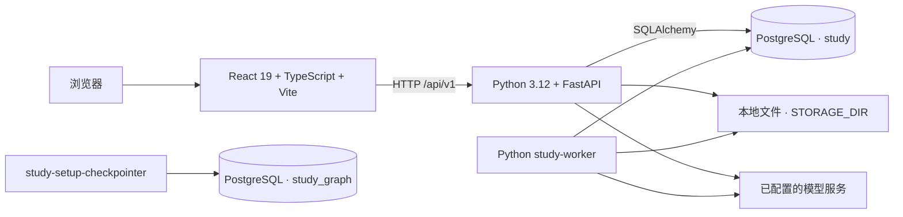

# 当前架构

更新于 2026-11-21，依据仓库源码和配置。

## 当前源码结构

前端使用 React 19、TypeScript 与 Vite。开发服务器将 `/api` 代理到 FastAPI，生产环境需配置 API 代理和 SPA 路由回退。

FastAPI 使用 Python 3.12，公开路由位于 `/api/v1`。SQLAlchemy 访问 PostgreSQL，Alembic 管理业务 schema。

PostgreSQL 的 `study` schema 保存账户、知识库、资料、会话、引用和学习记录等应用数据，pgvector 保存向量。

原始资料和派生文件保存在本地 `STORAGE_DIR`，默认路径为仓库下 `.local/storage`。

独立 Python `study-worker` 从 PostgreSQL 的 `ai_jobs` 领取索引与生成任务。PostgreSQL 保存任务状态、重试、租约和 fencing token。

聊天通过 `langchain-openai` 的 `ChatOpenAI` 适配。Embedding 和视觉模型通过 OpenAI SDK 调用兼容 API，Rerank 使用兼容的 HTTP `/rerank` 接口。服务端支持默认模型连接和用户配置的连接。

单独的 `study-setup-checkpointer` 命令在 `study_graph` 初始化 LangGraph 的表。应用的问答流程通过 LangChain 调用模型，并在 `study` 保存轮次。Tutor `StateGraph` 执行流仍属于归档设计。

## 归档设计

Java 兼容方案、Next.js、Redis 和 MinIO 等历史设计见以下快照。数据库和 API 的现行契约见 [数据库规则](../database-rules.md) 与 [API 接入](../api-integration.md)。

- [01 架构设计（归档）](01_Architecture_Design.md)
- [02 数据库设计（归档）](02_Database_Design.md)
- [03 API 设计（归档）](03_API_Design.md)

产品目标见[首页与聊天工作区需求](../product/homepage-requirements.md)，本地问答链路的历史实测范围见[本地 RAG 验收](../verification-local-rag.md)。
