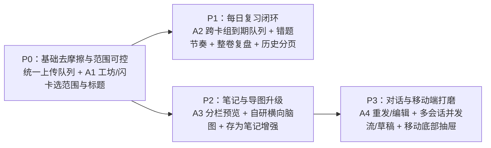

# 维度 A：高频日常体验打磨需求规格与推进计划

> 状态：需求已确认，待按批次实现｜2026-11-20  
> 基线：`codex` 分支（`a6b3b21`）  
> 适用范围：个人多库知识工作台（知循 · KnowLoop / Synapse）日常高频体验闭环（A1–A4）  
> 参考红线：[产品定位与路线图](product-positioning-and-roadmap.md) · [学习功能确认记录](learning-grilling.md) · [AGENTS.md](../../AGENTS.md)

---

## 1. 背景与目标

截至 `a6b3b21`，知循已完整具备资料接入、单库/指定资料范围问答、NotebookLM 风格知识工坊、SM-2 闪卡、学习闭环 2.0、混合检索命中测试与全站搜索等核心骨架。但在高频日常使用中，仍存在一批“底层能力已就绪、前端交互或收尾链路差最后 20%”的体验断层：

- **A1（知识工坊与闪卡选范围 + 自定义标题）**：后端已支持 `material_ids` 与 `title`，但前端写死全库生成与默认标题。
- **A2（SM-2 闪卡与错题本每日复习节奏）**：后端已有 SM-2 与 `WrongQuestion.next_review_at` 列，但缺少跨卡组到期队列、首页/学习页今日待复习入口、键盘盲操、整卷复盘与历史分页。
- **A3（笔记分栏实时预览 + 导图可视化 + 聊天无缝沉淀）**：笔记编辑为纯文本框、`mindmap` 仅按普通列表显示、聊天「存为笔记」无法编辑标题/追加到已有笔记/保存后直达查看。
- **A4（对话、上传队列与移动端交互去摩擦）**：上传队列双实例割裂、切换会话丢草稿与单流阻塞、已完成回答无重新生成/提问无编辑重发、移动端引用面板堆叠在 `100dvh` 底部。

**核心目标**：在不修改核心数据库表结构（**零 Alembic 迁移**）、不突破产品定位红线的前提下，将维度 A 拆分为 **4 个低耦合、可独立验收与提交的迭代批次（P0 → P1 → P2 → P3）**，系统性打磨高频使用体验。

---

## 2. 边界约束与明确不做

### 必须坚守的产品与工程边界
1. **定位红线**：保持个人多库知识工作台定位；练习整卷复盘仅呈现三态（正确 / 错误 / 待确认）分布与错题重练入口，**不做百分制打分、排行榜或考试倒计时**。
2. **可信与隔离红线**：对话每轮仍严格限定单个知识库；重新生成、编辑重发与追加笔记合并引用时，必须保持防篡改引用快照语义，绝不混入跨库来源。
3. **零数据库迁移**：复用既有 `study` schema（含 `wrong_questions.next_review_at`、`flashcards.due_at`、`notes` / `note_citations`、`ai_workflow_runs.fencing`），不触碰 `study_graph`。
4. **前端组件与动效约束**：优先使用 `frontend/src/components/arc/` 下的 UI Arc 组件（`Dialog`、`Button`、`Input`、`Textarea`、`Select`、`DropdownMenu`、`EmptyState`、`Tooltip`）；保留首页轨道、`ThinkingOrb` 与 `metal-fx` 动效，仅在 `prefers-reduced-motion` 下退化。

### 明确不做（Out of Scope）
- 对话树形多版本分支（如 `< 1/2 >` 历史分支树）或截断式删除中间任意轮次。
- 引入重体积图谱渲染库（如 `mermaid`）或修改后端 `mindmap` 提示词为 Mermaid 语法。
- 为错题本新增独立 SM-2 因子表（复用既有 `next_review_at` 与 `status` 即可）。
- 网页 URL 剪藏、PPTX 解析、Rerank 模型与原文对照大阅读器（属于维度 B / C，另行立项）。

---

## 3. 已确认设计决策（Q1–Q8）

| 编号 | 决策主题 | 确认结论 | 关键依据 |
| --- | --- | --- | --- |
| **Q1** | 纳入范围与排期策略 | 全部纳入 A1–A4，拆分为 **P0 → P1 → P2 → P3** 四个可独立验收批次 | 先统合上传状态与补齐零后端改动项，再依次推进复习节奏、笔记导图、对话并发与移动端 |
| **Q2** | A1 选资料与自定义标题交互 | 知识工坊点生成后弹轻量配置 `Dialog`（默认全库、可勾选已就绪资料、自定义标题，闪卡可选张数）；闪卡页采用与「练习出题」一致的内联资料勾选区 + 标题输入 | 保持工坊操作栏清爽，同时让学习页内两个 Tab 的生成体验一致 |
| **Q3** | A2 错题调度与首页入口 | 零迁移启用 `WrongQuestion.next_review_at`：`open` 立即待重练；重练答对进入 `reviewing` 推后 3 天，再次答对推后 7 天（随时可标 `mastered`）；首页右侧「资料概况」与「学习」页顶部统一展示「今日待复习闪卡 + 待重练错题」入口 | `wrong_questions.next_review_at` 列已存在，零迁移即可跑通每日节奏 |
| **Q4** | A2 闪卡队列与练习复盘 | 跨卡组「今日到期队列」+ 单卡组到期优先（刷完可切换重温全部）+ `Space`/`1-4` 快捷键 + 本轮掌握分布与「重刷生疏卡」+ 卡背「去对话追问」；练习页答完展示三态整卷复盘 + 历史练习「加载更多」分页 | 真正发挥 SM-2 算法价值，同时补齐学习闭环收尾体验 |
| **Q5** | A3 知识导图可视化方案 | 自研轻量交互式横向脑图组件（零重依赖）：直接解析现有「知识层级树」Markdown 列表，支持缩放/平移、折叠展开、节点内 `[S#]` 引用点击查原文，支持「脑图 / 原文」切换 | 后端 `mindmap` 产物为带 `[S#]` 引用的多层无序列表，自研方案 100% 兼容历史导图且原生支持引用核对 |
| **Q6** | A3 笔记编辑与聊天存为笔记 | 对话页「存为笔记」弹轻量 `Dialog`（可编辑标题、切换「新建 / 追加到本库已有笔记并合并引用」），保存后 Toast 附带「查看笔记」一键跳转；笔记编辑采用宽幅 `Dialog` 支持「编辑 / 分栏实时预览 / 预览」三态（移动端自动单栏切换） | 复用 `/knowledge?id=...&note=...` 路由，打通“对话 → 沉淀 → 编辑”闭环 |
| **Q7** | A4 重新生成与编辑重发语义 | 安全线性语义（零迁移）：①「重新生成」放宽末轮 `retry` 允许 `completed` 态原位重跑；②「编辑重发」支持末轮用户消息原位编辑重跑，任意历史用户消息支持“编辑后作为新提问发送”（回填内容与原知识库/资料范围到输入框，不破坏后续历史） | 仅 `message_citations` 外键指向 `messages`，既保留历史完整性又满足高频改写诉求 |
| **Q8** | A4 并发流、草稿与移动端引用 | `useChat` 按 `conversationId` 隔离并发流（同会话串行、跨会话并发）；按 `userId + conversationId` 持久化草稿与勾选资料范围（`sessionStorage`，登出清空）；移动端（`<=760px`）引用改为底部抽屉 | 消除切会话打断/丢草稿与手机端查看引用需划屏整页的核心痛点 |

---

## 4. 四阶段推进总览



| 批次 | 覆盖项 | 后端改动量 | 前端改动量 | 独立交付价值 |
| --- | --- | --- | --- | --- |
| **P0** | A4（统一上传队列）+ A1（工坊/闪卡选资料与标题） | 无（复用既有接口） | 中小 | 跨页上传进度不再丢失；工坊与闪卡可精准按选定文档生成并自定义命名 |
| **P1** | A2（闪卡到期队列/快捷键/复盘/追问 + 错题 `next_review_at` + 首页概览入口 + 练习整卷复盘/历史分页） | 中（2 个新/扩展查询 + 错题调度逻辑） | 中 | 首页与学习页形成每日复习节拍，闪卡可键盘盲操，练习闭环完整 |
| **P2** | A3（笔记分栏实时预览 + 自研横向脑图 + 聊天存为笔记弹窗/追加合并引用/Toast 跳转） | 小（1 个追加笔记接口） | 中偏大 | 写公式/Markdown 可实时预览，知识导图可读可交互，对话结论无缝沉淀 |
| **P3** | A4（末轮重新生成/编辑重发 + 历史提问回填重发 + 多会话并发流 + 草稿持久化 + 移动端引用底部抽屉） | 小（放宽 `retry` + 新增末轮 `edit`） | 中偏大 | 多会话并行提问不阻塞不丢草稿，手机端引用就地核对 |

---

## 5. 分批次详细规格

---

### 批次 P0：统一上传队列 + A1 工坊/闪卡选范围与自定义标题

#### 5.1 需求与交互规格

1. **全局统一上传队列（A4-1）**
   - 移除 `Composer.tsx` 内部独立的 `useUploadQueue` 实例，统一复用 `WorkspaceData.tsx` 提供的单一队列实例（重命名或保留兼容导出 `uploadQueue`，兼容 `libraryUploadQueue` 引用避免破坏现有测试）。
   - `useUploadQueue` 支持订阅/通知目标库更新回调（例如暴露 `lastUploaded: { libraryId: string; at: number } | null`），让 `Composer` 在向当前库上传后仍可自动展开 `CurrentMaterials` 面板。
   - 在首页/对话页发起多文件上传后切换到「知识库详情」页（或反向切换），上传中/等待中/失败重试队列保持连续可见，页面切换不再中止正在进行的上传请求。
   - 当用户登出或切换账号时，队列自动中止并清空（沿用现有 `userId` 变化逻辑）。

2. **知识工坊选资料与自定义标题（A1-1）**
   - `LibraryDetail`（`frontend/src/components/Library.tsx`）向 `LibraryStudio` 传入当前库已就绪资料列表 `readyMaterials: Material[]`（`status === 'ready'`）。
   - 在 `LibraryStudio.tsx` 中点击「生成学习指南」「生成知识导图」「概念公式速查」「生成记忆闪卡」时，弹出轻量配置 `Dialog`：
     - **自定义标题**（`Input`，可选；留空由后端使用默认命名规则，最大 255 字符）。
     - **资料范围**：默认「全部已就绪资料（共 N 份）」；可切换为「指定资料」并复选具体文档（若未勾选任何资料则禁用确认按钮并提示）。
     - **闪卡数量**（仅 `flashcards` 模式显示）：`Select`（5 / 8 / 12 / 16 张，默认 8 张）。
   - 确认后调用既有接口：
     - `api.studio.generateNote(kbId, { kind, material_ids, title })`
     - `api.studio.generateFlashcards(kbId, { count, material_ids, title })`

3. **闪卡页内联选资料与自定义标题（A1-2）**
   - `FlashcardPanel.tsx` 与 `Learning.tsx` 练习出题配置区保持一致的视觉和交互：
     - 保留「选择知识库」「闪卡数量」下拉，新增可选「卡组标题」输入框（`maxLength={255}`，占位符如「留空则自动命名」）。
     - 新增与练习页一致的可折叠/内联「出卡资料范围」多选区（默认全库，切换知识库自动重置选择；拉取该库 `status === 'ready'` 资料，支持全选/清空/单选与失败重试）。
   - 调用 `api.studio.generateFlashcards(kbId, { count, material_ids, title })`。

#### 5.2 接口与类型契约
- **后端**：无接口改动，复用 `backend/src/study_platform/api/v1/studio.py` 已有字段：
  - `POST /api/v1/knowledge-bases/{kb_id}/notes/generate`：`{ kind, material_ids?: UUID[] | null, title?: string | null }`
  - `POST /api/v1/knowledge-bases/{kb_id}/flashcard-decks/generate`：`{ count, material_ids?: UUID[] | null, title?: string | null }`
- **前端 `api/client.ts`**：确认 `api.studio.generateFlashcards` 支持传递 `material_ids` 与 `title`。

#### 5.3 涉及文件清单
- `frontend/src/useUploadQueue.ts`
- `frontend/src/WorkspaceData.tsx`
- `frontend/src/components/Composer.tsx`
- `frontend/src/components/Library.tsx`
- `frontend/src/components/LibraryStudio.tsx`
- `frontend/src/components/FlashcardPanel.tsx`
- `frontend/src/api/client.ts`

#### 5.4 验收标准（AC-P0）
- **AC-P0-1**：在首页上传文件过程中跳转到 `/knowledge?id=<kbId>`，上传不中断且详情页可见同一上传任务与失败重试按钮。
- **AC-P0-2**：在知识工坊勾选 2 份已就绪资料并输入自定义标题生成指南/导图/公式速查，请求体携带准确的 `material_ids` 和 `title`，生成结果标题与自定义标题一致。
- **AC-P0-3**：在学习页「记忆闪卡」Tab 勾选指定资料并填写自定义卡组标题，生成请求携带 `material_ids` 和 `title`；切换知识库时勾选状态自动重置。

---

### 批次 P1：A2 每日复习节奏、闪卡体验与练习复盘分页

#### 5.1 后端接口与业务逻辑规格

1. **错题本 `next_review_at` 调度（零迁移）**
   - 位置：`backend/src/study_platform/services/learning.py`
   - 调度规则（统一使用 UTC `datetime.now(UTC)` 存储）：
     - **首次答错 / 重练再次答错**（`verdict == 'incorrect'`）：`status = 'open'`，`wrong_count += 1`，`last_wrong_at = now`，`next_review_at = now`（立即可重练）。
     - **重练答对**（`verdict == 'correct'` 且存在 `WrongQuestion`）：
       - 若原状态为 `open`（或 `next_review_at` 为空 / 间隔不足 3 天）：设 `status = 'reviewing'`，`next_review_at = now + timedelta(days=3)`。
       - 若原状态已为 `reviewing`（巩固期再次答对）：延长巩固周期 `next_review_at = now + timedelta(days=7)`（同时前端提示可直接标记「已掌握」）。
     - **用户手动标 `mastered`**：`status = 'mastered'`，`next_review_at = None`。
   - **老数据向后兼容**（`next_review_at IS NULL` 且 `status != 'mastered'`）：
     - `status == 'open'`：视为已到期（`is_due = True`）。
     - `status == 'reviewing'`：按 `last_wrong_at + 3 天 <= now` 计算 `is_due`。
   - **API 扩展**（`backend/src/study_platform/api/v1/learning.py`）：
     - `GET /api/v1/learning/wrong-questions`：新增可选查询参数 `due_only: bool = False`；每条返回新增 `next_review_at: str | None` 与 `is_due: bool`，排序优先将到期错题前置，再按 `last_wrong_at DESC`。
     - `POST /api/v1/learning/wrong-questions/retry`：`RetryWrongBody` 新增可选 `due_only: bool = False`（当未显式传 `wrong_ids` 且 `due_only=True` 时，仅抽取今日到期错题生成重练试卷）。

2. **跨卡组「今日到期闪卡」聚合接口**
   - 位置：`backend/src/study_platform/api/v1/studio.py` & `services/studio.py`
   - 新增 `GET /api/v1/flashcards/due`：
     - 查询参数：`knowledge_base_id: UUID | None = None`，`limit: int = Query(default=30, ge=1, le=100)`。
     - 过滤：`FlashcardDeck.owner_user_id == user.id`、`FlashcardDeck.deleted_at.is_(None)`、`Flashcard.status == 'active'`、`Flashcard.due_at <= now`。
     - 排序：`Flashcard.due_at.asc(), Flashcard.created_at.asc()`。
     - 返回：
       ```json
       {
         "total_due": 12,
         "items": [
           {
             "id": "...",
             "deck_id": "...",
             "deck_title": "...",
             "knowledge_base_id": "...",
             "knowledge_base_name": "...",
             "front": "...",
             "back": "...",
             "ease_factor": 2.5,
             "interval_days": 1,
             "repetition_count": 1,
             "due_at": "...",
             "is_due": true,
             "sources": [{ "title": "...", "availability": "available" }]
           }
         ]
       }
       ```

3. **首页概览接入今日待复习统计**
   - 位置：`backend/src/study_platform/api/v1/resources.py`（`DashboardDTO` & `GET /api/v1/dashboard/overview`）
   - 新增两个向后兼容字段：
     - `due_flashcard_count: int`（用户所有未删卡组中 `status='active' AND due_at <= now` 的卡片数）
     - `due_wrong_question_count: int`（用户未掌握且按上述规则已到期的错题数）

4. **历史练习分页**
   - 位置：`backend/src/study_platform/api/v1/learning.py` & `services/learning.py`
   - `GET /api/v1/learning/attempts` 新增可选 `offset: int = Query(default=0, ge=0)`（或游标 `cursor: UUID | None = None`；建议沿用项目其余列表接口一致的 `cursor: UUID | None = None` 游标分页，返回 `{ items, next_cursor }`，单页默认 `limit=20`）。

#### 5.2 前端交互规格

1. **首页与学习页「今日待复习」入口**
   - `Home.tsx` 右侧「资料概况」面板：当已登录且加载完成时，展示两行紧凑入口（样式复用 `.overview-row`）：
     - 「待复习闪卡」显示 `overview.due_flashcard_count`，点击跳转 `/learning` 并携带 `state: { tab: 'flashcards', startDueQueue: true }`。
     - 「待重练错题」显示 `overview.due_wrong_question_count`，点击跳转 `/learning` 并携带 `state: { tab: 'wrong', wrongFilter: 'due' }`。
   - `Learning.tsx` 顶部增加紧凑「今日复习概览条」：展示当前待复习闪卡数与待重练错题数，提供「开始今日到期闪卡」与「重练今日到期错题」两个一键按钮。

2. **闪卡复习体验全面升级（`FlashcardPanel.tsx`）**
   - **两种队列模式**：
     - **今日到期跨卡组队列**（从概览条或「开始今日到期闪卡」进入）：拉取 `GET /api/v1/flashcards/due`，卡片头部显示所属知识库与卡组名。
     - **单卡组复习**：打开卡组时，若 `due_count > 0` 默认只进入「到期卡片队列」（右上角或头部提供切换「仅看到期（M）/ 重温全部（N）」）；若 `due_count === 0` 则明确提示「本组今日到期卡片已全部复习完毕」，并提供「自由重温全部卡片」按钮。
   - **键盘盲操快捷键**（当焦点不在 `input` / `textarea` / `select` / `contenteditable` 且无遮罩弹窗时生效）：
     - `Space`：翻转正反面。
     - 背面展开时按 `1`（重来）/ `2`（困难）/ `3`（良好）/ `4`（熟练掌握）直接提交对应评分（0/1/2/3），按钮文案旁标注紧凑快捷键徽标（`[1]`–`[4]`、`[Space]`）。
   - **本轮复习总结与生疏卡重刷**：
     - 记录本轮每张卡的评分分布（重来 / 困难 / 良好 / 熟练掌握）。
     - 刷完当前队列最后一张后展示**本轮复习总结卡**（各档数量统计 + 两个操作：「仅重刷本轮“重来/困难”卡（K 张）」（仅当 K > 0 显示）、「返回卡组列表」）。
   - **卡背「去对话追问」**：
     - 卡片翻转后，在来源区旁提供「去对话追问」按钮，调用现有导航模式跳转 `/` 并预填 `preferredLibrary = card.knowledge_base_id`、`initialDraft`（带卡片问题、背面要点与追问引导）。

3. **练习整卷复盘与历史「加载更多」（`Learning.tsx`）**
   - **整卷复盘卡**：当当前 `attempt` 所有题目均已有 `verdict`（全部已作答）时，在题目下方或最后题完成后展示「本轮练习复盘」摘要卡：
     - 展示三态统计：**正确 X 题 · 错误 Y 题 · 待确认 Z 题**（严禁出现分数/排名）。
     - 若存在 `incorrect` 题，提供「立即重练本卷错题」按钮（调用 `retryWrong`）；若存在 `pending` 题，提供「查看待确认题目」快捷定位到第一道 `pending` 题；另提供「再出一套新题」。
   - **错题本增强**：
     - 支持在「全部未掌握 / 今日到期」间筛选，每条错题展示状态徽标与「今日待重练」或「下次复习：MM-DD」。
   - **历史练习分页**：
     - 列表底部根据 `next_cursor` 渲染「加载更多历史记录」按钮（追加加载，不丢失当前展开状态）。

#### 5.3 涉及文件清单
- 后端：`backend/src/study_platform/services/learning.py`、`backend/src/study_platform/api/v1/learning.py`、`backend/src/study_platform/services/studio.py`、`backend/src/study_platform/api/v1/studio.py`、`backend/src/study_platform/api/v1/resources.py`
- 前端：`frontend/src/api/types.ts`、`frontend/src/api/client.ts`、`frontend/src/components/Home.tsx`、`frontend/src/components/Learning.tsx`、`frontend/src/components/FlashcardPanel.tsx`、`frontend/src/learningUi.ts`、`frontend/src/styles.css`

#### 5.4 验收标准（AC-P1）
- **AC-P1-1**：答错题生成 `WrongQuestion` 后 `is_due=true`；重练答对后 `status=reviewing` 且 `next_review_at` 推后 3 天、`is_due=false`；再次答对推后 7 天；`next_review_at=NULL` 的历史数据计算正确。
- **AC-P1-2**：首页「资料概况」和学习页顶部准确显示 `due_flashcard_count` 与 `due_wrong_question_count`，点击可直达对应复习队列。
- **AC-P1-3**：闪卡页支持 `Space` 翻面、`1-4` 评分（输入框聚焦时不误触发），刷完后出现掌握分布与「仅重刷本轮生疏卡」，卡背点击「去对话追问」可预填草稿与对应知识库。
- **AC-P1-4**：做完一整套练习出现三态整卷复盘（无分数），历史练习超过 20 条时可通过「加载更多」翻页读取。

---

### 批次 P2：A3 笔记分栏实时预览 + 自研脑图可视化 + 聊天无缝沉淀

#### 5.1 后端接口规格

1. **追加内容到已有笔记并合并引用**
   - 新增：`POST /api/v1/notes/{note_id}/append`
   - 位置：`backend/src/study_platform/api/v1/studio.py` & `services/studio.py`
   - 请求体 `AppendNoteBody`：
     ```python
     class AppendNoteBody(BaseModel):
         content_md: str = Field(min_length=1, max_length=200000)
         section_heading: str | None = Field(default=None, max_length=255)
         message_id: UUID | None = None
     ```
   - 服务端处理逻辑（事务加锁 `_owned_note(..., lock=True)`）：
     1. 校验合并后总长度不超过 `200000` 字符（超出返回 422）。
     2. 计算原笔记已有 `NoteCitation` 的最大 `ordinal`（设为 `base_offset`）。
     3. 若传入 `message_id`：校验消息归属当前用户且与笔记同属同一知识库（跨库则拒绝或忽略跨库引用，严守单库隔离边界），读取该消息的 `MessageCitation` 列表；将待追加 `content_md` 中的行内 `[S{k}]` 映射为 `[S{base_offset + k}]`，同时按映射后的顺延 `ordinal` 写入新的 `NoteCitation` 快照（完整复制 `chunk_id`、`material_version_id`、`index_version_id`、`locator`、`quote_sha256`、`quote_text`）。
     4. 以 `\n\n---\n\n`（若提供 `section_heading` 则加上 `## {section_heading}\n\n`）拼接到 `note.content_md` 末尾。
     5. `note.edit_revision += 1`、`note.edited_at = now`、`note.updated_at = now`，返回最新 `note_dto`。

#### 5.2 前端组件与交互规格

1. **笔记编辑器：分栏实时预览（`NoteEditor.tsx` + `LibraryStudio.tsx`）**
   - 抽离受控组件 `frontend/src/components/NoteEditor.tsx`，同时服务于「新建研究笔记」和「编辑笔记」弹窗：
     - 弹窗采用宽幅模式（桌面端 `width: min(960px, 94vw)`）。
     - 顶部工具条提供三态视图切换（桌面端默认「分栏预览」，移动端 `<=760px` 自动降级为「编辑 / 预览」两态标签页）：
       - **仅编辑**：全宽 `Textarea`（等宽字体优化，支持 `Tab` 缩进、保留字数提示）。
       - **分栏实时预览**：左侧编辑、右侧实时渲染 `MarkdownContent`（完整支持 KaTeX 公式、GFM 表格、代码高亮与 `[S#]` 引用预览；输入做轻量 `useDeferredValue` 避免长文卡顿）。
       - **仅预览**：全宽预览排版。
     - 编辑态未保存关闭时增加轻量防误关确认（有脏改动时提示确认）。

2. **自研交互式横向脑图组件（`MindmapView.tsx`）**
   - 新建 `frontend/src/components/MindmapView.tsx`（零新增第三方包）：
     - **纯函数解析器** `parseMindmapMarkdown(contentMd: string)`（抽离至 `frontend/src/mindmap.ts` 便于单测）：
       - 定位 `## 知识层级树`（或整个文档中首个多层无序列表 `- ` / `* `），按缩进层级解析为递归树 `MindmapNode { id, text, citations: number[], children: MindmapNode[] }`，并将剩余正文（如 `## 脉络关系说明`）保留在下方独立渲染。
       - 容错降级：若文档中解析不到至少 2 个有效层级节点，自动回退展示标准 Markdown 视图，绝不白屏或报错。
     - **交互能力**：
       - 横向树形卡片布局（根节点在左，子分支向右展开，SVG 贝塞尔曲线连接父子节点，适配明暗双主题与 CSS 变量）。
       - 节点支持点击折叠/展开子树（带子节点数角标），顶部工具栏提供：**缩放（`-` / `100%` / `+` / 适配画布）**、**全部展开 / 全部折叠**、**拖拽平移**（兼容触屏与鼠标）与**「脑图视图 / Markdown 原文」一键切换**。
       - 节点文本内的 `[S#]` 标记直接渲染为可点击引用徽标，点击触发 `onSelectCitation` 查看原文。
   - 在 `LibraryStudio.tsx` 查看 `activeNote.artifact_kind === 'mindmap'` 时默认展示「脑图视图」，并可随时切回 Markdown 原文。

3. **聊天页「存为笔记」增强与 Toast 动作按钮（`App.tsx` + `LiveChat.tsx`）**
   - **扩展全局 `notify`**：
     - `notify(message: string, options?: { action?: { label: string; onClick: () => void }; durationMs?: number })`（完全向后兼容所有 `notify(str)` 调用）。
     - 当包含 `action` 时，适当延长自动消失时间（如 5500ms）并在 Notice 条中渲染操作按钮，点击后执行跳转并关闭 Notice。
   - **对话页「存为笔记」Dialog**（`LiveChat.tsx`）：
     - 点击某条已完成 AI 回答下方的「存为笔记」时，打开 UI Arc `Dialog`：
       - 模式切换：「新建研究笔记」（默认）/「追加到已有笔记」。
       - 新建模式：预填可编辑标题（取该轮用户提问前 60 字或会话标题）+ 内容摘要预览。
       - 追加模式：加载 `api.studio.notes(kbId)` 下拉选择目标已有笔记（空列表时引导切回新建）+ 可选「小节标题」（默认取提问前 60 字）。
     - 提交成功后关闭弹窗并调用：
       `notify('已保存至「...」研究笔记。', { action: { label: '查看笔记', onClick: () => navigate('/knowledge?id=...&note=...') } })`。

#### 5.3 涉及文件清单
- 后端：`backend/src/study_platform/services/studio.py`、`backend/src/study_platform/api/v1/studio.py`
- 前端：`frontend/src/App.tsx`、`frontend/src/WorkspaceData.tsx`、`frontend/src/api/client.ts`、`frontend/src/components/LiveChat.tsx`、`frontend/src/components/LibraryStudio.tsx`、`frontend/src/components/NoteEditor.tsx`（新增）、`frontend/src/components/MindmapView.tsx`（新增）、`frontend/src/mindmap.ts`（新增）、`frontend/src/components/Library.css`、`frontend/src/styles.css`

#### 5.4 验收标准（AC-P2）
- **AC-P2-1**：新建或编辑笔记时可切换「编辑 / 分栏预览 / 预览」，输入 `$E=mc^2$` 与 Markdown 表格时右侧实时渲染无报错；移动端自动单栏切换。
- **AC-P2-2**：打开任意新旧 `mindmap` 知识导图笔记，默认渲染为横向交互脑图，支持折叠展开、缩放平移、切换原文，点击节点内 `[S#]` 可正常打开来源弹窗；畸形 Markdown 自动降级为文本。
- **AC-P2-3**：在对话页点「存为笔记」可改标题新建，也可追加到已有笔记并保持 `[S#]` 引用不冲突且可点击；保存后 Toast 点击「查看笔记」直达对应知识库并打开该笔记弹窗。

---

### 批次 P3：A4 末轮重新生成/编辑重发 + 多会话并发流与草稿 + 移动端引用抽屉

#### 5.1 后端接口规格

1. **放宽末轮重新生成（`chat.retry`）**
   - 位置：`backend/src/study_platform/services/chat.py`（`POST /api/v1/conversations/{conversation_id}/turns/{turn_id}/retry`）
   - 变更：将 `run.status not in ("failed", "cancelled")` 放宽为 `run.status not in ("failed", "cancelled", "completed")`。
   - 保留全部既有防护：
     - 严格校验 `latest == run.id`（仅限会话最后一轮）。
     - 保留 `owned_conversation(..., lock=True)`、`expire_runs`、`fencing += 1`、删除旧 `MessageCitation`、重置 `assistant` 正文与状态。
     - 保留索引版本可用性检查（若原资料已被删或索引不可用，返回 `409 scope_unavailable`，前端提示开启新提问）。

2. **新增末轮用户消息原位编辑并重跑**
   - 新增：`POST /api/v1/conversations/{conversation_id}/turns/{turn_id}/edit`
   - 位置：`backend/src/study_platform/api/v1/chat.py` & `services/chat.py`
   - 请求体 `EditTurnBody`：
     ```python
     class EditTurnBody(BaseModel):
         content: str = Field(min_length=1, max_length=8000)
     ```
   - 服务端处理逻辑（与 `retry` 复用相同事务锁顺序与流式返回 `text/event-stream`）：
     1. 校验 `run` 归属、`kb` 存在、`latest == run.id` 且 `run.status in ("completed", "failed", "cancelled")`（进行中轮次返回 `409`）。
     2. 校验原范围索引可用（`visible_indices` 校验逻辑与 `retry` 一致）。
     3. 在同一事务内更新该轮 `role == 'user'` 消息的 `content = body.content.strip()`，清除该轮 `assistant` 的旧 `MessageCitation`，重置 `assistant.content = ""`、`status = "streaming"`、`run.fencing += 1`、`run.status = "running"`、`run.lease_expires_at = ...`。
     4. 返回 `StreamingResponse(chat.stream(owner, run.id, run.fencing, False), media_type="text/event-stream")`（与 `/retry` 事件流协议完全一致）。

#### 5.2 前端架构与交互规格

1. **多会话隔离并发流（`useChat.ts`）**
   - 将单一 `controller` / `active` / `busy` 升级为**按会话键索引的会话流表**：
     - 内部维护 `controllersRef: Map<string, AbortController>` 与 `activeByConversation: Record<string, Active>`（首页尚未拿到 `conversation_id` 前暂用临时键 `'__new__'`，收到 `meta` 事件后原子迁移至真实 `event.conversation_id`）。
     - 暴露按会话查询能力：`isBusy(conversationId?: string)`、`activeFor(conversationId?: string)`、`pendingFor(conversationId?: string)`，同时保留 `active` / `busy` 兼容属性供现有测试平滑过渡。
     - **约束**：同一 `conversationId` 仍严格串行（防止同会话并发写冲突）；但会话 A 生成中时，用户可切换到会话 B 或首页立即发起提问，会话 A 在后台继续接收 SSE 流并完成落库与刷新。
     - `evictConversation(id)` 仅中止被删除会话的流与 recovery，不影响其他并发会话。

2. **按会话持久化草稿与资料范围（`useChatDrafts.ts` + `Composer.tsx`）**
   - 新建 `frontend/src/useChatDrafts.ts`：
     - 存储键：`knowloop:drafts:${userId}`（存放在 `sessionStorage`，内存 Map 同步镜像；`userId` 变更或登出时清空，避免多账号串数据）。
     - 每条记录键为 `conversationId ?? 'home'`，字段：
       `{ text: string; libraryId?: string; materialIds?: string[]; scoped?: boolean; supplement?: boolean; summaryMode?: boolean; updatedAt: number }`。
     - 最多保留最近 30 个会话草稿（LRU 清理）；发送成功后自动清除对应键的 `text`（保留当前库选择与开关体验）。
   - `Composer.tsx` 挂载或 `conversationId` 切换时自动恢复对应草稿与已选资料范围（当来自外部显式 `initialDraft` 如“去对话追问”时，优先覆盖文本草稿）。

3. **回答「重新生成」与用户消息「编辑重发」（`LiveChat.tsx`）**
   - **AI 回答操作栏**：
     - 对**最后一轮** `completed` 态回答增加「重新生成」按钮（触发 `chat.retry(id, message.turn_id)`，该会话忙碌时禁用）。
     - 保留原有 `stopped` / `failed` 态「重试本轮」。
   - **用户消息操作栏**：
     - 对**最后一轮**处于终态的用户消息提供「编辑并重发」按钮：点击后该消息气泡原地切换为行内编辑区（`Textarea` + 「保存并重新生成」/「取消」），提交调用 `POST /turns/{turn_id}/edit` 原位流式重跑。
     - 对**更早的历史用户消息**提供「编辑为新提问」按钮：点击后将该消息正文与原轮次的 `scope.knowledge_base_id`、`scope.selected_material_ids`、`scope.answer_mode`、`scope.intent` 回填到底部 `Composer` 并聚焦输入框，用户修改后作为新一轮发送（零破坏既有上下文）。

4. **移动端（`<=760px`）引用底部抽屉（`LiveChat.tsx` + `styles.css`）**
   - 在视口 `<=760px`（通过 `matchMedia('(max-width: 760px)')` 监听）：
     - 隐藏堆叠在页面底部的 `.source-panel`。
     - 点击行内 `[S#]` 引用、回答底部来源按钮或聊天顶栏「引用与来源」图标时，打开底部抽屉样式的 UI Arc `Dialog`（固定贴底、圆角顶栏、最大高度 `78dvh`、独立滚动区与明确关闭按钮），就地查看本轮范围与全部引用卡片；点击卡片直接查看来源详情或返回列表。
   - 桌面端（`>760px`）保持现有右侧分栏 `.source-panel` 不变。

#### 5.3 涉及文件清单
- 后端：`backend/src/study_platform/services/chat.py`、`backend/src/study_platform/api/v1/chat.py`
- 前端：`frontend/src/api/client.ts`、`frontend/src/useChat.ts`、`frontend/src/useChatDrafts.ts`（新增）、`frontend/src/components/Composer.tsx`、`frontend/src/components/LiveChat.tsx`、`frontend/src/styles.css`

#### 5.4 验收标准（AC-P3）
- **AC-P3-1**：会话最后一轮已完成的回答点击「重新生成」后，原位清空旧答案与旧引用并重新流式生成；若原资料已被删，清晰提示 409 且不损坏页面状态。
- **AC-P3-2**：末轮用户消息支持原地编辑并重新生成，更新后的提问与新回答刷新页面后持久化一致；更早的历史用户消息点「编辑为新提问」后，文本与原资料范围准确回填到 `Composer`。
- **AC-P3-3**：会话 A 正在流式回答时切到会话 B 提问，两条流独立推进互不覆盖、互不取消；在会话 B 输入未发送草稿并勾选资料后切走再切回，草稿与勾选状态完整保留；登出后 `sessionStorage` 草稿清空。
- **AC-P3-4**：在 `390×844` 移动端视口下点击回答中的 `[S1]` 或来源按钮，底部抽屉就地弹出展示出处，无需下滑整屏；桌面端右侧来源栏行为无回归。

---

## 6. 风险与防护策略

| 风险点 | 影响 | 防护措施 |
| --- | --- | --- |
| **多会话并发流竞态** | 切会话后 `meta` / `done` 事件串流或删除会话时幽灵回调写回状态 | 以 `conversationId` 为键隔离 `AbortController` 与 `Active` 状态；每次回调校验 `controllersRef.get(key) === abort`；`evictConversation` 同步取消流与 recovery |
| **追加笔记 `[S#]` 编号错位** | 追加含 `[S1]` 的新回答到已有 `[S1][S2]` 的笔记时引用指向错误段落 | 在服务端统一计算 `base_offset = max(existing ordinal)` 并正则重映射追加正文中的 `[S{k}]` → `[S{base_offset + k}]`，与新写入 `NoteCitation.ordinal` 保持严格一致 |
| **脑图解析面对非规范 Markdown** | 用户手动编辑导图后破坏缩进格式导致渲染崩溃 | `parseMindmapMarkdown` 纯函数做严格边界防御；节点数不足或无法构树时无感降级为标准 `MarkdownContent` 并提示原因 |
| **`WrongQuestion.next_review_at` 历史空值与时区** | 存量错题 `next_review_at` 为 `NULL` 导致统计漏算 | 后端统一以 UTC 计算并在查询与 DTO 层兼容 `NULL` 兜底规则，补充单元与集成测试覆盖 |
| **`sessionStorage` 跨账号泄露** | 同一浏览器切换账号看到上一账号未发草稿 | 存储键绑定 `user.id`，登出或 `401` 过期回调时主动清理 `knowloop:drafts:*` |

---

## 7. 测试与验证门禁

每个批次（P0 / P1 / P2 / P3）完成并提交前，须通过以下自动化验证与手工走查：

### 自动化验证命令
```powershell
# 1. 后端风格检查与单元测试（无需外部 DB）
cd backend
uv run ruff check src tests
uv run pytest tests/unit -q

# 2. 后端集成测试（P1 / P2 / P3 涉及接口变更时必跑）
uv run pytest tests/integration/test_learning_api.py tests/integration/test_chat.py tests/integration/test_resource_api.py -q

# 3. 前端类型检查、单测与生产构建
cd ../frontend
npx tsc --noEmit
npm test
npm run build
```

### 规划新增/补充测试清单
- **P0**：更新/新增 `frontend/src/studio-and-flashcards.test.tsx`（工坊配置弹窗传 `material_ids`/`title`、闪卡内联选资料与标题）、`frontend/src/resource-lifecycle.test.tsx`（跨页共享上传队列状态）。
- **P1**：
  - 后端：`backend/tests/unit/test_learning_review_schedule.py`（`next_review_at` 调度与 `NULL` 兼容）、扩展 `test_learning_api.py`（`due_only`、历史分页）与 `test_resource_api.py`（overview 待复习计数）。
  - 前端：扩展 `frontend/src/studio-and-flashcards.test.tsx`（到期队列、`Space`/`1-4` 快捷键、生疏卡重刷、卡背追问）与 `frontend/src/learning-v2.test.tsx`（整卷三态复盘、加载更多）。
- **P2**：
  - 后端：补充 `POST /notes/{note_id}/append` 集成测试（验证跨库拒收与 `[S#]` 引用顺延重映射）。
  - 前端：新增 `frontend/src/mindmap.test.ts`（列表解析与畸形降级）、扩展 `studio-and-flashcards.test.tsx`（分栏预览、脑图 `[S#]` 点击、存为笔记弹窗新建/追加与 Toast 跳转）。
- **P3**：
  - 后端：扩展 `backend/tests/integration/test_chat.py`（末轮 `completed` 重试、末轮 `edit` 重跑、非末轮拒绝 `409`、资料失效 `409`）。
  - 前端：扩展 `frontend/src/chat-eviction.test.tsx` 与 `scoped-chat-and-markdown.test.tsx`（多会话并发流、草稿恢复与登出清理、末轮重新生成/编辑重发、移动端底部引用抽屉）。
