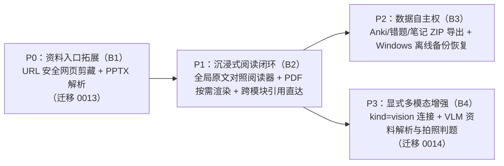

# 维度 B：核心新功能拓展需求规格与推进计划

> 状态：需求已确认，待按批次实现｜2026-11-20  
> 基线：`codex` 分支（`b25ff35`，维度 A P0–P3 及复审修复已合入）  
> 适用范围：知循 · KnowLoop（Synapse）个人多库知识工作台核心能力拓展（B1–B4）  
> 参考红线：[产品定位与路线图](product-positioning-and-roadmap.md) · [维度 A 规划](dimension-a-ux-polish-plan.md) · [Windows 本地运行与恢复](../local-runtime.md) · [AGENTS.md](../../AGENTS.md)

---

## 1. 背景与目标

在维度 A 完成日常高频交互打磨后，知循已形成顺畅的“资料上传 → 单库/范围问答 → 笔记与脑图沉淀 → 闪卡与练习复习”个人知识闭环。下一阶段的核心瓶颈从“操作摩擦”转向“能力厚度与长期可托付性”：

- **B1（网页剪藏 URL 导入 + PPTX 演示文稿解析）**：个人研究与学习最常见的两类资料源（公开技术网页/论文页面与 `.pptx` 课件）尚无法直接入库，仍需手工复制粘贴或转 PDF。
- **B2（沉浸式「原文对照阅读器」与跨模块引用直达）**：当前点击引用仅在 `max-height: 55vh` 小弹窗中查看孤立片段，无法浏览前后文或按页翻阅普通 PDF，学习页 `SourceList` 来源甚至不可点击。
- **B3（数据自主权：批量导出 + Windows 一键本地离线备份恢复）**：闪卡与错题本尚无法导出，笔记只能单篇导出，且 [local-runtime.md](../local-runtime.md) 标注的“整库本地离线备份与恢复”尚未闭环。
- **B4（显式可选的「视觉理解模式（VLM）」增强图表与公式）**：入库与拍照判题目前完全依赖纯本地 RapidOCR，面对流程图、数据图表、手写公式与草图时语义信息易丢失。

**核心目标**：坚守个人多库工作台定位与可信边界，仅引入 **2 次小而可逆的 Alembic 迁移**（`0013`、`0014`）与 **2 项纯 Python 轻量解析依赖**，将维度 B 拆分为 **4 个可独立验收与提交的迭代批次（P0 → P1 → P2 → P3）**。

---

## 2. 边界约束与明确不做

### 必须坚守的产品与工程边界
1. **定位与安全红线**：
   - 保持个人多库知识工作台定位；网页剪藏必须复用 SSRF 公网 IP 绑定机制，禁止探测内网与本地服务。
   - 离线备份严格仅操作 `study` schema 与 `.local/storage`，**绝不触碰其他数据库或非 `study` schema**，**绝不明文打包 `.env` 或私钥**。
2. **可信与成本红线**：
   - VLM 视觉理解默认关闭、仅显式触发，解析结果在 `locator` 与前端展示中明确标注「视觉解析（VLM）」，**绝不伪装为纯文字 OCR**。
   - 拍照判题接入 VLM 后仍严格维持三态门禁（`correct` / `incorrect` / `pending`）与用户人工改判，失败自动回退本地 RapidOCR 或降级 `pending`。
3. **数据库与架构约束**：
   - 仅在 `study` schema 新增 2 个向后兼容迁移（`0013_material_source_url.py`、`0014_vision_model_connections.py`），不触碰 `study_graph`，均须通过 `test_migration_roundtrip.py` 升降级验证。
   - 前端优先使用 `frontend/src/components/arc/` 下的 UI Arc 组件，不引入 `pdf.js` 等重体积前端渲染库（PDF 翻页由后端既有 `pypdfium2` 按需渲染）。

### 明确不做（Out of Scope）
- 不在 Python worker 中捆绑 Playwright / Chromium 无头浏览器抓取登录墙或重 SPA 网页（明确提示改用「随手贴文本」）。
- 不依赖本机安装 LibreOffice 将 PPTX 转为 PDF 截图。
- 不引入企业级多租户权限、云端同步托管或自动定时云盘备份。
- 不在维度 B 中改动混合检索排序或 Rerank 架构（属于维度 C，另行立项）。

---

## 3. 已确认设计决策（Q1–Q7）

| 编号 | 决策主题 | 确认结论 | 关键依据 |
| --- | --- | --- | --- |
| **Q1** | 纳入范围与推进顺序 | 全部纳入 B1–B4，拆分为 **P0（B1）→ P1（B2）→ P2（B3）→ P3（B4）** 四个独立批次 | 先落地 URL 与 PPTX 资料形态，P1 阅读器即可原生支持网页外链直达与按页幻灯片浏览 |
| **Q2** | B1 网页剪藏边界与存储 | 仅抓公开静态网页（复用 `model_network.py` SSRF 防护 + 逐跳校验重定向 `<=5` 跳 + 大小/超时上限），提取正文 Markdown 入库并持久化 `materials.source_url`；登录墙/重 JS 页提示改用「随手贴文本」 | 兼顾安全与轻量部署，同时保留来源 URL 供引用一键跳回原网页 |
| **Q3** | B1 PPTX 解析深度 | 纯 Python（`python-pptx`，零 LibreOffice 依赖）：复用 OOXML ZIP 解压上限保护，提取标题、文本框、表格与演讲者备注，保留 `slide` 页码定位；低文本含大图幻灯片自动调用本地 RapidOCR 兜底 | 与 DOCX 解析体系一致，零额外系统软件前置依赖 |
| **Q4** | B2 原文对照阅读器形态 | 全局统一右侧宽抽屉（桌面右侧宽抽屉 / 移动端底部全屏抽屉），覆盖聊天、学习（练习/错题）、知识库片段、笔记与搜索；支持命中高亮、上下文相邻段落浏览、全部 PDF 按页翻阅（后端 `pypdfium2` 按需渲染）、网页剪藏外链、以及「针对此段追问」与「摘录到笔记」 | 不打断当前对话/刷题上下文，且复用后端已有 `pypdfium2` 避免前端打包体积膨胀 |
| **Q5** | B3 批量导出与 Windows 备份策略 | ① Web 导出：闪卡 Anki TSV + Markdown、错题本按筛选导出 Markdown、单库笔记后端打包 ZIP；② Windows 备份恢复（`Backup-Synapse.cmd` / `Restore-Synapse.cmd`）：打包 `study` schema dump + `.local/storage` + `manifest.json` 校验清单，仅记录 `MODEL_CONNECTIONS_KEY` 指纹（不明文打包 `.env`），恢复前强制检查运行进程与密钥指纹 | 既满足个人知识资产自由迁出，又避免备份包意外泄露 API 密钥与 Fernet 密钥 |
| **Q6** | B4 VLM 模型连接架构 | 新增独立连接类型 `kind='vision'`（Alembic `0014` 放宽 `ck_model_connections_kind`），复用现有凭据加密、租约、探测与用量统计，支持 OpenAI 兼容多模态 `image_url` 协议 | 日常文本问答可继续使用高性价比纯文本 LLM（如 DeepSeek），视觉理解独立按需调用 VLM |
| **Q7** | B4 VLM 触发与护栏 | 默认保持本地零成本 RapidOCR；①资料侧支持上传显式勾选或对已有图片/扫描 PDF 触发「视觉理解解析（VLM）」（设单文档页数上限防误耗 Token），`locator.extraction='vlm'` 且前端显示「视觉解析」角标；②拍照判题提供显式开关「视觉模型辅助识别公式/草图」，保留三态门禁与人工改判、失败回退 RapidOCR/`pending` | 严控额外模型费用并坚守“不将视觉推断冒充纯 OCR”的可信边界 |

---

## 4. 四阶段推进总览



| 批次 | 覆盖项 | 数据库迁移 | 新增依赖 | 独立交付价值 |
| --- | --- | --- | --- | --- |
| **P0** | B1（URL 网页剪藏 + PPTX 解析） | `0013_material_source_url.py` | 后端：`python-pptx`、正文抽取库（`trafilatura`） | 直接粘贴网页链接或拖拽 `.pptx` 课件入库，引用指明幻灯片页码或直达原网页 |
| **P1** | B2（全局原文对照阅读器 + PDF 按需渲染 + 学习页引用直达） | 无 | 无（复用 `pypdfium2`） | 全站任意位置点引用都在右侧宽抽屉看上下文、翻原 PDF、追问或摘录到笔记 |
| **P2** | B3（Anki/错题/笔记 ZIP 导出 + Windows 离线备份恢复） | 无 | 无（Python 标准库 `zipfile` + PowerShell/`pg_dump`） | 知识资产可自由导出到 Anki/Markdown，本地库具备可验证的一键备份与恢复 |
| **P3** | B4（`kind='vision'` 连接 + VLM 资料解析与拍照判题） | `0014_vision_model_connections.py` | 无（复用 OpenAI 兼容多模态消息格式） | 按需开启图表与手写公式视觉理解，默认仍零成本本地 OCR，来源标识清晰 |

---

## 5. 分批次详细规格

---

### 批次 P0：B1 网页剪藏（URL 导入）与 PPTX 演示文稿解析

#### 5.1 数据模型与依赖增量
- **Alembic 迁移** `backend/alembic/versions/0013_material_source_url.py`：
  - 给 `study.materials` 新增可空列 `source_url TEXT NULL`（`downgrade` 删除该列）。
  - 同步更新 `backend/src/study_platform/persistence/models/identity.py`（`Material.source_url`）。
- **后端依赖**（`backend/pyproject.toml`，通过 `uv` 锁定安装）：
  - `python-pptx>=1.0,<2`
  - `trafilatura>=2.0,<3`（纯 Python 正文与标题抽取，输出结构化 Markdown；若需更轻量备选可在实现时评估 `beautifulsoup4` + `lxml`，以在 `tests/unit` 离线样本中抽取准确率更高者为准）。

#### 5.2 后端接口与处理规格

1. **安全网页抓取与正文抽取（`backend/src/study_platform/services/web_clip.py`）**
   - 复用 `model_network.py` 的公网 IP 解析与 `GuardedSyncBackend` 思想，封装 `fetch_public_webpage(url: str)`：
     - 仅允许 `http` / `https`（禁止凭据、禁止解析到回环/私网/链路本地/保留/组播地址）。
     - `follow_redirects=False` 手动逐跳处理 `301/302/303/307/308`，最多 5 跳，每一跳重新执行 URL 校验与 DNS 公网 IP 检查（防重定向 SSRF 绕过）。
     - 流式读取响应体，强制上限 `max_web_clip_bytes`（默认 5 MB）与总超时 `web_clip_timeout_seconds`（默认 15s），仅放行 `text/html`、`application/xhtml+xml`、`text/plain`、`text/markdown`。
   - 正文抽取：
     - HTML 使用抽取器提取文档标题与干净 Markdown 正文；`text/plain` / `text/markdown` 直接作为 UTF-8 文本入库。
     - 若正文为空或有效字符数过少（例如 `< 40` 字，典型为登录墙或纯客户端渲染 SPA），返回 `422 web_clip_empty`（提示：“未能从该网页提取到有效正文，可能是需要登录或动态渲染页面，请改用「随手贴文本」导入。”）。
   - 落盘与入库：
     - 创建 `Material(title=..., kind="other", status="active", source_url=final_url)` 与 `MaterialVersion(source_mime="text/markdown", ...)`，将提取的 Markdown 写入 `.local/storage/{version_id}/source`，复用既有 `create_job` 投递 `ingest` 任务异步切分与建索引。

2. **网页剪藏接口（`backend/src/study_platform/api/v1/materials.py`）**
   - 新增 `POST /api/v1/knowledge-bases/{kb_id}/materials/web-clip`（状态码 `202` 或 `201`，返回既有 `UploadResponse`：`{ material_id, version_id, job_id, status: "queued" }`）：
     ```python
     class WebClipRequest(BaseModel):
         url: str = Field(min_length=8, max_length=2048)
         title: str | None = Field(default=None, max_length=255)
     ```
   - 扩展 `MaterialResponse` 与 `CitationDTO`（`api/v1/materials.py`、`api/v1/resources.py`、`services/citations.py`）新增向后兼容字段 `source_url: str | None = None`。

3. **PPTX 解析与校验**
   - `upload_validation.py` 与 `materials.py`：
     - `EXTENSION_MIMES` / `MIMES` 新增 `".pptx": "application/vnd.openxmlformats-officedocument.presentationml.presentation"`。
     - `validate_upload_content` 校验 ZIP 魔数 `PK\x03\x04` 及关键入口（包含 `ppt/presentation.xml`）。
   - `ingestion.py`：
     - 将 `ensure_docx_uncompressed_limit` 泛化为 `ensure_ooxml_uncompressed_limit(path)`，同样保护 `.pptx` 免受 ZIP 炸弹攻击。
     - 新增 `extract_pptx(path)`：遍历 `Presentation(path).slides`（从 1 开始计页码）：
       - 按阅读顺序提取每页标题、形状文本框与表格文本，生成 `MaterialSection`（`locator = {"slide": slide_no}`，含 `heading` 若该页存在标题）。
       - 若存在非空演讲者备注（`slide.notes_slide.notes_text_frame.text`），单独提取并标记 `locator = {"slide": slide_no, "notes": True}`。
       - **低文本含大图幻灯片 RapidOCR 兜底**：当某页可见文本字符数低于阈值（如 `< 20` 字）且包含位图图片（PNG/JPEG）时，使用现有 `ocr_image` 对内嵌图片执行本地 OCR，写入 `locator = {"slide": slide_no, "ocr": True}`（单文件总 OCR 图数受配置上限约束防止超时）。
     - 设置 `version.page_count = len(slides)`。
   - `services/citations.py` 与前端 `api/ui.ts`（`locatorLabel`）：
     - 识别 `locator["slide"]`：展示为「第 N 页幻灯片」（若 `notes: true` 则为「第 N 页幻灯片 · 备注」）。

#### 5.3 前端交互规格
- 新建 `frontend/src/components/WebClipDialog.tsx`（UI Arc `Dialog` + `Input`）：支持输入网页 URL 与可选自定义标题，提交后关闭并刷新资料列表、弹出状态提示，失败时在弹窗内清晰展示错误（如登录墙引导改用「随手贴文本」）。
- 入口接入：
  - `Composer.tsx` 的「添加资料」`DropdownMenu` 新增「导入网页链接」项；`fileInput.accept` 增加 `.pptx`。
  - `Library.tsx` 顶部资料操作区新增「导入网页」按钮；`fileInput.accept` 增加 `.pptx`。
  - `useUploadQueue.ts` 的 `ALLOWED_EXTENSIONS` 增加 `.pptx`，提示文案同步更新。
- 来源外链展示：当 `Citation` / `Material` 带有合法 `http(s)://` `source_url` 时，在资料详情与来源卡片展示「打开原网页」（`target="_blank" rel="noopener noreferrer"`）。

#### 5.4 涉及文件清单
- 后端：`backend/pyproject.toml`、`backend/alembic/versions/0013_material_source_url.py`（新增）、`backend/src/study_platform/persistence/models/identity.py`、`backend/src/study_platform/core/config.py`、`backend/src/study_platform/services/web_clip.py`（新增）、`backend/src/study_platform/services/upload_validation.py`、`backend/src/study_platform/services/ingestion.py`、`backend/src/study_platform/services/citations.py`、`backend/src/study_platform/api/v1/materials.py`、`backend/src/study_platform/api/v1/resources.py`
- 前端：`frontend/src/api/types.ts`、`frontend/src/api/client.ts`、`frontend/src/api/ui.ts`、`frontend/src/useUploadQueue.ts`、`frontend/src/components/WebClipDialog.tsx`（新增）、`frontend/src/components/Composer.tsx`、`frontend/src/components/Library.tsx`、`frontend/src/components/LiveChat.tsx`

#### 5.5 验收标准（AC-P0）
- **AC-P0-1**：向 `/materials/web-clip` 提交公网文章链接后，成功提取标题与 Markdown 并完成异步索引，问答引用可点击外链跳回原网页；提交 `http://127.0.0.1`、私网 IP、或跳转到内网的重定向链接全部被 `422` 拦截。
- **AC-P0-2**：上传含多页正文、表格、演讲者备注和纯图页的 `.pptx` 后，解析成功并按「第 N 页幻灯片」定位；损坏或伪造扩展名的 `.pptx` 与超限 ZIP 炸弹均被拒绝。
- **AC-P0-3**：`0013_material_source_url.py` 通过 `upgrade` → `downgrade` → `upgrade` 往返测试。

---

### 批次 P1：B2 沉浸式「原文对照阅读器」与跨模块引用直达

#### 5.1 后端接口规格

1. **原文阅读器上下文接口**
   - 新增：`GET /api/v1/material-versions/{version_id}/reader`
   - 查询参数：`chunk_id: UUID | None = None`、`window: int = Query(default=3, ge=0, le=10)`
   - 位置：`backend/src/study_platform/api/v1/materials.py`
   - 返回 `MaterialReaderResponse`：
     ```json
     {
       "material_id": "...",
       "version_id": "...",
       "knowledge_base_id": "...",
       "title": "...",
       "mime_type": "application/pdf",
       "source_url": null,
       "page_count": 24,
       "can_render_pages": true,
       "content_url": "/api/v1/material-versions/.../content",
       "target_chunk_id": "...",
       "target_page": 5,
       "target_quote": "...",
       "chunks": [
         {
           "id": "...",
           "ordinal": 11,
           "text": "...",
           "locator": { "page": 5 },
           "location_label": "第 5 页",
           "is_target": false
         }
       ],
       "total_chunks": 86,
       "has_prev": true,
       "has_next": true
     }
     ```
   - 支持按 `chunk_id` 定位前后相邻 `window` 个分块（或按 `offset`/`limit` 翻看更多相邻上下文），若目标 `chunk_id` 属于已停用/历史 `retired` 索引版本，依然返回该版本的只读上下文快照，不越权访问其他用户资料。

2. **PDF 按需单页渲染**
   - 位置：`backend/src/study_platform/api/v1/materials.py`（`GET /api/v1/material-versions/{version_id}/pages/{page_no}`）
   - 逻辑升级：
     - 若 `page_path(version_id, page_no)` 已存在 PNG，直接返回。
     - 若不存在且 `version.source_mime == "application/pdf"` 且 `1 <= page_no <= min(version.page_count or 0, max_pdf_page_preview)`：使用既有 `pypdfium2` 渲染单页（固定合理 DPI 如 `scale=1.5`，使用临时文件 + 原子 `os.replace` 写入 `page_path` 防并发读写半成品文件），随后返回 `image/png`。
     - 若是单张图片资料（`image/png` / `image/jpeg`）且 `page_no == 1`：支持返回原图或已存预览图，统一阅读器图片展示。

3. **学习模块来源信息补齐**
   - 位置：`backend/src/study_platform/services/learning.py`（`_load_sources_by_item`）
   - 扩展 `LearningSource` DTO 补充：`knowledge_base_id`、`locator`、`source_url`，使练习页与错题本中的每一条「资料依据」都能直接唤起原文阅读器。

#### 5.2 前端组件与交互规格

1. **统一阅读器组件 `frontend/src/components/SourceReaderDrawer.tsx`（新增）**
   - 使用 UI Arc `Dialog` 定制宽抽屉样式：
     - **桌面端（`> 760px`）**：固定右侧宽抽屉（`width: min(720px, 56vw)`，`height: 100dvh`，贴右滑入），背景遮罩支持点击关闭或 `Esc` 关闭。
     - **移动端（`<= 760px`）**：底部全屏/高抽屉（`height: 88dvh`，圆角顶栏，独立滚动区）。
   - **头部信息栏**：文档标题、位置徽标（如「第 5 页」「第 12 页幻灯片」）、提取来源角标（如纯文字 / OCR / 网页剪藏外链按钮）、下载原件按钮。
   - **视图切换**（当 `can_render_pages` 为 true，即 PDF 或图片资料时）：
     - 「原文上下文」视图：展示目标分块及其前后相邻分块，**自动滚动到并高亮命中分块与引文片段**，顶部/底部提供「加载前文」「加载后文」按钮。
     - 「原页图像」视图：支持上一页 / 下一页 / 页码跳转翻阅 PDF 每一页（复用 `MaterialPage` + 缓存）。
   - **阅读闭环动作栏**（针对当前高亮分块或用户选中文本）：
     - **「针对此段追问」**：携带对应 `knowledge_base_id`、`material_id` 与预填追问草稿（含所选原文片段）跳转 `/` 发起聚焦追问。
     - **「摘录到笔记」**：打开复用自维度 A 的 `SaveChatNoteDialog`（支持新建研究笔记或追加到同库已有笔记，自动保留该分块出处标题与定位说明）。

2. **跨模块全站接入**
   - **聊天页（`LiveChat.tsx`）**：点击行内 `[S#]` 或右侧来源卡片打开 `SourceReaderDrawer`（替换原先狭小的 `55vh` 来源弹窗）。
   - **学习页（`Learning.tsx`）**：将 `SourceList` 中每条 `availability === 'available'` 的资料依据改为可点击按钮，点击直接打开 `SourceReaderDrawer`。
   - **知识库详情（`Library.tsx` & `LibraryFragments.tsx` & `LibraryStudio.tsx`）**：片段列表点击与笔记内 `[S#]` 点击均打开 `SourceReaderDrawer` 并高亮命中片段。
   - **搜索（`SearchPanel.tsx`）**：命中 `fragment` 结果跳到知识库后直接以 `SourceReaderDrawer` 高亮打开。

#### 5.3 涉及文件清单
- 后端：`backend/src/study_platform/api/v1/materials.py`、`backend/src/study_platform/services/learning.py`、`backend/src/study_platform/services/citations.py`
- 前端：`frontend/src/api/types.ts`、`frontend/src/api/client.ts`、`frontend/src/components/SourceReaderDrawer.tsx`（新增）、`frontend/src/components/SourceReaderDrawer.css`（新增）、`frontend/src/components/LiveChat.tsx`、`frontend/src/components/Learning.tsx`、`frontend/src/components/Library.tsx`、`frontend/src/components/LibraryFragments.tsx`、`frontend/src/components/LibraryStudio.tsx`

#### 5.4 验收标准（AC-P1）
- **AC-P1-1**：在聊天、练习、错题本、笔记与知识库片段任意位置点击可用引用，均可在右侧宽抽屉（移动端底部抽屉）打开对应原文并自动高亮定位，可点击查看前/后相邻分块。
- **AC-P1-2**：对普通文本 PDF（非 OCR）点击引用并切至「原页图像」，后端按需渲染并缓存对应页图，支持上一页/下一页翻阅。
- **AC-P1-3**：在阅读器内点击「针对此段追问」可预填草稿并带出对应知识库；点击「摘录到笔记」可新建或追加到目标知识库笔记。

---

### 批次 P2：B3 数据自主权（批量导出 + Windows 一键本地离线备份恢复）

#### 5.1 Web 批量导出规格

1. **闪卡组导出（Anki TSV + Markdown）**
   - 新增：`GET /api/v1/flashcard-decks/{deck_id}/export?format=anki_tsv|markdown`（位置：`backend/src/study_platform/api/v1/studio.py` & `services/studio.py`）
   - `anki_tsv` 格式：
     - UTF-8（含 `#separator:tab` / `#html:true` 元头，Anki 2.1+ 自动识别免手工选分隔符）。
     - 三列：`Front\tBack\tTags`（换行转为 `<br>`，制表符转义，公式保留原样，`Tags` 写入规范化后的知识库名与卡组名；对潜在电子表格公式前缀在导出说明中保持纯 Anki 文本语义）。
   - `markdown` 格式：每张卡输出 `## Q1 ...`、背面答案、复习间隔与来源标题清单。
   - 前端：`FlashcardPanel.tsx` 在卡组列表项与复习头部增加「导出 Anki (.tsv)」与「导出 Markdown」操作（`DropdownMenu`）。

2. **错题本 Markdown 导出**
   - 位置：前端基于已筛选错题列表（`visibleWrongs`）复用 `downloadMarkdownFile` 直接生成可打印 `.md` 错题集（也可提供后端 `GET /api/v1/learning/wrong-questions/export` 支持全量导出，含知识库名、题干、选项、上次作答、参考答案、解析、错误次数、下次复习时间与来源依据）。
   - 前端：`Learning.tsx` 错题本工具栏新增「导出错题集 (.md)」按钮。

3. **单知识库研究笔记批量打包 ZIP 导出**
   - 新增：`GET /api/v1/knowledge-bases/{kb_id}/notes/export`（位置：`backend/src/study_platform/api/v1/studio.py` & `services/studio.py`）
   - 服务端使用标准库 `zipfile` 在内存/临时文件打包 `application/zip`：
     - 包含 `INDEX.md`（导出时间、知识库名、笔记目录清单）与每篇笔记对应的 `{序号}-{安全文件名}.md`（清理路径分隔符与非法字符，自动重名消歧，末尾附关联来源依据列表）。
     - 若知识库暂无笔记返回 `409 no_notes`。
   - 前端：`LibraryStudio.tsx` 操作栏新增「批量导出笔记 (.zip)」按钮。

#### 5.2 Windows 一键本地离线备份与恢复规格

1. **文件结构**
   - 根目录入口（对齐现有 `Start-Synapse.cmd` / `Status-Synapse.cmd` / `Stop-Synapse.cmd`）：
     - `Backup-Synapse.cmd`
     - `Restore-Synapse.cmd`
   - 核心脚本：`infra/windows/backup-restore.ps1`
   - 自动化测试：`infra/windows/tests/backup-restore.tests.ps1`（Pester 离线桩测试，不破坏真实数据库）

2. **备份流程（`backup`）**
   - 读取根目录 `.env` 中的 `DATABASE_URL`、`STORAGE_DIR`（默认 `.local/storage`）与 `MODEL_CONNECTIONS_KEY`。
   - 若检测到 API / worker 正在运行，默认提示“建议先运行 `Stop-Synapse.cmd` 确保数据库与文件快照一致性”（支持 `-Online` 显式允许联机热备）。
   - 调用本机 `pg_dump --schema=study --format=custom --no-owner --no-privileges` 导出 `study` schema 至临时目录 `study.dump`（严格不导出其他库或其他 schema）。
   - 复制 `.local/storage` 目录文件至 `storage/`（排除临时文件）。
   - 生成 `manifest.json`：
     - `format_version: 1`、`created_at_utc`、`database_name`、`alembic_revision`、`file_count`、`files`（相对路径 + SHA-256 校验和）。
     - `model_connections_key_fingerprint`：若 `.env` 存在 `MODEL_CONNECTIONS_KEY`，仅写入其 `SHA-256` 前 12 位指纹；**绝不写入明文 `.env`、数据库密码或 API 密钥**。
   - 打包输出至 `.local/backups/synapse-backup-YYYYMMDD-HHMMSS.zip`（`.local/` 已在 `.gitignore` 中，绝不提交 Git）。

3. **恢复流程（`restore -BackupPath <zip> [-DryRun] [-Force]`）**
   - **前置强检**：
     1. 检查 `local-runtime.ps1` 管理的 API / worker 均已停止；若仍在运行则**拒绝恢复**并提示先运行 `Stop-Synapse.cmd`。
     2. 解压至临时目录并逐文件校验 `manifest.json` 中的 SHA-256，校验失败立即中止。
     3. 比对当前 `.env` 的 `MODEL_CONNECTIONS_KEY` 指纹与 `manifest.json`：若不一致，发出醒目警告（说明恢复后已保存的「模型连接」凭据将无法解密，需保持原密钥或在恢复后重新录入连接），未传 `-Force` 时暂停确认。
   - **预检模式（`-DryRun`）**：仅执行上述校验并打印将要恢复的表/文件数量与目标库名，不写入任何数据。
   - **正式恢复**：
     1. 自动先对当前状态生成一份恢复前快照 `.local/backups/pre-restore-<timestamp>.zip`（除非显式 `-SkipPreBackup`）。
     2. 在单事务中恢复 `study` schema（`pg_restore --clean --if-exists --no-owner --no-privileges --schema=study --single-transaction`），并原子替换 `.local/storage`（先移至 `.local/storage.old-<ts>`，替换成功后再清理）。
     3. 输出恢复结果与下一步提示（运行 `Start-Synapse.cmd` 启动并核查）。

#### 5.3 涉及文件清单
- 后端：`backend/src/study_platform/api/v1/studio.py`、`backend/src/study_platform/services/studio.py`、`backend/src/study_platform/api/v1/learning.py`
- 前端：`frontend/src/api/client.ts`、`frontend/src/components/FlashcardPanel.tsx`、`frontend/src/components/Learning.tsx`、`frontend/src/components/LibraryStudio.tsx`、`frontend/src/learningUi.ts`
- Windows 运维与文档：`Backup-Synapse.cmd`（新增）、`Restore-Synapse.cmd`（新增）、`infra/windows/backup-restore.ps1`（新增）、`infra/windows/tests/backup-restore.tests.ps1`（新增）、`docs/local-runtime.md`（补充备份恢复说明）

#### 5.4 验收标准（AC-P2）
- **AC-P2-1**：导出的闪卡 `.tsv` 可直接被 Anki 导入且正确识别正反面、换行与标签；错题集 `.md` 完整反映当前筛选条件；单库笔记 `.zip` 解压后文件名安全无乱码、包含 `INDEX.md` 与所有笔记。
- **AC-P2-2**：运行 `Backup-Synapse.cmd` 生成的备份包中**绝对不含** `.env` 或任何明文密钥，`manifest.json` 校验和与密钥指纹准确。
- **AC-P2-3**：运行 `Restore-Synapse.cmd -DryRun` 在服务运行中或校验和被篡改时拒绝执行；在隔离测试库完成备份 → 修改数据 → 恢复后，数据库记录与存储文件 100% 还原。

---

### 批次 P3：B4 显式可选的「视觉理解模式（VLM）」增强图表与公式

#### 5.1 数据迁移与模型连接扩展
- **Alembic 迁移** `backend/alembic/versions/0014_vision_model_connections.py`：
  - 更新 `study.model_connections` 检查约束 `ck_model_connections_kind` 为 `kind IN ('llm', 'embedding', 'vision')`（`downgrade` 仅在不存在 `vision` 行或清理后恢复原约束）。
  - 同步更新 `backend/src/study_platform/persistence/models/model_connections.py`。
- **模型连接与调用链扩展**：
  - `api/v1/model_connections.py` & `services/model_connections.py`：`kind` 字面量扩展为 `Literal["llm", "embedding", "vision"]`，`uq_model_connections_default` 自动支持用户设置一个默认 `vision` 连接。
  - `services/model_probe.py`：新增 `probe_vision(...)`——通过既有 `model_network.sync_client` 向配置的 OpenAI 兼容 `/chat/completions` 发送极小 1×1 PNG（`data:image/png;base64,...`）探测多模态能力，验证通过后连接变为 `ready`。
  - `services/model_calls.py` & `services/model_usage.py`：新增统一视觉调用入口 `invoke_vision(prompt_text, image_bytes, mime_type, context=ModelUsageContext(owner, "vision_ingest" | "vision_grade"))`，完整记录 token 用量与失败错误码。
  - `api/v1/resources.py`（`GET /api/v1/capabilities`）：新增 `vision: bool`（当用户存在 `ready` 状态的默认 `vision` 连接时为 `true`）。

#### 5.2 资料入库 VLM 解析规格
- **默认行为不变**：常规上传图片与 PDF 继续 100% 走本地免费 RapidOCR。
- **显式触发入口**：
  1. 上传接口 `POST /api/v1/knowledge-bases/{kb_id}/materials` 支持可选表单参数 `extraction_mode: Literal["ocr", "vlm"] = "ocr"`（仅对图片与 PDF 生效；若传 `vlm` 但无就绪 `vision` 连接直接返回 `409 vision_not_configured`）。
  2. 新增 `POST /api/v1/materials/{material_id}/reparse`（入参 `extraction_mode: Literal["ocr", "vlm"]`）：对已有图片或 PDF 资料创建新的解析/索引任务（不覆盖原件，沿用 `AiJob` 围栏状态机；若旧版本正在处理则返回 `409`）。
- **成本与可信护栏**：
  - 新增配置 `MAX_VLM_PAGES_PER_MATERIAL`（默认 `20`）：当目标 PDF 需 VLM 解析的页数超过上限时拒绝并提示，防止大教材误烧大量 Token。
  - `ingestion.py` 在 `extraction_mode == "vlm"` 时：
    - 将每页图像经 `invoke_vision` 生成结构化 Markdown（忠实转录文字、用 `$...$` 还原数学公式、简明描述图表结构与数据关系）。
    - 在 `MaterialSection.locator` 与 `MaterialChunk.locator` 显式写入 `{"page": p, "extraction": "vlm"}`（图片为 `{"image": 1, "extraction": "vlm"}`），**不设 `"ocr": true`**，与纯 OCR 彻底区分。
    - 前端引用徽章、阅读器头部与片段列表识别 `locator.extraction === "vlm"`，显式显示「视觉解析（VLM）」徽标。

#### 5.3 学习拍照判题 VLM 规格
- 位置：`backend/src/study_platform/api/v1/learning.py` & `services/learning.py`
- `POST /api/v1/learning/responses/{response_id}/answer-image` 新增可选表单参数 `use_vision: bool = Form(default=False)`：
  - `use_vision=False`（默认）：完全保持既有 RapidOCR + 文本判题路径。
  - `use_vision=True`：
    - 校验用户存在就绪的 `vision` 连接（否则返回 `409 vision_not_configured`）。
    - 将答题图片、题干与参考答案（简答题）通过 `invoke_vision` 识别手写公式/草图并输出结构化 JSON：`{ transcribed_text, verdict, confidence, feedback }`。
    - **严格遵守三态与安全降级**：低于 `learning_confidence_threshold` 自动降为 `pending`；若 VLM 调用超时/解析失败，自动回退至本地 RapidOCR 路径或直接落为 `pending` 并提示用户手动判题。
    - 在 `row.answer` 中记录 `"extraction": "vlm"`，在 `row.grader_profile` 记录 `"learning_vision_v1"`，前端反馈区明确展示「视觉模型辅助识别（可手动改判）」。

#### 5.4 前端交互规格
- `ModelConnections.tsx`（设置 → 模型连接）：新增「视觉理解模型（VLM）」连接分组，支持新增、测试多模态连通性、设默认、删除，与现有 LLM/Embedding 表单一致。
- `Library.tsx` 资料列表操作菜单：当 `capabilities.vision === true` 且资料为图片或 PDF 时，展示「使用视觉理解重新解析（VLM）」操作（弹窗提示预估页数与费用确认）。
- `Learning.tsx` 拍照作答区：当 `capabilities.vision === true` 时，展示显式复选框「视觉模型辅助识别手写公式/草图（可选）」（默认不勾选）；答后反馈区带「视觉模型辅助」标识。

#### 5.5 涉及文件清单
- 后端：`backend/alembic/versions/0014_vision_model_connections.py`（新增）、`backend/src/study_platform/persistence/models/model_connections.py`、`backend/src/study_platform/core/config.py`、`backend/src/study_platform/api/v1/model_connections.py`、`backend/src/study_platform/services/model_connections.py`、`backend/src/study_platform/services/model_probe.py`、`backend/src/study_platform/services/model_calls.py`、`backend/src/study_platform/services/model_usage.py`、`backend/src/study_platform/api/v1/resources.py`、`backend/src/study_platform/api/v1/materials.py`、`backend/src/study_platform/services/ingestion.py`、`backend/src/study_platform/api/v1/learning.py`、`backend/src/study_platform/services/learning.py`
- 前端：`frontend/src/api/types.ts`、`frontend/src/api/client.ts`、`frontend/src/components/ModelConnections.tsx`、`frontend/src/components/Library.tsx`、`frontend/src/components/Learning.tsx`、`frontend/src/components/SourceReaderDrawer.tsx`

#### 5.6 验收标准（AC-P3）
- **AC-P3-1**：在设置页可独立配置并测试 `vision` 连接，不影响默认 `llm` 对话模型；`capabilities.vision` 准确反映就绪状态；模型用量统计面板能单独看到 `vision_ingest` / `vision_grade` 消耗。
- **AC-P3-2**：未勾选 VLM 时图片/PDF 入库与拍照作答 100% 走本地 RapidOCR（零 VLM 调用）；显式触发 VLM 后，解析产物带 `extraction='vlm'` 且前端明确标注「视觉解析」，超过页数上限被拒绝。
- **AC-P3-3**：拍照判题开启 VLM 时，低置信度自动落为 `pending`，VLM 异常时安全回退 RapidOCR 或 `pending`，人工改判与错题本链路完全正常；`0014` 迁移通过升降级往返测试。

---

## 6. 风险与防护策略

| 风险点 | 所属批次 | 防护措施 |
| --- | --- | --- |
| **网页剪藏 SSRF / 重定向绕过 / 超大响应 OOM** | P0 | 复用 `model_network.py` 公网 IP 绑定；关闭自动重定向，逐跳重检公网 IP（`<=5` 跳）；流式限字节（5 MB）+ 严格超时（15s） |
| **PPTX 恶意 ZIP 炸弹与伪造扩展名** | P0 | `upload_validation.py` 校验魔数与 OOXML 结构；`ingestion.py` 强制解压后总字节上限与单文档最大幻灯片 OCR 次数 |
| **PDF 按需渲染并发竞态与磁盘膨胀** | P1 | 临时文件 + `os.replace` 原子落盘；受 `max_pdf_page_preview` 与单页缩放上限约束，删除资料时随版本目录一并清理 |
| **ZIP 导出路径穿越与重名覆盖** | P2 | 文件名白名单清洗去除 `/\..` 控制字符，重名加序号后缀，限制单次归档总大小 |
| **恢复覆盖未停机数据或密钥不匹配** | P2 | `Restore-Synapse.cmd` 强制检查服务已停止、校验 SHA-256、比对 `MODEL_CONNECTIONS_KEY` 指纹、恢复前自动打 `pre-restore` 快照并在单事务内仅恢复 `study` schema |
| **VLM 费用误耗与可信度混淆** | P3 | 永远默认关闭、显式勾选触发、设置 `MAX_VLM_PAGES_PER_MATERIAL` 上限、`locator.extraction='vlm'` 与前端角标显式区分纯 OCR 与视觉理解 |

---

## 7. 测试与验证门禁

每个批次（P0 / P1 / P2 / P3）完成并在 `codex` 分支提交前，须通过以下验证：

### 自动化验证命令
```powershell
# 1. 后端静态检查与单元测试
cd backend
uv run ruff check src tests
uv run pytest tests/unit -q

# 2. 后端集成测试与迁移往返测试（P0 / P3 含 Alembic 迁移必跑）
uv run pytest tests/integration/test_migration_roundtrip.py tests/integration/test_resource_api.py tests/integration/test_learning_api.py tests/integration/test_model_connections.py -q

# 3. 前端类型检查、单测与生产构建
cd ../frontend
npx tsc --noEmit
npm test
npm run build

# 4. Windows 备份恢复脚本测试（P2 必跑）
cd ..
powershell.exe -NoProfile -ExecutionPolicy Bypass -File infra/windows/tests/backup-restore.tests.ps1
```

### 各批次规划新增测试清单
- **P0**：
  - `backend/tests/unit/test_web_clip.py`（SSRF 私网/重定向拦截、正文抽取、登录墙空内容 `422`）
  - `backend/tests/unit/test_pptx_extraction.py`（幻灯片文本/表格/备注、ZIP 炸弹、纯图页 OCR 兜底）
  - `frontend/src/upload-workflow.test.tsx`（扩展 `.pptx` 队列放行与 `WebClipDialog` 提交流程）
- **P1**：
  - `backend/tests/integration/test_resource_api.py`（`/reader` 上下文窗口与按需 PDF 页图渲染）
  - `frontend/src/source-reader.test.tsx`（新增：高亮滚动、上下文加载、PDF 翻页、学习页点击来源直达、追问与摘录到笔记）
- **P2**：
  - `backend/tests/unit/test_exports.py`（Anki TSV 转义与元头、笔记 ZIP 安全文件名与去重）
  - `infra/windows/tests/backup-restore.tests.ps1`（密钥指纹校验、无 `.env` 泄露、停机门禁、`-DryRun` 与篡改拦截）
  - `frontend/src/studio-and-flashcards.test.tsx` & `learning-v2.test.tsx`（导出按钮触发与下载行为）
- **P3**：
  - `backend/tests/unit/test_vision_pipeline.py`（VLM 多模态调用、页数上限拦截、`extraction='vlm'` 标记、拍照判题低置信 `pending` 与失败回退 RapidOCR）
  - `backend/tests/integration/test_model_connections.py`（`kind='vision'` 增删改测、默认切换与用量统计）
  - `frontend/src/model-connections.test.tsx` & `learning-v2.test.tsx`（VLM 连接管理、显式开关与「视觉解析」角标）
