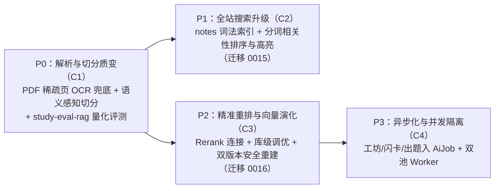

# 维度 C：RAG 检索引擎与底层架构升级需求规格与推进计划

> 状态：需求已确认，待按批次实现｜2026-11-20  
> 基线：`codex` 分支（紧接维度 B 迁移 `0013` / `0014`）  
> 适用范围：知循 · KnowLoop（Synapse）RAG 解析切分质量、全站检索相关性、重排与向量演化、以及长耗时任务异步调度（C1–C4）  
> 参考红线：[产品定位与路线图](product-positioning-and-roadmap.md) · [维度 A 规划](dimension-a-ux-polish-plan.md) · [维度 B 规划](dimension-b-core-expansion-plan.md) · [检索评测说明](../retrieval-evaluation.md) · [模型连接说明](../model-connections.md) · [AGENTS.md](../../AGENTS.md)

---

## 1. 背景与目标

经过维度 A（高频体验打磨）与维度 B（URL/PPTX 资料入口、原文对照阅读器、导出与备份、显式可选 VLM）之后，个人知识工作台的功能面已经完整，下一阶段的核心瓶颈集中在**检索精准度、解析切分质量与高负载任务稳定性**：

- **C1（PDF 扫描件 OCR 盲区修复 + 语义感知切分）**：当前 [ingestion.py](../../backend/src/study_platform/services/ingestion.py) 中 PDF 页只要 `get_text_range().strip()` 非空就直接跳过 OCR（带页码/页眉/水印的扫描 PDF 会丢失整页正文）；切分器采用纯字符滑窗 `800 / 120`，容易将代码块、Markdown 表格与 `$$...$$` 公式拦腰截断。
- **C2（升级 `Ctrl+K` 全站搜索为「分词相关性检索」）**：[resources.py](../../backend/src/study_platform/api/v1/resources.py) 的 `/search` 依赖 `ILIKE '%q%'` 连续子串匹配且按 UUID 排序，多关键词乱序召回失效、标题命中容易被淹没在正文边缘命中之后。
- **C3（Rerank 重排连接 + 库级检索调优 + 双版本安全重建索引）**：目前检索仅做 RRF 粗融合，缺少 Cross-Encoder / Rerank 重排模型和知识库级检索调优持久化；切换知识库向量连接后尚无零中断重建索引的迁移闭环。
- **C4（重模型任务异步化 + Worker 隔离并发）**：知识工坊产物、闪卡和出题仍在 HTTP 请求内同步等待模型返回（慢推理或大资料易超时、刷新即丢失结果）；`study-worker` 单循环串行处理任务，大 PDF 的解析/OCR 会直接阻塞后续生成任务。

**核心目标**：保持个人本地部署轻量原则（**零新增重依赖、零引入 Redis/Celery 等外部中间件**），仅引入 **2 次小而可逆的 Alembic 迁移**（`0015`、`0016`），将维度 C 拆分为 **4 个可独立验证与交付的批次（P0 → P1 → P2 → P3）**，并以 `study-eval-rag` 评测集定量护航检索质量。

---

## 2. 边界约束与明确不做

### 必须坚守的产品与工程边界
1. **单库隔离与可信边界**：所有检索、Rerank、命中测试与重建索引仍严格按 `owner_user_id` 与单个 `knowledge_base_id` 隔离；Rerank 与语义切分不得破坏历史已发布分块的引文快照（`MessageCitation` / `NoteCitation`）。
2. **向量表与 Schema 守则**：
   - 保持 `chunk_embeddings.embedding` 统一 `1024` 维与全局 pgvector HNSW 索引（主流模型如 Qwen3-Embedding / BGE-M3 / SiliconFlow / OpenAI `text-embedding-3` 均原生支持 `1024` 维）。
   - 迁移严格落在 `study` schema（`0015_note_lexical_search.py`、`0016_rerank_and_kb_retrieval.py`），不触碰 `study_graph`，均须通过 `test_migration_roundtrip.py` 升降级往返验证。
3. **安全与降级韧性**：
   - Rerank 外部接口复用 `model_network.py` 公网 IP 绑定 SSRF 防护与 Fernet 凭据加密；实时问答中 Rerank 超时或报错必须自动降级回 RRF 粗排并记录 `fallback_calls`，绝不阻断用户提问。
   - 双版本重建索引期间，原激活 `IndexVersion` 持续服务在线问答；任一资料构建失败不得污染或中断原库检索。

### 明确不做（Out of Scope）
- 不放开 `chunk_embeddings` 任意向量维度（不破坏 `Vector(1024)` 定长 HNSW 索引）。
- 不在后端捆绑本地 ONNX/PyTorch Cross-Encoder 权重文件（Rerank 统一走标准 HTTP `/rerank` 连接）。
- 不引入 Redis、RabbitMQ 或 Celery（Worker 并发复用 PostgreSQL `ai_jobs` + `FOR UPDATE SKIP LOCKED` + Python 有界线程池）。
- 不把单题判题（`grade`）强行改为异步排队（保留同步即时反馈，已有超时与低置信 `pending` 兜底）。
- 不自动在迁移中重切或重嵌所有历史资料（C1 语义切分仅对新入库与用户显式触发的「重建索引」生效）。

---

## 3. 已确认设计决策（Q1–Q6）

| 编号 | 决策主题 | 确认结论 | 关键依据 |
| --- | --- | --- | --- |
| **Q1** | 纳入范围与推进顺序 | 全部纳入 C1–C4，拆分为 **P0（C1）→ P1（C2）→ P2（C3）→ P3（C4）** 四个独立批次 | 先夯实底层解析切分与评测基准，再补全站搜索、精准重排与向量重建，最后统一异步化与并发隔离 |
| **Q2** | C1 PDF OCR 兜底与语义切分 | 稀疏文本页（有效字数 `< 40` 或含大面积位图且有效文本极少）自动跑本地 RapidOCR，OCR 有效字数显著高于原文本层时采用 OCR 结果并保存页图；语义切分保留 `~800/120` 目标窗口，按标题 → 段落 → 句子边界切分并原子保护代码块、Markdown 表格与 `$$...$$` 公式块（单块超 `1600` 字按行安全折分），仅作用于新入库与显式重建，并用 `study-eval-rag` 验证 Recall@k / MRR | 彻底消除扫描 PDF 因水印/页码导致的整页漏识，且不破坏存量片段与历史引用 |
| **Q3** | C2 `Ctrl+K` 全站搜索升级 | 迁移 `0015` 为 `notes` 新增 `lexical TSVECTOR` + GIN 索引并分批回填存量笔记，与 `material_chunks` 统一接入 `jieba` 分词 FTS；按「标题精确/前缀 > 标题全词命中 > 正文/笔记分词相关性」加权排序（单字/符号兜底子串匹配），返回 `matched_terms` 供前端安全高亮，并使用稳定排序游标分页 | 统一资料正文与研究笔记的中文分词能力，解决多词乱序召回与标题被淹没痛点 |
| **Q4** | C3 向量维度与双版本重建索引 | 保持统一 `1024` 维；切换知识库向量连接或显式「重建索引」时，后台为全库就绪资料构建新 `generation`（原索引照常问答），全部成功后单事务原子切换知识库绑定与 `is_active`，失败可局部重试或取消回滚且零中断 | 最大化复用现有 `IndexVersion` 多世代与部分唯一索引结构，保障在线问答零中断 |
| **Q5** | C3 Rerank 协议与库级调优 | 迁移 `0016` 新增 `kind='rerank'` 模型连接（标准 HTTP `/rerank` JSON 协议，兼容 Cohere / Jina / SiliconFlow / DashScope 兼容格式，超时/失败自动降级 RRF）与 `knowledge_bases.retrieval_settings` JSONB；在现有「检索命中测试台（`LibraryHitTest.tsx`）」直接对比 Rerank 前后排位变化并一键「保存为本库默认检索配置」 | 调参诊断与持久化闭环合一，零学习成本 |
| **Q6** | C4 任务异步化与 Worker 并发 | ① 将 3 类长耗时生成（工坊 `notes`、闪卡 `flashcards`、出题 `quiz`）接入既有 `AiJob` 状态机（单题判题保持同步）；② 提供统一 `/api/v1/ai-jobs` 查询/列表/取消接口与轻量轮询（刷新页面自动恢复进行中任务与完成跳转）；③ 升级 `study-worker` 为零新中间件的“双池有界并发”（重解析 `ingest/reindex` 池与轻 I/O 生成池隔离） | `ai_jobs.job_type` 已原生预留 `'notes'/'quiz'/'flashcards'`，双池隔离避免大 PDF 卡住用户生成请求 |

---

## 4. 四阶段推进总览



| 批次 | 覆盖项 | 数据库迁移 | 核心能力增量 |
| --- | --- | --- | --- |
| **P0** | C1（PDF 稀疏页 OCR 兜底 + 语义切分 + 评测基准） | 无 | 补齐扫描 PDF 漏识盲区；保留公式/表格/代码块完整性的语义切分器；`study-eval-rag` 对比回归 |
| **P1** | C2（`Ctrl+K` 分词相关性搜索 + 关键词高亮） | `0015_note_lexical_search.py` | `notes.lexical` GIN 索引 + 全站多词乱序相关性排序 + 稳定排序游标 + 前端安全 `<mark>` 高亮 |
| **P2** | C3（Rerank 连接 + 库级检索调优 + 双版本安全重建索引） | `0016_rerank_and_kb_retrieval.py` | `kind='rerank'` 模型连接、命中测试台对比与保存库级参数、零中断双版本切换向量模型/重建索引 |
| **P3** | C4（长耗时生成异步化 + Worker 双池有界并发） | 无（复用 `ai_jobs` 既有类型） | 工坊/闪卡/出题进入 `AiJob` 队列、刷新不丢进度且可取消、Worker 重/轻双池隔离并发 |

---

## 5. 分批次详细规格

---

### 批次 P0：C1 PDF 扫描件 OCR 盲区修复 + 语义感知切分

#### 5.1 PDF 稀疏文本页 OCR 兜底规则
- 位置：`backend/src/study_platform/services/ingestion.py` & `core/config.py`
- 新增可调配置项（`Settings`）：
  - `pdf_ocr_min_effective_chars: int = 40`（低于此有效字数直接尝试 RapidOCR）
  - `pdf_ocr_image_page_max_chars: int = 120`（检测到页面含大面积位图对象且有效字数低于此阈值时也尝试 RapidOCR）
- 判定与采纳逻辑（`extract()` 中 `application/pdf` 分支）：
  1. 提取文本层 `text`，统计有效字符数 `effective_len`（仅计字母、数字与 CJK 字符，过滤空白与标点）。
  2. 通过 `pypdfium2` 页面对象检查是否包含覆盖面积显著的图像对象（`FPDF_PAGEOBJ_IMAGE` 面积占比 `>= 0.25`）。
  3. 若 `effective_len < pdf_ocr_min_effective_chars` 或 `(has_large_image and effective_len < pdf_ocr_image_page_max_chars)`：
     - 渲染页面图像并执行本地 `ocr_image(image)`，统计 OCR 有效字数 `ocr_effective_len`。
     - **防退化采纳准则**：仅当 `effective_len == 0` 或 `ocr_effective_len >= max(int(effective_len * 1.5), effective_len + 20)` 时，保存 `page-{number}.png` 并输出 OCR 结果 `{"page": number, "ocr": lines}`；否则保留原始文本层 `{"page": number}`（避免纯短标题页/目录页被 OCR 误伤）。

#### 5.2 语义感知切分器（`backend/src/study_platform/services/chunking.py`）
- 新建独立模块 `chunking.py`，替代 `ingestion.py` 的机械滑窗 `chunks(text, size=800, overlap=120)`：
  1. **原子块识别**：预扫描将正文划分为普通段落与受保护原子块：
     - 围栏代码块（`` ```...``` ``、`~~~...~~~`）
     - 连续 Markdown 表格块（含 `|...|` 表头与分隔行）
     - 块级数学公式（`$$...$$`）
  2. **层次切分优先级**：
     - 优先在标题/空行段落边界聚合，目标单块长度 `chunk_size = 800` 字符。
     - 单个普通段落超 `800` 字时，按中英文句末标点（`。\n！？.!?;；`）切分，并在相邻块之间保留 `~120` 字符的**句级重叠**（尽量不从半句/半词腰斩）。
     - 单个原子块（表格/代码块/公式块）在 `<= 1600` 字（硬上限）内绝不拆散；超过 `1600` 字时按行边界折分（表格保留表头行、代码块保留围栏标记）。
  3. **索引世代与兼容**：
     - 将新切分构建的 `IndexVersion.pipeline_profile` 更新为 `"semantic-v2"`（旧数据保持既有 profile 不受影响，历史 `MessageCitation` / `NoteCitation` 零破坏）。
     - `ingestion.py` 在构造 `MaterialChunk` 时保留原有 `locator` 语义（含 `heading`、`page`、`slide`、`start_line` 等）。

#### 5.3 评测集与定量验证
- 扩展 `backend/evaluation/retrieval_mini.jsonl`：补充含长代码块、Markdown 表格、块级公式与扫描件水印文本模拟的评测样例。
- 在 [rag_evaluation.py](../../backend/src/study_platform/services/rag_evaluation.py) 中同步使用新的 `semantic_chunks` 并运行 `uv run --no-sync study-eval-rag`，确保 Recall@k、Hit@k、MRR 不低于旧切分基线且结构完整度显著提升。

#### 5.4 涉及文件清单
- `backend/src/study_platform/core/config.py`
- `backend/src/study_platform/services/chunking.py`（新增）
- `backend/src/study_platform/services/ingestion.py`
- `backend/src/study_platform/services/rag_evaluation.py`
- `backend/evaluation/retrieval_mini.jsonl`

#### 5.5 验收标准（AC-P0）
- **AC-P0-1**：仅含页眉/页码（如 `"第 3 页"`）的扫描 PDF 页自动触发 RapidOCR 并完整提取正文；普通短标题纯文本页不误退化。
- **AC-P0-2**：含 500 字 Markdown 表格、多行代码块与 `$$...$$` 公式块的文档切分后，表格/代码块/公式块不被截断，重叠区对齐句末边界。
- **AC-P0-3**：`uv run --no-sync study-eval-rag` 全量通过且 Recall@k / MRR 达到或优于旧切分基准。

---

### 批次 P1：C2 升级 `Ctrl+K` 全站搜索为「分词相关性检索」

#### 5.1 数据库迁移与索引维护
- **Alembic 迁移** `backend/alembic/versions/0015_note_lexical_search.py`：
  - 给 `study.notes` 新增 `lexical TSVECTOR NULL` 列与 GIN 索引 `ix_notes_lexical`。
  - 参照 `0008_lexical_backfill.py` 分批回填存量未删笔记（组合 `f"{note.title}\n{note.content_md}"` 经 `lexical_index_text` 写入 `to_tsvector('simple', ...)`）；`downgrade` 删除索引与列。
- **写入维护**（`backend/src/study_platform/services/studio.py` & `persistence/models/conversations.py`）：
  - 在 `create_note`、`update_note`、`append_note`、`generate_studio_artifact` 写入或变更笔记标题/正文时，同步更新 `note.lexical`。

#### 5.2 分词相关性搜索服务（`backend/src/study_platform/services/workspace_search.py`）
- 改造 `GET /api/v1/search`（`backend/src/study_platform/api/v1/resources.py`）：
  - **多词召回策略**：
    - 用 `lexical_query_terms(q)` 提取去停用词后的中文/英文分词词项 `terms` 与 `tsq = plain_tsquery(q)`。
    - `MaterialChunk` 与 `Note`（`include_content=True` 时）通过 `lexical @@ tsq` 走 GIN 索引高速召回，并叠加子串 `ILIKE` 兜底（当 `terms` 为空，如单汉字/纯符号/短编号查询时无缝生效）。
    - `KnowledgeBase.name`、`Material.title`、`Conversation.title` 支持原串 `ILIKE` 或全词/多词 `ILIKE` 匹配，解决“向量 模型”乱序查标题。
  - **加权相关性打分**：
    - `exact_title`（标题完全相等，忽略大小写）：`+100.0`
    - `prefix_or_substr_title`（标题前缀命中 `+70.0` / 连续子串命中 `+55.0`）
    - `title_term_coverage`（标题命中词项比例 × `+40.0`）
    - `body_fts_score`（`ts_rank_cd(lexical, tsq)` 归一化加权 + 多词覆盖奖励，最高 `+35.0`）
  - **稳定排序与分页**：
    - 按 `(-score, type_rank, id)` 稳定排序（同分时优先 `knowledge_base > material > note > conversation > fragment`）。
    - `next_cursor` 改为不透明 URL-safe Base64 编码的 `(score, type_rank, id)` 游标（类型仍为 `str | None`，向后兼容前端 `Page<SearchItem>` 契约，非法游标返回 `400 invalid_cursor`）。
  - **摘要与高亮词项**：
    - `SearchItem` 新增可选字段 `matched_terms: list[str] = []`。
    - 升级 `search_excerpt(text, q, terms)`：优先定位包含最多命中词项的窗口生成居中摘要。

#### 5.3 前端安全高亮（`frontend/src/components/SearchPanel.tsx`）
- 在 `SearchPanel.tsx` 中新增纯 React 片段拆分辅助函数（正则转义 `matched_terms`，拆分为文本节点与 `<mark className="search-highlight">` 元素，**严禁 `dangerouslySetInnerHTML`**）。
- 对结果标题与摘要同时高亮命中关键词；样式适配明暗双主题。

#### 5.4 涉及文件清单
- 后端：`backend/alembic/versions/0015_note_lexical_search.py`（新增）、`backend/src/study_platform/persistence/models/conversations.py`、`backend/src/study_platform/services/studio.py`、`backend/src/study_platform/services/workspace_search.py`（新增）、`backend/src/study_platform/api/v1/resources.py`
- 前端：`frontend/src/api/types.ts`、`frontend/src/components/SearchPanel.tsx`、`frontend/src/styles.css`

#### 5.5 验收标准（AC-P1）
- **AC-P1-1**：搜索乱序多词（如「模型 向量」）能命中包含“向量检索模型”的资料、笔记与正文片段，不再要求连续子串；单字/编号搜索（如「Q3」）仍可正常命中。
- **AC-P1-2**：标题精确/前缀命中结果严格排在正文边缘命中之前；分页「加载更多」无重复、无漏项。
- **AC-P1-3**：`SearchPanel` 中标题与摘要准确高亮 `matched_terms`，含 `<script>` 等特殊字符的文本安全转义无 XSS；`0015` 迁移通过升降级往返测试。

---

### 批次 P2：C3 Rerank 模型连接 + 知识库级检索调优 + 双版本安全重建索引

#### 5.1 数据库迁移
- **Alembic 迁移** `backend/alembic/versions/0016_rerank_and_kb_retrieval.py`：
  1. 更新 `study.model_connections` 检查约束 `ck_model_connections_kind` 为 `kind IN ('llm', 'embedding', 'vision', 'rerank')`。
  2. 为 `study.knowledge_bases` 新增 `retrieval_settings JSONB NULL`（存储库级覆盖参数）。
  3. 更新 `study.ai_jobs` 检查约束 `ck_ai_jobs_job_type_values` 增加 `'reindex'`。
  - 同步更新 `model_connections.py`、`knowledge.py`、`operations.py` 模型定义。

#### 5.2 Rerank 模型连接与调用链
- **连接管理与探测**：
  - `api/v1/model_connections.py` & `services/model_connections.py`：`kind` 扩展为 `Literal["llm", "embedding", "vision", "rerank"]`；`GET /api/v1/capabilities` 新增 `rerank: bool`。
  - `services/model_probe.py`：新增 `probe_rerank(base_url, api_key, model)`，通过 `model_network.sync_client` 发送 2 条极短测试文档的 `POST /rerank` 验证可用性。
- **标准 `/rerank` 客户端（`backend/src/study_platform/services/rerank.py`，新增）**：
  - 支持主流 OpenAI/Cohere/Jina/SiliconFlow/DashScope 兼容请求体：`{"model": ..., "query": ..., "documents": [...], "top_n": ...}`，兼容解析 `results[].{index, relevance_score}`（以及 DashScope `output.results` 形态）。
  - 复用 `model_network.sync_client` 与独立超时配置 `rerank_timeout_seconds: float = 15`，经 `model_usage` 记录 `purpose="rerank"` 调用与延迟。
  - **自动降级保护**：实时聊天问答中，若 Rerank 未就绪、超时或返回 4xx/5xx，自动回退至 RRF 融合排序并在用量表记录 `fallback=True`，问答不中断；在「命中测试台」中则显式返回 `rerank_error` 提示便于用户排查连接配置。

#### 5.3 知识库级检索调优与命中测试台升级
- **配置接口（`backend/src/study_platform/api/v1/library_detail.py`）**：
  - 新增 `PATCH /api/v1/knowledge-bases/{kb_id}/retrieval-settings`（校验范围：`top_k` 1–20、`lexical_weight` 0.0–1.0、`min_similarity` 0.0–0.95、`rerank_enabled: bool`、`rerank_connection_id: UUID | None` 须归属当前用户且为 `rerank` 类型、`rerank_candidate_k` 5–50）。
  - `KnowledgeBaseDTO` 返回 `retrieval_settings`（未配置时前端显示继承全局默认）。
- **检索管线联动**：
  - `chat.py`（`retrieve_hybrid`）与 `rag_workshop.py`（`run_hit_test`）优先采用库级 `retrieval_settings`；开启 Rerank 时先以 `rerank_candidate_k` 扩大 RRF 候选池，再经 `rerank()` 重排取最终 `top_k`，最后执行 `dedup_documents`（保留文档多样性）。
- **前端命中测试台（`LibraryHitTest.tsx`）**：
  - 初始化自动加载当前知识库的 `retrieval_settings`，新增「启用 Rerank 重排」开关与相似度阈值选择。
  - 测试结果卡片新增展示 `rerank_score` 与重排前后名次变化（如 `RRF #5 → 重排 #1`），顶部新增「保存为本库默认检索配置」按钮。

#### 5.4 双版本安全切换向量连接与重建索引
- **接口设计（`backend/src/study_platform/api/v1/library_detail.py` & `services/reindex.py`，新增）**：
  - `POST /api/v1/knowledge-bases/{kb_id}/reindex`：
    ```python
    class ReindexKnowledgeBaseBody(BaseModel):
        embedding_connection_id: UUID | None = None  # None 表示保持当前向量绑定仅按新切分器重建
        rechunk: bool = True
    ```
    校验目标向量连接属于当前用户、状态为 `ready` 且返回 `1024` 维；校验该库不存在进行中的 `reindex` 任务（否则返回 `409 reindex_in_progress`），创建一个 `AiJob(job_type="reindex", resource_type="knowledge_base", resource_id=kb.id)`，在 `payload` 中冻结目标 `embedding_connection` 快照、待重建的 `material_version_ids` 与计划状态，返回 `202 { job_id, status: "queued", total_materials }`。
  - `GET /api/v1/knowledge-bases/{kb_id}/reindex-status`：返回当前/最近一次重建批次的总进度（`total` / `succeeded` / `failed` / `running`）、目标模型信息与失败资料明细。
  - `POST /api/v1/knowledge-bases/{kb_id}/reindex/retry-failed`：仅重试本批次中失败的资料分片，不重跑已成功世代。
  - `POST /api/v1/knowledge-bases/{kb_id}/reindex/cancel`：取消进行中的重建，并将本批次生成的未激活 `building`/`failed` `IndexVersion` 标记清理（原激活索引毫发无损）。
- **原子切换机制（双版本零中断）**：
  1. Worker 执行 `reindex` 任务时，逐份处理当前就绪资料：读取原件/分块，使用目标向量连接写入新的 `IndexVersion(generation = max_gen + 1, status="building", is_active=False)` 与对应的 `MaterialChunk` / `ChunkEmbedding`（含 `lexical` 词法列）。
  2. 整个构建期间，`KnowledgeBase.embedding_connection_id` 与旧 `IndexVersion(is_active=True)` **完全不变**，用户照常提问与搜索。
  3. 当批次内全部资料均构建完成（且未触发取消）时，在**单个数据库事务**内按既定锁序锁住 `KnowledgeBase` → 校验无并发新增未处理资料（或将其纳入补建）→ 将旧 `is_active=True` 索引统一置为 `is_active=False, status="retired"` → 将本批次新 `IndexVersion` 置为 `status="ready", is_active=True, ready_at=now` → 更新 `KnowledgeBase.embedding_connection_id` 与 `embedding_binding` → 提交事务。
- **前端入口**：
  - `ModelConnections.tsx` 新增「重排模型（Rerank）」连接管理区。
  - `Library.tsx` 知识库设置区支持选择目标向量连接并触发「切换模型并安全重建索引」（或「使用最新切分器重建本库索引」），重建期间顶部展示非阻塞进度条、失败项重试与取消按钮。

#### 5.5 涉及文件清单
- 后端：`backend/alembic/versions/0016_rerank_and_kb_retrieval.py`（新增）、`backend/src/study_platform/persistence/models/model_connections.py`、`knowledge.py`、`operations.py`、`backend/src/study_platform/core/config.py`、`backend/src/study_platform/api/v1/model_connections.py`、`resources.py`、`library_detail.py`、`backend/src/study_platform/services/model_connections.py`、`model_probe.py`、`model_usage.py`、`rerank.py`（新增）、`reindex.py`（新增）、`chat.py`、`rag_workshop.py`
- 前端：`frontend/src/api/types.ts`、`frontend/src/api/client.ts`、`frontend/src/components/ModelConnections.tsx`、`frontend/src/components/LibraryHitTest.tsx`、`frontend/src/components/Library.tsx`

#### 5.6 验收标准（AC-P2）
- **AC-P2-1**：可在设置页创建、测试并启用默认 `rerank` 连接；在命中测试台开启 Rerank 后显示重排分数与名次变动，并可一键保存为知识库默认配置，后续聊天问答自动生效。
- **AC-P2-2**：模拟 Rerank 外部超时/500 错误时，聊天问答自动静默降级至 RRF 排序完成回答且用量表记录 `fallback_calls`；命中测试台明确提示 Rerank 异常原因。
- **AC-P2-3**：触发知识库切换向量模型重建索引时，构建中途原库问答 100% 正常；人为制造某份资料失败时原索引不切换，局部重试通过后一次性原子切换至新向量模型；取消重建不影响旧索引；`0016` 迁移通过升降级往返测试。

---

### 批次 P3：C4 重模型生成任务异步化 + Worker 双池隔离并发

#### 5.1 统一异步任务 API（`backend/src/study_platform/api/v1/ai_jobs.py` & `services/ai_jobs.py`，新增）
- 复用既有 `study.ai_jobs` 与 `study.ai_job_attempts` 表（`job_type` 已覆盖 `'notes'`、`'flashcards'`、`'quiz'`、`'ingest'`、`'classification'`、`'reindex'`，**零新迁移**）。
- 新增 REST 接口：
  - `GET /api/v1/ai-jobs`：查询参数 `knowledge_base_id: UUID | None`、`job_types: list[str] | None`、`status: Literal["active", "all"] = "active"`、`limit: int = 20`，返回当前用户任务列表（按 `created_at DESC`）。
  - `GET /api/v1/ai-jobs/{job_id}`：返回单任务状态 DTO：
    ```json
    {
      "id": "...",
      "job_type": "notes",
      "knowledge_base_id": "...",
      "status": "running",
      "phase": "generating",
      "progress": 50,
      "title": "第 3 章学习指南",
      "result_resource_type": "note",
      "result_resource_id": "...",
      "error_code": null,
      "error_message": null,
      "created_at": "...",
      "updated_at": "..."
    }
    ```
  - `POST /api/v1/ai-jobs/{job_id}/cancel`：锁任务行，置 `cancel_requested_at = now`、`status = "cancelled"`、`fencing += 1`，确保 Worker 正在跑的旧围栏执行在提交结果前被安全丢弃。

#### 5.2 三类长耗时生成异步化
- 将以下 3 个同步等待 LLM 的生成端点接入异步 `AiJob`（保持清晰契约，同步更新 `contracts/frontend.openapi.json`）：
  1. `POST /api/v1/knowledge-bases/{kb_id}/notes/generate`（`job_type="notes"`）
  2. `POST /api/v1/knowledge-bases/{kb_id}/flashcard-decks/generate`（`job_type="flashcards"`）
  3. `POST /api/v1/learning/knowledge-bases/{kb_id}/quizzes/generate`（`job_type="quiz"`）
- **平滑过渡与测试兼容**：支持请求参数/查询参数 `wait: bool = False`（默认异步返回 `202 { job_id, status: "queued", job_type, ... }`；若显式 `wait=true` 仅用于向后兼容旧调用或离线桩单测，前端统一走异步 `202` 路径）。
- **防重复提交与取消一致性**：
  - 同一用户同知识库同 `job_type` 在 `queued`/`running` 态的并发任务数做温和上限控制（例如最多 3 个同时排队防误连点）。
  - Worker 在 LLM 返回后、写入最终 `Note` / `FlashcardDeck` / `Quiz` 前，于事务内加锁校验 `AiJob.fencing == fence and AiJob.cancel_requested_at is None`；若用户已取消则不落库、直接放弃结果。

#### 5.3 Worker 双池有界并发（`backend/src/study_platform/cli/worker.py` & `services/worker_runner.py`，新增）
- 彻底摆脱单循环串行阻塞，同时不引入任何外部队列中间件：
  - **Heavy 池**（`worker_heavy_concurrency: int = 1`，可配 `1..2`）：专职认领 `job_type IN ('ingest', 'reindex')`（重 CPU / OCR / 批量向量化）。
  - **Generation 池**（`worker_generation_concurrency: int = 2`，可配 `1..4`）：专职认领 `job_type IN ('notes', 'flashcards', 'quiz', 'classification')`（轻 I/O 等待 LLM 响应）。
  - 两个池分别使用 `ThreadPoolExecutor` 与独立的 `FOR UPDATE SKIP LOCKED` 认领函数，配合后台租约续期心跳（防长任务租约过期误判）和优雅停机（响应 `SIGINT`/`SIGTERM`，停止认领新任务并等待当前活动短步骤收尾）。
  - 同步核算 `Settings.database_pool_size`（默认适当上调至 `>= 10` 或基于并发数校验），避免多线程 Worker 耗尽连接池。

#### 5.4 前端进度卡片与刷新恢复
- 新增轻量 hook `frontend/src/useAiJobs.ts`：
  - 组件挂载时调用 `GET /api/v1/ai-jobs?status=active` 自动恢复未完成任务。
  - 当存在 `queued`/`running` 任务时每 `1800ms` 轮询直至终态；页面切走自动停止轮询（不泄漏定时器），切回或刷新立即恢复。
  - 任务变为 `succeeded` 时触发对应列表刷新，并弹出带「立即查看」动作按钮的全局 Toast（复用维度 A 扩展的 `notify(..., { action })`）。
- 接入页面：
  - `LibraryStudio.tsx`：点击「生成学习指南 / 导图 / 公式速查 / 闪卡」提交后立即关闭弹窗并在面板顶部展示进行中任务条（阶段文案 + 取消按钮），用户可继续阅读或切换页面。
  - `FlashcardPanel.tsx` 与 `Learning.tsx`：出卡与出题提交后立即展示异步生成进度条与取消按钮，完成后自动加载新卡组或提供「开始本套练习」一键进入。

#### 5.5 涉及文件清单
- 后端：`backend/src/study_platform/core/config.py`、`backend/src/study_platform/api/v1/__init__.py`、`backend/src/study_platform/api/v1/ai_jobs.py`（新增）、`backend/src/study_platform/services/ai_jobs.py`（新增）、`backend/src/study_platform/services/worker_runner.py`（新增）、`backend/src/study_platform/cli/worker.py`、`backend/src/study_platform/api/v1/studio.py`、`backend/src/study_platform/services/studio.py`、`backend/src/study_platform/api/v1/learning.py`、`backend/src/study_platform/services/learning.py`、`backend/src/study_platform/services/ingestion.py`
- 前端：`frontend/src/api/types.ts`、`frontend/src/api/client.ts`、`frontend/src/useAiJobs.ts`（新增）、`frontend/src/components/LibraryStudio.tsx`、`frontend/src/components/FlashcardPanel.tsx`、`frontend/src/components/Learning.tsx`

#### 5.6 验收标准（AC-P3）
- **AC-P3-1**：触发工坊生成、闪卡生成或练习出题后立即返回 `202` 与 `job_id`，前端展示实时阶段卡片；刷新浏览器后进行中任务自动恢复，完成后列表自动更新并可直达结果。
- **AC-P3-2**：在任务运行中点击「取消」后，即使模型稍后返回也不会写入脏笔记/卡组/试卷；失败任务展示明确错误码与重试指引。
- **AC-P3-3**：一个大 PDF 正在 `heavy_pool` 执行 OCR/索引期间，用户在另一个库发起闪卡或出题任务可在 `generation_pool` 立即并发执行，不被阻塞。

---

## 6. 风险与防护策略

| 风险点 | 所属批次 | 防护措施 |
| --- | --- | --- |
| **PDF OCR 误触发导致纯文本页退化或耗时激增** | P0 | 双门槛触发（稀疏字数/大位图）+ 仅当 OCR 有效字数显著超过原文本层才替换；单文件页数沿用 `max_pdf_pages` 上限 |
| **存量笔记 `lexical` 回填锁表** | P1 | 迁移 `0015` 按主键分批 `UPDATE` 提交，回填脚本幂等可重入（沿用 `0008_lexical_backfill.py` 模式） |
| **Rerank 外部服务抖动拖慢或打断对话** | P2 | 独立短超时（15s）+ 问答路径异常自动静默降级至 RRF 粗排并记录 `fallback_calls` |
| **双版本重建期间并发上传/删资料引发状态错乱** | P2 | 严格遵循 `KnowledgeBase → Material → IndexVersion` 锁序；最终原子切换前校验资料存续与未激活世代完整性，避免产生悬空 `is_active` |
| **多线程 Worker 连接池耗尽或脏写** | P3 | 严格限制双池并发上限（Heavy 1–2 / Generation 2–3）、调大 `database_pool_size`、全路径基于 `AiJob.fencing` 与独立短事务写入 |

---

## 7. 测试与验证门禁

每个批次（P0 / P1 / P2 / P3）完成并在 `codex` 分支提交前，须通过以下验证：

### 自动化验证命令
```powershell
# 1. 后端风格检查与单元测试（无需外部 DB）
cd backend
uv run ruff check src tests
uv run pytest tests/unit -q

# 2. RAG 检索评测回归（P0 / P2 必跑）
uv run --no-sync study-eval-rag

# 3. 后端集成测试与迁移往返测试（P1 / P2 / P3 必跑）
uv run pytest tests/integration/test_migration_roundtrip.py tests/integration/test_ingestion_db.py tests/integration/test_resource_api.py tests/integration/test_rag_workshop.py tests/integration/test_model_connections.py tests/integration/test_learning_api.py -q

# 4. 前端类型检查、单测与生产构建
cd ../frontend
npx tsc --noEmit
npm test
npm run build
```

### 各批次规划新增测试清单
- **P0**：
  - `backend/tests/unit/test_chunking.py`（代码块/Markdown 表格/`$$...$$` 原子保护、句级重叠、超长块按行折分）
  - `backend/tests/unit/test_pdf_ocr_fallback.py`（水印/页码稀疏页触发 OCR、纯短文本页防退化采纳准则）
  - 扩展 `backend/evaluation/retrieval_mini.jsonl` 并验证 `study-eval-rag` 指标
- **P1**：
  - `backend/tests/integration/test_resource_api.py`（多词乱序中文分词召回、标题加权排序、单字兜底、排序游标翻页不重不漏）
  - `frontend/src/search-panel.test.tsx`（扩展：`matched_terms` `<mark>` 高亮与 XSS 特殊字符转义）
- **P2**：
  - `backend/tests/unit/test_rerank.py`（标准 `/rerank` 解析、SSRF 防护、超时/错误静默降级 RRF）
  - `backend/tests/integration/test_rag_workshop.py` & `test_model_connections.py`（`kind='rerank'` 探测/默认、库级 `retrieval_settings` 持久化、双版本重建原子切换/局部重试/取消零中断）
  - `frontend/src/rag-workshop.test.tsx` & `model-connections.test.tsx`（命中测试台 Rerank 排位变化与一键保存配置、切换向量模型重建进度条）
- **P3**：
  - `backend/tests/unit/test_worker_runner.py`（双池队列隔离、围栏取消阻止落库、优雅停机）
  - `backend/tests/integration/test_ai_jobs_api.py`（新增：工坊/闪卡/出题 `202` 入队、状态轮询、取消与终态产物校验）
  - `frontend/src/studio-and-flashcards.test.tsx` & `learning-v2.test.tsx`（刷新恢复进行中生成卡片、取消任务、完成后 Toast 跳转）
