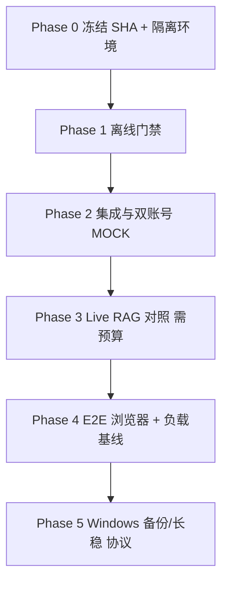

# KnowLoop 全系统深度测试主计划

| 项 | 值 |
| --- | --- |
| 产品 | KnowLoop · 知循（[Study_Platform](https://github.com/ggwenling/Study_Platform)） |
| 默认开发分支 | `codex` |
| 基线冻结 | 见各次 `artifacts/deep-test/<run-id>/manifest.json` 中 `git.baseline_sha` |
| Harness 变更 | 与基线分开记录于测试准备 PR 提交 |
| 本轮范围 | **准备 + 离线可执行门禁**；不含真实模型花费与 Windows 长稳 |

## 1. 目标与策略

在**隔离云 VM** 上建立可复现的深度测试体系：标准化合成语料、用例矩阵、环境剧本、结果与缺陷台账，并分阶段执行九大可测域。未审批模型预算前，**禁止**调用外部 LLM/Embedding/Vision。

### 1.1 九大可测域与默认优先级

| 优先级 | 域 | 焦点 |
| --- | --- | --- |
| P0 | 采集/OCR/索引 | 格式、重试、失败、分块、向量维、活跃索引 |
| P0 | RAG 检索/重排/改写/事实/引用 | 混合/RRF/改写开关对照、引用存在性与归属 |
| P0 | 认证/隔离/SSRF/密钥 | 双账号、角色、跨库泄露、模型连接 URL 约束 |
| P0 | 备份/迁移/恢复 | Alembic 往返、空库、权限、checkpointer 分离 |
| P1 | 业务前后端 | 聊天、笔记、学习、导出、模型连接 |
| P1 | 异步双池/租约/重试 | Worker、ingest 作业、模型租约 |
| P1 | 桌面/移动/键盘/错误 UX | Vitest + 选手工（标记 MANUAL） |
| P1 | 性能/资源/模型用量 | 隔离栈上 1/5/10 客户端短压测基线 |
| P2 | 干净安装/契约/日志 | OpenAPI、数据字典、Ruff、构建 |

### 1.2 执行顺序（分阶段）

**入口准则（Phase 0）**

- 工作区干净或可隔离副本；`artifacts/deep-test/` 与 `.local/deep-test/` 不污染生产配置。
- 独立 `study_platform_test` 或 `study_eval_*_test`；存储目录 `.local/deep-test/storage`。
- 双测试账号剧本就绪（见 [test-environment.md](test-environment.md)）。

**出口准则（发布推荐 — 提案门禁，非本轮实测值）**

| 门禁 | 目标 | 说明 |
| --- | --- | --- |
| G-01 | 100% 必需自动化 | CI + deep-test 离线步 + 约定集成 |
| G-02 | 跨用户泄露 0 | 双账号对全部资源类 API 断言 |
| G-03 | 虚构/越权引用 0 | 存在性 + 归属 + 蕴含分检 |
| G-04 | 可回答事实性 ≥90% | 仅对 **live** 合成集；须记分母 |
| G-05 | 无答案拒答 ≥95% | 同步记录 **误拒率** |
| G-06 | 备份元数据完整恢复 | 文件 + DB 指纹 |
| G-07 | 无重复 publish / 坏活跃索引 | ingest 生命周期 |
| G-08 | P95 延迟 | **在目标硬件完成基线后** 再设阈值 |

## 2. 风险与停止规则

| 风险 | 缓解 |
| --- | --- |
| `ci_bootstrap_postgres.py` 写根目录 `.env` | 仅用 `harness/bootstrap_isolated_env.py`；备份后恢复 |
| 真实模型费用 | `run_offline_gate` 与 live 脚本 **fail-closed**；无密钥不调用 |
| 跨环境污染 | `DEEP_TEST_ISOLATION=1`；数据库名须含 `_test` |
| 推断质量 | 单次生成不构成增益；向量/混合/重排/改写须 **同语料同索引成对** |
| 数据损坏 | 隔离失败 **立即停止** 并升级；不做静默业务修复 |

## 3. 缺陷处理

测试发现业务缺陷：**不 silently fix**；记录复现、期望、最小修复建议，进入独立修复审批。离线门禁失败同样阻断「发布推荐」，但可继续标注 `DIAGNOSTIC` 的安全探测。

## 4. 交付物索引

| 文档/目录 | 路径 |
| --- | --- |
| 用例矩阵 | [test-matrix.md](test-matrix.md) |
| 环境剧本 | [test-environment.md](test-environment.md) |
| 合成语料 | `backend/evaluation/deep-test/` |
| 运行结果 | `artifacts/deep-test/<run-id>/` |

## 5. 八项准备状态（模板）

| # | 项 | 状态（2026-11-21 云 VM） |
| --- | --- | --- |
| 1 | 冻结代码 SHA | ✅ 基线 `20a20b96`；harness SHA 见 manifest |
| 2 | 隔离环境 | ✅ PG 16.16 + pgvector；`prove_isolation.py` 通过 |
| 3 | 模型预算/连接 | ❌ 待业主审批（live `study-eval-rag` 仍 BLOCKED） |
| 4 | 标准语料 | ✅ 100 题；`synthetic_not_human_curated` |
| 5 | 测试用户/种子 | ✅ `seed_accounts.py` 双账号 + 上传 canary |
| 6 | 矩阵/门禁 | ✅ 矩阵 + 离线门禁脚本 |
| 7 | 结果/缺陷记录 | ✅ `artifacts/deep-test/<run-id>/` |
| 8 | 负载/恢复条件 | ⚠️ 负载 BLOCKED；`test_migration_roundtrip` 已跑 |